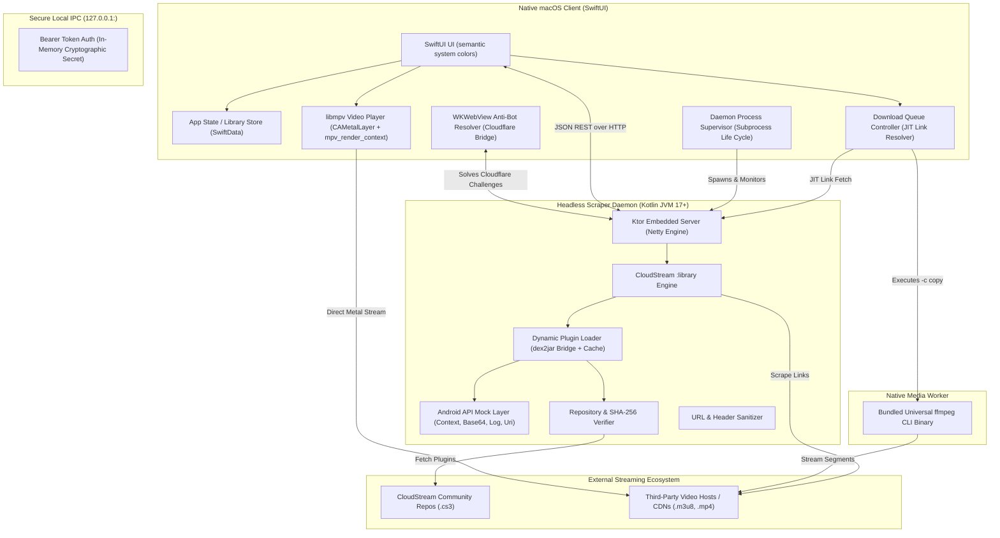

# Architecture Specification: CloudStream macOS

## 1. System Overview & Architectural Topology

### Engine connection and shutdown ownership

`AppDelegate.applicationDidFinishLaunching` starts application-scoped engine
observation once. Opening another `WindowGroup` window does not replace its
subscription. `DaemonSupervisor` owns each launch and its output handles until
confirmed exit, coalesces restart requests, and waits for TERM/KILL cleanup
before starting a replacement. Independent ffmpeg transfers survive engine
restart and are stopped during application shutdown. Recovery uses monotonic
deadlines, capped backoff and a finite retry budget; requested safe mode remains
latched until an explicit clear. Sustained health resets the retry budget.

Each main `RootView` owns a `WindowSession` through SwiftUI state. Sidebar
selection, pushed detail coordinates, library filter, progressive search tasks/
results, pending repository presentation and shortcut sheets are private to
that window. Main-window views receive the session through their environment;
Go commands use the focused scene. A weak window/session registry routes
application entry points (Shortcuts and menu-bar actions) to the last active
main window and preserves pending routes before a window exists. Settings and
player-window commands retain their last-main-window target. Closing a window
cancels only its search; engine changes cancel all obsolete searches, while
profile activation clears every window's profile-specific navigation. The
shared details cache retains coordinates active in any main window. Player,
connection, downloads and durable stores remain application-scoped.

### Stable media identity foundation

`LibraryIdentity` generates new remote keys from the stable provider ID and
original URL bytes using length framing and SHA-256. Display names are excluded
from identified keys. Search/detail DTO identities, preview constructors and
library writes use the same contract; library/history navigation and Handoff/
deep links carry the provider ID separately from the display name. Older
name-only routes remain readable.

Existing known-provider legacy rows are located by exact provider ID and URL.
Migration first preserves the original schema before opening an older store and
then takes a verified SQLite backup of the current graph before rekeying. SQLite
backup includes committed WAL contents. One owned SwiftData transaction updates
titles, history and playback preference keys and commits a migration record with
legacy aliases and recovery paths. Repeated migration does not rewrite rows or
publish a new version. A failed profile migration restores the prior profile
context; a failed active-library update has a persistent retry action.

Unknown legacy owners resolve only when the restored catalog contains exactly
one distinct installed provider ID for the saved name. Ambiguous/unavailable
owners remain unchanged. Backup exports use format v2 with identity metadata and
playback timestamps; v1 remains readable with unknown fields kept unknown. Merge
maps incoming references to the local stable owner's key and rejects conflicts.
Explicit reassignment, abrupt-process/minimum-OS and per-field chronological
merge acceptance remain separate gates. The original pre-schema recovery copy
was verified with an independently compiled frozen old model; this is not
permission to open the migrated store with an older binary.

The supervisor publishes independent replayable connection snapshots containing
state, endpoint and launch identity, including disconnection. `AppState` consumes
one snapshot stream, rejects superseded snapshots and fences verification,
bootstrap, solver and media tasks by connection generation. `EngineConnection`
is the UI readiness authority: a verified endpoint is distinct from completed
provider restoration and usable services. Only `ready` or `safe_mode` restoration
phases count as complete; an early `idle` phase does not. Credential resend is
awaited and provider-specific failures are reported without blocking healthy
providers. Production downloads await a cancellable connection signal and
receive an actionable terminal recovery error.

Normal quit, SIGTERM and SIGINT share the idempotent `ApplicationShutdown`
coordinator: persist playback, quiesce application tasks/transfers, then stop
owned processes before completing quit. Ordinary quit retains download and save
failure confirmation. A signal-path save failure is recorded while cleanup
continues. Signal-level durable-store acceptance remains a separate test gate.

AppCDS remains optional. Recording uses a private safe-mode worker root and
records jar, JRE modules and archive SHA-256 hashes. Before launch, the client
validates these hashes off the main actor; missing, malformed, oversized,
unsupported or stale metadata disables the archive. Older metadata without an
archive hash requires regeneration and falls back to normal JVM startup.

CloudStream macOS utilizes a **decoupled 3-tier architecture**: a native Apple SwiftUI client, a local headless Kotlin JVM scraping engine, and bundled native UNIX media processing tools (`ffmpeg` and `libmpv`).



---

## 2. Tier 1: Native macOS Client (Swift 6 & SwiftUI 6)

The frontend is a 100% native macOS application compiled in **Swift 6** using **Xcode 26+** and **SwiftUI**, strictly adhering to Apple’s Human Interface Guidelines and the Apple TV app aesthetic.

### 2.1 Responsibilities
* **Process Supervision:** Launches the Kotlin daemon on application startup on a randomized loopback port; manages health pings (`/health`) and handles graceful shutdown (`SIGTERM`) on quit.
* **CloudStream Native macOS Interface:** 
  - Translucent frosted sidebar with `.ultraThinMaterial` implementing CloudStream's 5 core destinations: `Home` (with provider switcher & dynamic homepage sections), `Search` (with `TvType` filters & search history), `Library` (with official `WatchType` statuses: Watching, Plan to Watch, Completed, On Hold, Dropped), `Downloads` (downloaded items & active queue), and `Settings` (Extensions, Providers, Player, Downloads, Sync).
  - Media Details view preserving CloudStream's exact buttons: Play/Resume, Watch Status dropdown, Dub/Sub toggle, Season selector, and Episode rows (Play, Download, Mirrors).
  - Clean, unadorned unified titlebar with provider switcher accessory on Home screen.
  - "Resume Watching" shelf using `.scrollClipDisabled()` and `.scrollTargetBehavior(.viewAligned)` with 16:9 widescreen landscape cards, interactive scrubber bar, and remaining time badges.
* **Media Playback & Metal 3:** Hosts the `libmpv` viewport via an `NSViewRepresentable` backed by `CAMetalLayer` and `mpv_render_context` with `MPV_RENDER_API_TYPE_METAL`, wiring native zero-copy Metal rendering, floating glass HUD, and keyboard shortcuts.
* **macOS System Media Integration:**
  - `MPNowPlayingInfoCenter` & `MPRemoteCommandCenter`: Exposes playback status, show titles, and episode backdrops to macOS Control Center and responds to hardware media keyboard keys.
  - `AVPictureInPictureController`: Native macOS Picture-in-Picture window support.
* **Just-In-Time Download Execution:** Resolves stream links dynamically at the moment of download, invoking the bundled `ffmpeg` binary with custom headers and lossless `-c copy` muxing.
* **Security & Challenge Bridge:** Hosts an offscreen `WKWebView` to execute Cloudflare clearance / anti-bot scripts on behalf of the Kotlin daemon.

### 2.2 Core Modules in Swift
```
App/
├── Application/
│   ├── CloudStreamMacApp.swift       # App lifecycle entry point & SwiftData ModelContainer
│   ├── DaemonSupervisor.swift       # Subprocess lifecycle & heartbeat monitor
│   └── SecurityVault.swift          # In-memory ephemeral token generator
├── UI/
│   ├── Navigation/SidebarView.swift # Apple TV sidebar navigation
│   ├── Home/HomeView.swift          # Provider Switcher & Dynamic MainPage carousels
│   ├── Search/SearchView.swift      # Search bar, MeshGradient category cards, and results grid
│   ├── Library/LibraryView.swift    # WatchType segmented filter (Watching, Plan, Done)
│   ├── Details/MediaDetailView.swift# Apple TV Hero backdrop, Action Pills, Episode List
│   ├── Player/MpvPlayerView.swift   # Embedded CAMetalLayer libmpv viewport
│   ├── Player/PlayerHUDView.swift   # Floating glass transport and subtitle controls
│   ├── Downloads/DownloadsView.swift# Active and completed downloads table
│   └── Settings/SettingsView.swift  # Repository URLs and paths
├── Services/
│   ├── DaemonClient.swift           # Actor-isolated HTTP client to localhost daemon
│   ├── DownloadService.swift        # JIT link resolver & ffmpeg process manager
│   ├── NowPlayingService.swift      # MPNowPlayingInfoCenter & MPRemoteCommandCenter
│   ├── PipService.swift             # AVPictureInPictureController bridge
│   └── WebViewSolverService.swift   # WKWebView anti-bot execution bridge
└── Storage/
    └── LibraryDatabase.swift        # SwiftData local persistence for history/bookmarks
```

### 2.3 Local Data & Offline Features (Offline-Features-Plan, IPC v3)

Everything the user owns lives on the Mac; nothing below talks to a
service other than the providers themselves.

| Concern | Where | Notes |
| :--- | :--- | :--- |
| Library, favorites, Continue Watching | `StoredMediaItem` (SwiftData) | Title-level resume pointer; `LibraryStore.version` drives UI (ADR-0009) |
| Per-episode history | `EpisodeProgress` | Watched ticks, positions, next-unwatched (ADR-0011) |
| Per-show playback memory | `TitlePlaybackPrefs` | Audio/subtitle language, subtitle delay/speed, marked intro |
| Downloads | `DownloadRecord` (shared store) | Per-Mac, never per-profile; orphaned `.part` files cleaned at launch |
| Profiles | one SwiftData store per profile | ADR-0013 |
| Backup / restore | `Services/Backup/` | Versioned JSON, merge or replace, Android import (all accounts or one), per-profile daily backups scheduled for the life of the app, 7 kept per profile (ADR-0012) |
| Lock | `AppLock` | System owner authentication; covers main window, Settings, menus and links (ADR-0014) |
| Network policy | daemon `NetworkSetup` + `network/` | DoH resolvers, HTTP disk cache, one retry on connection errors; configured via `/settings/network` |
| Offline detection | `ConnectivityMonitor` | Banner; downloads pause and resume automatically |
| Details cache | daemon `ProviderExecutor`, client `DetailsCache` | Engine: 10 min per `(provider, url)`; `⌘R` sends `refresh=1`. Client: an entry is authoritative only for the engine generation, installed-extension generation and provider-settings generation it was loaded under, for 10 min; least recently used entries are evicted; without a usable engine the copy is display-only and is revalidated when one answers |
| Movie and episode history | `EpisodeProgress` (`kind`) | Movies have one row per title under a fixed key; statistics count the rows History shows; a one-time, marker-committed backfill; deleting a row moves or clears the title's resume pointer in the same transaction |
| Diagnostics | Settings ▸ Diagnostics | `/test/run` provider tester, `/diagnostics` health, redacted log viewer/export (`~/.cloudstream-macos/logs/daemon.log`, `~/Library/Logs/CloudStreamMac/client.log`) |
| System integration | `Services/System/`, `UI/Navigation/SystemIntegration.swift` | Spotlight index of the library, menu bar extra, Dock menu/badge, Handoff, App Intents, external players (IINA/VLC/mpv/QuickTime), `cloudstreamapp://` routes |

`LibraryStore` owns separate non-autosaving contexts for the active profile's
library and the shared download records. Queries and mutations throw; a failed
read is distinct from a successful empty library. Mutations save only their
owned context, roll back on failure, and publish `version` after commit. Restore
uses a separate transaction context, so it cannot commit or roll back another
operation's pending changes. Views use `readForDisplay` to defer error publication
until after rendering; the main window offers explicit library recovery while
preserving the selected profile. A failed selected-profile startup never displays
or restores into the default profile's data.

Failed playback writes retain the latest position per owned title/episode for
explicit retry. Retried episodes commit in monotonic event order, preserving their
original timestamps. Profile activation and backup refuse to proceed while these
writes remain unsaved. Normal quit flushes after closing playback and offers to
keep the app open if saving fails. These in-process guarantees do not imply
crash-proof download finalization; the remaining durability gates are tracked in
[Audit-Remediation-Status.md](archive/plans/Audit-Remediation-Status.md).

`cloudstreamapp://` routes: `search?q=`, `open?provider=&url=`, `continue`,
`history`, `downloads`; the legacy `cloudstreamapp://<query>` form still
searches. Repository schemes (`cloudstreamrepo://`, `cs3://`, …) add a
repository. All routes are parsed by `DeepLinkRouter` and executed by
`AppState.perform`.

---

## 3. Tier 2: Headless Scraper Daemon (Kotlin JVM)

The backend is a lightweight Kotlin JVM daemon that embeds the CloudStream extension API, built here as the Kotlin/JVM [`:library`](../library) module.

### 3.1 Responsibilities
* **Android API Mock Layer:** Provides pure Java stub implementations of `android.content.Context`, `android.util.Base64`, `android.util.Log`, and `android.net.Uri` so that community `.cs3` plugins run seamlessly on OpenJDK without Android runtime dependencies.
* **Extension Lifecycle:** `InstallationManager` is the only authority for installing, updating, rolling back, enabling and removing extensions. Committed installation receipts (repository + internal name → installation ID, artifact SHA-256, content-addressed catalog evidence, trust tier) are the only execution authority; see [`repository-signing.md`](repository-signing.md) for the Verified and Community tiers.
* **Search & Extractor Execution:** Executes searches across multiple providers in parallel using Kotlin Coroutines (`Dispatchers.IO`), returning structured metadata.
* **Stream Resolution:** Executes `loadLinks()` for selected media items, resolving direct video URLs, HLS streams, required HTTP request headers, and subtitle tracks.
* **URL Sanitization:** Strips tracking parameters, affiliate tokens, and advertising redirect scripts.

### 3.2 Extension Loading Pipeline
```
[Repository catalog] — Verified: signed root → list digests → artifact digest
        │               Community: exact list bytes + recorded user consent
        ▼ (download, SHA-256 + length check, atomic content-addressed store)
[Committed receipt] (per-installation operation lock; durable commit first)
        │
        ▼ (every load: source re-hashed against the receipt)
[dex2jar translation] (cache keyed by source digest + translation profile;
        │              reused only when its digest matches the receipt)
        ▼
[VerifiedClassLoader] (in-memory verified bytes; :library + Android stubs as parent)
        │
        ▼ (plugin load() into a staged registration, per-installation Context)
[Atomic publication of a generation] (old generation drains, then retires;
                                      its verifier jobs are cancelled)
```
In production every step from translation onward runs in the extension's own **worker** process (ADR-0016): the engine launches `daemon.jar --worker` under a per-worker macOS sandbox profile, sends the committed receipt and the verified artifact path, and registers `RemoteProvider` stubs built from the provider metadata the worker reports (cached in the receipt, so restore starts no worker until the first call). The engine calls the worker over length-prefixed JSON frames on its pipes, enforces hard deadlines (cancel, then kill), reserves up to 8 base worker slots plus 4 bounded overflow slots across startup/running/stopping (a further start waits up to 30 seconds for a slot before a retryable `capacity` failure), releases process slots only on confirmed exit, stops idle ones after 5 minutes, and quarantines an extension after three crashes in an hour. Tests cover both legacy in-process providers and real isolated workers. Batch and streaming search share an eight-permit operation limit; streaming disconnects cancel outstanding provider work through the Netty connection-close event.

Startup serves `/health` first, then restores receipts in the background. `BackgroundRefresh` re-syncs repositories every 6 h to apply publisher revocations and automatic updates.

### 3.3 Daemon Endpoints (Ktor HTTP on `127.0.0.1:<port>`)
Every request requires the `Authorization: Bearer <ephemeral_token>` header.

> **The authoritative, current contract is [`ipc-api.md`](ipc-api.md) (v4).** The table below is the
> original design sketch and is kept for history only.

| Endpoint | Method | Parameters | Description |
| :--- | :--- | :--- | :--- |
| `/health` | `GET` | None | Heartbeat check; returns `{ "status": "ok", "version": "<engine version>", ... }` (full shape in [ipc-api.md](ipc-api.md)). |
| `/repos` | `GET` | None | Returns list of configured repository URLs and their statuses. |
| `/repos/sync` | `POST` | `{ "repoUrl": "..." }` | Syncs repo plugins, verifies hashes, and downloads updates. |
| `/plugins` | `GET` | None | Returns list of loaded extensions with language, version, and type. |
| `/search` | `GET` | `?q=<query>&plugins=<ids>` | Executes parallel search across plugins; returns list of `SearchResponse`. |
| `/details` | `GET` | `?plugin=<id>&url=<url>` | Fetches seasons, episodes, plot, and cover art. |
| `/links` | `GET` | `?plugin=<id>&data=<data>` | Resolves stream URLs, quality options, HTTP headers, and subtitles. |
| `/solve-callback`| `POST` | `{ "taskId": "...", "cookies": "..." }` | Receives anti-bot solution from Swift's `WKWebView`. |

---

## 4. Tier 3: Media Engines (`libmpv` & `ffmpeg`)

### 4.1 Player Pipeline (`libmpv` with Metal presentation)
* **Engine:** embedded `libmpv` linked as `mpv.framework`; SwiftUI hosts an AppKit `MetalVideoView`.
* **Rendering:** The default renderer uses mpv's OpenGL API on a private CGL context to draw into pooled IOSurfaces; Metal presents them on a `CAMetalLayer`. The software render API remains the fallback (`CS_PLAYER_RENDERER=sw`). See [ADR-0019](adr/0019-gpu-render-bridge.md). Frame storage belongs to a render-queue generation; teardown retains that generation until its context and GPU work finish. A main-actor event sink is invalidated before native shutdown, fencing late events.
* **Resource boundary:** `MediaResourcePolicy` accepts provider HTTP(S) URLs with a host and no userinfo/control characters, preserving their original URI spelling. It validates root, playlist, audio and subtitle resources plus request-header syntax before native requests. `PlaybackResource` distinguishes remote resources, closed application-generated EDL plans and explicitly authorized local files. Providers cannot supply pseudo-protocols or claim local authority; selected/downloaded local media and selected subtitle sidecars retain their explicit authorization through reloads. The daemon applies the same validation before URL cleanup and returns terminal `rejected_media_resource` failures without secret URL/header values.
* **Nested access:** libmpv disables configuration/scripts, file autoload and unsafe playlists, and passes a remote protocol whitelist to both lavf demuxing and streaming. Setup fails if a required boundary option is rejected. Local fixtures verify valid HLS, generated playlists/split tracks, local playback, and rejection of remote manifests/redirects referencing local files. External-player recursive confinement and final packaged validation remain remediation gates.
* **Header forwarding:** headers are rejected as a whole if names, control characters, case-insensitive duplicates or connection/framing fields are unsafe. Native HTTP header lists preserve commas using mpv's list API; Referer/User-Agent use their dedicated options. Reload clears previous resource headers. Split streams whose audio needs other headers than the video are read through the engine's relay (see Split streams); downloader inputs carry separate scoped headers.
* **Subtitles:** validated remote `.vtt`/`.srt` resources and explicitly authorized local subtitle files attach after file load, with the existing ASS appearance settings.
* **Sequence:** `PlaybackSequence` is the episode order and edition of one session: the sub/dub edition of the episode that started it, then season/episode, with provider order kept for episodes without coordinates. The details screen builds its order with the same type; next/previous, Up Next, autoplay and prefetch read the session's sequence, never the provider's raw list.
* **Split streams:** video and separate audio are merged into one EDL request, and the native player has one request-header set for all of it. A split link is loaded directly only when every audio track would receive the same headers anyway and the video's credentials cannot reach another audio origin. Otherwise the player registers the video and each audio track with the engine's relay (`MediaRelay`, `/media/relay`), each with its own headers, and loads the same EDL with the relay's loopback addresses: the engine fetches every resource with exactly its headers, forwards only the player's byte range, and the player's own header set never leaves this Mac. An audio track without headers of its own inherits the video's, minus credentials when it lives on another origin. The relay belongs to one load: a mirror switch, a new episode, a failure and closing the player revoke it, and a registration that returns after its load was replaced is revoked instead of used. It serves progressive media only; if it cannot be set up (no usable engine, capacity) or the stream is a manifest, the mirror is skipped as before and the reason is shown when no other mirror is left. An engine restart ends the relay, and playback then fails over like any failed mirror. Proven end to end with the real engine jar and mpv 0.41 (`scripts/tests/test_media_relay_playback.py`): two files behind different cookies play from a seek, and the audio origin never sees the video's cookie.
* **Outcomes:** engine start failures (core, initialization, renderer) are reported separately from a failed file and end the attempt without consuming mirrors. Seek and screenshot commands carry a reply tag: a rejected seek stops the pending-position wait, and a screenshot is announced only after a successful reply and an existing file. A load that produces no first frame within 45 s (extended once while buffering) fails over like any failed mirror.
* **Keep-alive:** links carrying `extractorData` start the engine's verifier for the active link; it is stopped on mirror switch, new play, close and failure, and a start that returns after its link was replaced is stopped instead of attached. Start failures retry twice, then the user is told the stream may stop early. Trailers and local files have none.
* **External players:** mpv and IINA receive the same nested-protocol whitelist and `load-unsafe-playlists=no` for remote streams; VLC and QuickTime Player accept no equivalent arguments and apply their own policy to nested resources.

### 4.2 Downloader Pipeline (JIT resolution, resumable transfers, ffmpeg remux)
* **Admission:** every way into an active transfer passes `drainQueue`: queued items, direct-file resumes and frozen ffmpeg processes alike. A paused remux stays stopped (no SIGCONT) until a global and per-provider slot is free and the network is available. Resume intent, a user pause and a network hold are separate; a user pause during a network hold stays paused on reconnect. Link resolution that finishes while offline re-queues instead of starting IO.
* **Queue model:** one structured task per item run (`DownloadService.runItem`), keyed by a generation token. Every completion path checks its token, so a superseded run (cancel → retry, app quit) can never touch a newer attempt. A cancelled run is fully torn down before the item may start again. Concurrency is bounded globally and per provider (Settings ▸ Downloads; defaults 3 and 2). "Download Next" reorders waiting items.
* **Just-In-Time Link Resolution:** links are resolved immediately before the first attempt and **re-resolved** before any retry or mirror failover once older than 2 minutes, so late failovers never start on an expired token. Resolution waits for the engine to be bootstrapped (queue restored at launch) and retries transient daemon errors with backoff; `422` (provider missing/disabled) is terminal.
* **Mirror selection:** candidates exclude playlists, torrents/magnets and non-http(s) URLs, and are ordered by the preferred download quality. Mirrors are identified by source/name/quality (stable across token rotation).
* **Failure disposition** (`DownloadPolicy`, Android `DownloadStatus` parity): local problems (disk full, permission, unavailable folder, missing provider) fail immediately; transient ones (network, stall, truncation, 5xx/429) retry the same mirror once after re-resolving; mirror-specific ones (403/404, bad media, unsupported protocol) move to the next mirror. Streams MP4 can't hold are retried once as Matroska.
* **Transfers:**
  - *Direct files* (`VIDEO`, without separate audio) use `DirectFileJob`: HTTP download into `<base>.part`. Resume requires the same mirror/total and a strong ETag or a date validator with sufficient saved clock evidence; the returned validator and complete remaining byte range must match. Missing, weak, ambiguous or changed validators restart. The request forces identity encoding; content-coded bodies are rejected because decoded bytes cannot be spliced by representation offsets. Invalid ranges are cancelled before at most one fresh request, with the prior writer closed before another opens. Streamed bytes cannot exceed the declared total and completion requires exact length plus successful file synchronization. Sidecars retain ownership metadata even when resume is unavailable; recovering an already complete partial requires a validated completion marker. A "direct" link that serves a playlist is handed to ffmpeg. Validator semantics follow [RFC 9110 §13.1.5](https://www.rfc-editor.org/rfc/rfc9110.html#section-13.1.5); old insufficient sidecars safely refetch.
  - *HLS/DASH and direct video with separate audio* use `FFmpegJob` (bundled ffmpeg, `-c copy`, no re-encode). Each input has its own request headers:
  ```bash
  ffmpeg -hide_banner -nostdin -y -loglevel info -progress pipe:1 -nostats \
    -protocol_whitelist http,https,tls,tcp,crypto,httpproxy \
    -reconnect 1 -reconnect_streamed 1 -reconnect_on_network_error 1 -reconnect_delay_max 10 \
    -rw_timeout 30000000 -headers "<sanitized extra headers>" -referer <ref> -user_agent <ua> \
    -i "<stream.m3u8>" [-i <separate audio> … -map 0:v:0 -map 1:a:0 … -map 0:a?] \
    -c copy -sn -dn -movflags +faststart -f mp4 "<dir>/<Show>/<Show S1, E1>.part"
  ```
* **Completion:** output is validated (minimum size; ffmpeg's `out_time` against the source's own `Duration`, which catches playlists that die mid-way with exit 0). The record is then saved as `finalizing` with the planned final path and byte count, the part is renamed, and the completed video is committed at once; resume metadata is removed only after that commit. Subtitle sidecars in the user's subtitle language (up to 3, `<base>.<lang>.<ext>`, 5 MiB each enforced while receiving), the notification and the optional library entry follow the committed state and cannot undo it. At launch a `finalizing` record is settled from the files: a final file of the recorded size is completed, a finished part is renamed, and anything else (both present, another size, missing) is an explicit failure that overwrites nothing. A file and a database row cannot be committed together; the journal is what repairs the gap, and it has been exercised by stopping finalization inside the process, not by killing a separate process.
* **Deletion:** returns a structured result. A deletion intent is saved before the file is touched and the record is removed only after the video is gone; a refused removal withdraws the intent. A missing file and an unmounted volume are reported separately and neither removes the record; "Remove from List" is an explicit action offered only when the file is really absent.
* **Ownership:** a download belongs to the Mac, but records the profile that queued it. The optional library entry is written into that profile's own store when the transfer completes, whichever profile is selected then. If that profile was deleted the download stays and the user is told; records with no owner are filed only by an explicit "Add to Library".
* **Progress:** ffmpeg's `-progress` key/value blocks (one main-actor hop per block) and the source duration from stderr; bytes/Content-Length for direct files. A watchdog stops attempts with no progress for 2 minutes.
* **Lifecycle:** idle system sleep is blocked while transfers run; quitting asks for confirmation (not on logout/shutdown) and leaves queue state intact for the next launch. Extractor links carrying `extractorData` get a daemon-side `extractorVerifierJob` keep-alive for the duration of the attempt (`/links/verify/start|stop`).

---

## 5. Security & Anti-Bot Architecture

### 5.1 Hardened Runtime & Sandboxing
1. **Localhost Isolation:** The Ktor server listens strictly on `127.0.0.1`. It never binds to `0.0.0.0` or public network interfaces.
2. **Ephemeral Cryptographic Token:**
   * When the Swift app launches, it generates a 32-byte cryptographically secure random token (via `SecRandomCopyBytes`).
   * It passes this token to the daemon process via standard input (`stdin`) or environment variable.
   * Every HTTP call from the frontend must include this bearer token; any rogue request from local system processes without the token is rejected with `401 Unauthorized`.
3. **Hardened Runtime Entitlements:**
   * Distributed outside the Mac App Store via Developer ID Notarization.
   * `com.apple.security.cs.allow-jit`: Allowed for JVM runtime execution.
   * `com.apple.security.network.client`: Allowed (outbound scraping/streaming).
   * The app and the engine are not App Sandboxed. Each extension runs in its own worker under a deny-by-default sandbox profile that allows writes only to that extension's directory and no reads of user files, engine state or other extensions' data (ADR-0016, [`Security.md`](Security.md)).

### 5.2 The `WKWebView` Fallback Bridge
When a scraper encounters a Cloudflare Turnstile or anti-bot challenge (which throws a 503 or relies on dynamic JavaScript):
1. The Kotlin daemon pauses the worker coroutine and sends an internal event to the Swift app: `{ "taskId": "123", "targetUrl": "..." }`.
2. The Swift app instantiates an offscreen `WKWebView` with a real Safari/WebKit user agent.
3. Once the page successfully executes its scripts and receives the clearance cookie (`cf_clearance`), Swift extracts `WKHTTPCookieStore` cookies.
4. Swift calls `/solve-callback` on the daemon, which injects the cookies into `OkHttp` and completes the scrape seamlessly.


Provider reassignment for unresolved library entries is an explicit Library card or History row action.
The user selects an installed stable provider ID; display names are presentation
only. Reassignment changes only that unknown remote row, rejects collisions with
another title, and uses the existing verified-store-snapshot and one-save rekey
transaction for title/history/playback preferences and legacy aliases. The dialog
checks profile/store ownership and lock state immediately before the synchronous
commit; an engine generation must have completed bootstrap to supply a current
catalog. Already identified titles and local download entries are excluded. Locking or
changing the active profile/store dismisses the dialog before further input.


Local downloaded media uses `local-download-v2:<download UUID>` as durable
library/playback identity. `StoredMediaItem.downloadRecordID` resolves that
namespace to the shared `DownloadRecord.id`; source provider display names and
filesystem paths do not determine ownership. Downloaded-file playback carries
that UUID and the real destination path, so two files from one provider retain
independent resume/history/settings. Remote provider IDs remain separate.
`markDownloaded` requires a matching completed shared record, and existing local
rows keep their identity when the record's path/display name changes. Backup
exports continue to omit machine-specific local titles and files.

Legacy local placeholders rekey only when one shared download UUID matches the
original stored path. Missing/ambiguous paths stay readable and unresolved.
The same verified snapshot, dependency rekey, durable alias marker and rollback
transaction applies; remote-only migration does not read the shared download
store. Explicit local UUIDs never alias another UUID merely because paths match.
Download origin-profile admission, completion/deletion journals, interruption
and minimum-OS acceptance remain separate pending remediation gates.


Migration interruption recovery uses the SQLite store UUID, not the store's
basename alone. Version-1 recovery manifests now include an optional source
store identifier; earlier manifests remain readable through the snapshot's
SQLite metadata. On reopening an already upgraded schema, LibraryStore locates
the matching original-schema snapshot and verifies its hash/integrity before
recording its path in the migration marker. A partial generation with no atomic
manifest is unpublished and ignored. A corrupted published candidate for this
store fails recovery; an unrelated profile's damaged manifest cannot block this
store. Recovery never silently attaches another database with the same filename.
Read-only SQLite inspections use a one-second SQLite busy timeout and
report failure rather than fabricating an absent/empty store or missing lineage.

The frozen-schema compatibility command also provisions a separate Debug app
process. Its isolated, Debug-only probe runs production ModelContainer and rekey
transactions, reports a durable boundary marker, then stops for the test to kill.
Acceptance covers snapshot publication, schema opening, pre-identity commit and
post-identity commit for both default and named profiles, and reopening the same
stores afterward. The Release app contains no probe. This proves process-kill
recovery at those boundaries on the test machine; it does not certify power-loss
or minimum-OS behavior.


Title merge metadata is additive: optional note/rating/favorite/list/resume edit
dates default to nil for old rows. User mutations and automatic list promotion
stamp only their affected fields; a playback tick cannot make an old note newer.
Each field's edits preserve at least millisecond ordering for JSON round trips,
including when the wall clock moves backwards; aggregate lastUpdated is the
maximum applied known edit and never advances from a rejected backup value.
Explicit list removal retains its clear metadata and independent user data.

Portable backup v2 carries these dates. Merge requires a known edit date on both
sides, applies strictly newer values including nil notes, zero ratings, false
favorites and cleared list/resume values, and preserves local values on ties.
Unknown dates are not converted into an invented oldest or import-time date;
local values remain and restore reports the ambiguity. Per-title playback
settings similarly replace as one complete value only when newer, allowing nil
language and intro fields to clear. An imported legacy playback row uses the
internal distant-past sentinel for unknown time, and export translates it to nil.
Version-1 and Android source version is preserved in LibrarySnapshot so Merge
cannot accidentally treat legacy data as v2 edits. Replace applies the requested
snapshot values; known dates remain known and unknown dates remain unknown.

A known-provider backup sharing an old display-name key with an unidentified
local title creates its own canonical row instead of claiming the unknown owner;
incoming history/preferences follow that row. An unidentified backup sharing a
key with an identified legacy title is rejected atomically rather than guessing
ownership. Portable input cannot contain local download namespaces/types and
cannot replace a retained local placeholder through a forged portable ID.
Restore exposes equal-time/unknown-time warnings and an actual failed pre-merge
safety-copy warning. The remaining external restore phases, catalog lifecycle,
history tombstones and per-profile backup scheduler are still separate work.


Profile-sensitive episode checks capture `LibraryStore.ProfileOperationContext`
(the facade, selected context, and profile activation generation) and immutable
candidate values before requesting details. A successful profile activation or
startup suspension invalidates earlier ownership; returning to the same profile
cannot revive old work. Context replacement during restore or identity migration
also invalidates a captured check. Ordinary library edits do not invalidate the
profile generation.

EpisodeUpdateChecker owns scheduled and manual batches, rejects overlapping
runs, and requires usable providers plus connectivity. It rechecks store, engine,
lock authorization, cancellation, and preference state after requests and spacing.
The update targets the captured durable item ID rather than an ID inferred from a
returned provider payload. Locking or switching profiles through AppLock cancels
the batch; generation checks also protect direct store switches. Notification
permission and delivery remain in the owned batch, with ownership checked after
permission and stale delivered/pending requests removed by their unique identifier.
Other profile-sensitive restore and download paths remain separate D03
acceptance work; this check does not certify them.

Spotlight has one ordered writer (`SpotlightIndexer`) for the library domain.
It keeps only the newest desired state, and an OS call that is already running
finishes before its replacement deletes or indexes. Snapshots are values tagged
with the selected-store operation token and library version. The writer rechecks
generation, the Spotlight preference and store ownership after every OS call; an
insertion that became obsolete in flight is followed by domain cleanup. Success
is remembered only after completed current work, so failed, disabled or replaced
work is retried rather than suppressed. Profile activation, startup and
preference changes (Settings or restore) invalidate and reschedule. Settings
shows the last failure and offers a retry. Test hosts use an injected backend
and never touch the system index. Live query results, minimum-OS and packaged
behavior are still unverified.


Continue Watching entry points (Home, Dock, menu bar, and Shortcuts) capture a
`LibraryStore.ResumeRequest` synchronously before starting application-owned
work. The request contains values and the selected-store operation token; stale
SwiftData models from a former context cannot be recaptured. A response rechecks
profile ownership, lock epoch, usable engine generation, cancellation, and the
current persisted resume values before invoking playback. Privacy clears,
deletion, or changed resume values during details loading suppress the old intent.
AppLock and successful store activation cancel owned resume tasks. Late failures
are not presented in a newly selected profile.

Continue Watching matches exact episode data before coordinate fallback. The
fallback requires non-nil season and episode and exactly one candidate; ambiguous
editions and unavailable series episodes produce an actionable title-selection
error instead of selecting an arbitrary episode or attempting movie playback.
Player link resolution propagates cancellation from its awaiting caller, and a
cancelled old caller can close only its own playback generation. This leaves
D04’s durable edition/sequence/history work and the broader playback-intent
coordination in R02 pending. Local-download Continue Watching now uses the authorized-local route described
below; Downloads’ direct local playback remains available.


Downloaded Continue Watching bypasses provider details and readiness. The stored
local-download UUID must match a completed shared DownloadRecord and its exact
absolute destination path. A missing record/file, different UUID at the same
path, changed destination, incomplete record, or directory is rejected with an
actionable Downloads error. The check reads one shared record by UUID, then
verifies readability and a regular file; it does not erase or repair metadata
when a volume/file is unavailable.

The native player receives an explicitly authorized local URL and the original
UUID-backed local DetailsDto, preserving independent profile resume/preferences
and optional subtitle sidecars. Legacy episode metadata on a downloaded entry
cannot trigger provider/episode resolution. Local requests still require the
captured profile/lock/cancellation/current-resume authorization, but engine
unavailability/replacement alone does not invalidate local playback. Conversely,
a provider details response cannot claim type Download or an application-owned
local download UUID to acquire this privilege. Remote movie resume retains its
provider lookup and stored position.


## Remote artwork and sidecars

`BoundedHTTPResource` loads small remote bodies with a per-request delegate:
an oversized declared length is refused before the body, the load is cancelled
when received (decoded) bytes pass the budget, redirects must stay valid
HTTP(S), and request headers are dropped when a redirect changes origin.
Artwork has a 32 MiB response budget, a MIME check, a 64-megapixel source limit
checked before any pixel buffer exists, and is decoded to at most 2560 px on
its long side with ImageIO. Six network loads run at once; the cache key
includes the request headers that select the response. A rejected poster or
sidecar is simply absent; it never fails playback or a completed download.

Memory is bounded at three points. A load keeps its turn until its image is
decoded, so at most six response bodies from the network (and six from the
disk cache, which has its own turns) are held. Decoding shares a budget of 24
million source pixels across all loads — about 96 MB, a dozen 1080p backdrops
or two 12-megapixel ones at once; a larger image is decoded alone. The memory
cache keeps its own account of 256 MB and evicts oldest-first, because
`NSCache` treats its cost limit as a hint. Measured with 24 simultaneous
4000x3000 JPEGs of 10 MB each (Debug, development Mac): peak process growth
went from 914 MB (decodes unbounded) to 502 MB, 328 MB of it retained by the
cache and the test itself, with no change in total time.

## Provider settings

A provider's address and credential are each unchanged, set or cleared, in the
request, the engine and the worker. The client applies them as one small
transaction with the Keychain: a new credential keeps the previous Keychain
value until the engine accepts it; a clear removes the Keychain value first and
never restores it, and if the engine cannot drop its in-memory copy the engine
is restarted. A running extension that does not accept a change is stopped, so
it can only restart with the committed settings.

A worker receives its providers' settings at every start from the settings
themselves, not from a list of provider names: a worker restarted in the
session in which its extension was installed used to start without them. With
a compiled fixture provider that reports its live address and credential
(`WorkerCredentialTest`), set, replace and clear are confirmed inside one
running worker process, across restarts, and for a frozen worker, which is
stopped and killed and restarts without the secret.

Anti-bot retries merge cookies by name on the same request: the provider's own
cookies stay and only the cookies the solver returned are replaced. Solver
cookies are cached per origin; a provider's login cookie is never cached.

## Engine logs and the smoke launch

The engine's stdout and stderr files are appended, never overwritten. Each
launch writes a start marker and an exit marker with its own identifier and
exit status; a file over 2 MiB becomes `<name>.1` before the next launch.
Diagnostics shows and exports them with the same redaction as the other logs.

`scripts/smoke_launch.sh` launches one built app with a private temporary
root. The app itself publishes which engine process it owns and how far that
engine's verified connection has come (`CS_SMOKE_STATUS_FILE`, honoured only in
an isolated launch). The script requires a usable engine that is a child of the
launched app, the player prerequisites, a bounded quit of both processes and
the launch markers, and exits nonzero otherwise. It signals only the app it
started and that app's children.

## Build and publication

`dist` has one writer, `scripts/publish_artifact.sh`. Build scripts
produce a private candidate, sign it (`sign_bundle`), verify it
(`verify_bundle`: signatures, native closure, minimum macOS, entry points) and
only then publish. The publisher copies the candidate into
`dist/generations/<buildID>`, verifies the copy and switches the `dist/current`
symlink with one rename; `dist/CloudStream.app`, `CloudStream.dmg` and
`BUILD_INFO.json` are links through `current`. A failed build leaves the last
generation in place and concurrent publishers are serialized by a lock. Xcode
builds no longer copy anything to `dist`.

`scripts/verify_macho_closure.py` resolves every load command of every Mach-O
in a bundle (absolute, `@rpath`, `@loader_path`, `@executable_path`) and fails
on anything unresolved or outside the bundle, on a run path that leaves it, on a
wrong architecture and on a newer minimum macOS. `scripts/stage_media.py`
stages ffmpeg and libmpv with that rule, removes outside run paths, runs the
staged ffmpeg and writes `media-manifest.json`; staged media is trusted only
when that manifest matches its sources. `bundle_runtime.sh` applies the same
check to the jlink image and writes `tools/runtime-provenance.json`.

Packaging has two explicit modes. Development is ad-hoc signed and may be
"not-portable" (it then says so in `BUILD_INFO.json`). Distribution requires a
usable Developer ID identity and notarization profile before it builds
anything, a verified closure, a notarized and stapled DMG, and never falls back
to an unsigned artifact. A JDK built against a package manager's libraries
(Homebrew OpenJDK links `java.desktop` against `/opt/homebrew`) cannot produce
a distribution build; a vendor JDK is required.

The daemon's packed dependency graph is locked in `engine/gradle.lockfile`;
the media stack is pinned by tag and commit and records
`media-provenance.json`; its build tools are pinned in
`scripts/media-build-requirements.txt`. Two clean builds of the daemon jar
from the same sources are byte-identical; an incrementally compiled jar is
not, so a distribution build compiles the daemon from clean.
`scripts/dependency_report.py` reports licences and known advisories for the
packed versions; decisions on advisories are recorded in
`engine/advisory-triage.json` and explained in
[Dependency-Review.md](Dependency-Review.md).

## Library availability and restore

Playback progress recorded while the selected profile's store cannot be
opened is kept in memory for that store, coalesced to the latest position per
title and episode, and reported as unsaved. It is written when that same store
opens and is never written to another profile; it is lost if the app quits
first.

A restore runs its single transaction on a background context
(`importSnapshotInBackground`), so the app stays responsive: 10,000 titles
with 50,000 history rows take about twelve seconds in a Release build. Until
it commits, that profile's library refuses other writes, profile switches and
identity changes with "A restore is still being applied"; reads answer with
the state before the restore; playback positions are kept and saved onto the
restored library afterwards. Settings shows "Restoring…" and disables Import
and Export meanwhile.

Titles saved before provider identity was recorded are matched against the
installed providers when an engine becomes usable and again whenever the
installed providers change, so installing the one provider a title can belong
to binds it without a relaunch. A title whose recorded installation is no
longer installed (removed, or reinstalled under a new identity) is never
rebound by name; Library and History offer "Choose Provider…" for it, which
rekeys the title with its notes, history and playback settings.

## Idle behavior

The two bridge polls (anti-bot solve, web-view media) run at full speed (2 s,
0.5 s) while a request to the engine is in flight or finished less than 20 s
ago, and at 6 s and 3 s otherwise. Measured on the development Mac with an
isolated launch and no extensions: about 1.0 % (app) and 1.4 % (engine) CPU
before, about 0.3 % and 0.5 % after (final Release build). Idle memory was
sampled twice with different results for the app (about 150 MB and about 51 MB)
and about 73 MB for the engine; against the 160 MB budget in Rules.md that is
unresolved and needs a controlled measurement.
