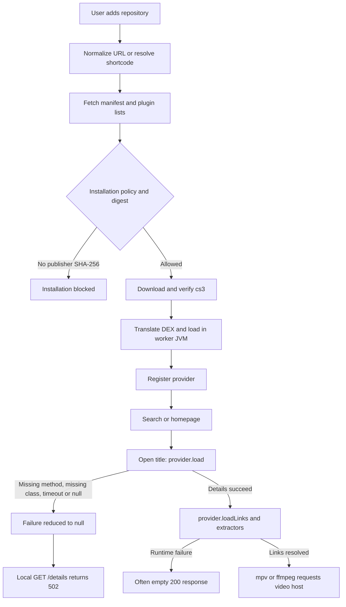

# CloudStream macOS extension and playback architecture audit

**Date:** 1 October 2026, Asia/Kolkata. **Local source:** `de03bd9e7c34aa61fd0a11a491cfbb528f7efcbd`. **Live upstream:** `d77c8564653346b1dc70339e8758a0fc76dd2819`, committed 28 September 2026. **Engine:** 1.2.0, IPC 4.

The macOS port has genuine host compatibility defects and a repository policy that excludes much of the catalog it recommends. These explain both categories of reported behavior: repositories that browse but cannot install, and installed extensions that search or display titles but fail when opening details. The failures are not adequately explained by unavailable streaming sites.

The strongest evidence is the existing local runtime log: **MoviesDrive, VegaMovies, and Rogmovies fail during `load` with `NoSuchMethodError: kotlin.Result.constructor_impl`**. This is the title-opening path that the engine turns into HTTP 502. Separate logs show **BollyFlix, Moviesmod, and TopMovies missing `CloudflareKiller`**, and **YouTube reporting `downloader is null`**. These are concrete host failures, not guesses about an ISP or video CDN.

Live catalog inspection found all six built-in suggestions reachable, but **five of the six publish no artifact SHA-256 for their active entries**. Together, **137 of 170 active entries in those suggestions are blocked by the macOS installation rule**, before any artifact download. CNC Verse is the exception in this sample, with digests for its 33 active entries. Digest availability does not establish that its providers can execute or play media.

The follow-up Android capability review found an additional startup dependency: cached **CineStream references the absent Android app `DataStore` during `load(Context)`**, despite declaring `requiresResources=false`. Resource-dependent extensions are separately rejected deliberately with **HTTP 422 / `unsupported`**. These failures are distinct from the details endpoint's 502. Findings F13–F15 document the Android compatibility boundary.

## Evidence and limits

This audit combines source tracing, live public catalog reads, inspection of the five cached community `.cs3` artifacts, packaged-runtime method resolution, existing runtime logs, and thirteen isolated characterization probes. The production app source and installed extension state were not changed. The two pre-existing working-tree changes, in the Xcode project and clean script, were preserved.

The [upstream comparison](macos/docs/audit/extension-runtime-2026-10-01/upstream-comparison.json) pins the live upstream commit and hashes. The local Android `RepositoryManager`, `PluginManager`, `Plugin`, `DataStore`, `APIRepository`, `CloudflareKiller`, `CommonActivity`, and both platform `WebViewResolver` files are byte-identical to that commit. The local common `BasePlugin` differs through an additive host registration sink; this stages registrations for macOS.

The reviewed scope is the repository-to-playback execution path and its relevant host contracts. The walkthrough below identifies its source blocks and decisions. It is not a claim that every unrelated UI, Android screen, or third-party extractor in this large repository was audited.

Evidence files:

- [Catalog observations](macos/docs/audit/extension-runtime-2026-10-01/catalog-results.json): nine public repositories; manifests and plugin lists only.
- [Runtime log summaries](macos/docs/audit/extension-runtime-2026-10-01/runtime-log-evidence.json): provider failures with original log line numbers and UTC timestamps; title URLs, cookies, and tokens omitted.
- [Translated bytecode references](macos/docs/audit/extension-runtime-2026-10-01/bytecode-results.json) and [host method resolution](macos/docs/audit/extension-runtime-2026-10-01/host-method-results.txt): translation with production options, without running community extension classes.
- [Eight probe results](macos/docs/audit/extension-runtime-2026-10-01/probe-results.json): passing tests characterize the adverse behavior; they do not indicate that it was repaired.
- [Android API resolution](macos/docs/audit/extension-runtime-2026-10-01/android-abi-results.json) and [Android compatibility evidence](macos/docs/audit/extension-runtime-2026-10-01/android-compatibility-evidence.json): exact classes, methods, fields, callers, cached manifests, and selected startup instructions.
- [Android follow-up probe results](macos/docs/audit/extension-runtime-2026-10-01/android-probe-results.json): five new characterization probes plus the original eight and fifteen existing conformance/loader tests; 28 checks passed.
- [Source and artifact snapshot](macos/docs/audit/extension-runtime-2026-10-01/source-snapshot.json): hashes to make this report checkable against later edits.

Repository health is time dependent. A catalog marked available by its publisher is not evidence of a working website. No live movie playback or full ecosystem compatibility rate is claimed. At inspection time the primary production `state.json` contained no repositories or installations; the logs and cached artifacts preserve earlier failures. The audit did not recreate or restore that production state.

## Where a 502 actually comes from



The exact details chain is:

1. [AppState.loadDetails](macos/client/Sources/ViewModels/AppState.swift:459) calls the loopback daemon through `DaemonClient`.
2. [GET /details](macos/daemon/src/main/kotlin/com/lagradost/macos/MediaRoutes.kt:175) finds the provider and delegates to `ProviderExecutor`.
3. [ProviderExecutor.loadDetails](macos/daemon/src/main/kotlin/com/lagradost/macos/ProviderExecutor.kt:283) calls the worker stub or the in-process provider.
4. [WorkerMain's DETAILS dispatch](macos/daemon/src/main/kotlin/com/lagradost/macos/worker/WorkerMain.kt:88) executes the provider in its worker process.
5. [safeProvider](macos/daemon/src/main/kotlin/com/lagradost/macos/ProviderExecutor.kt:635) logs an ordinary provider or linkage failure and returns null.
6. The worker's `DetailsResponsePayload` carries only nullable details. When details are null, [MediaRoutes line 199](macos/daemon/src/main/kotlin/com/lagradost/macos/MediaRoutes.kt:199) returns `502`, with `provider failure` and no underlying cause.
7. [DaemonClient.validate](macos/client/Sources/Services/DaemonClient.swift:493) renders the generic HTTP failure.

An isolated probe registered a harmless provider that throws `NoSuchMethodError` and exercised the real authenticated Ktor endpoint. It returned 502 without accessing any streaming server. Thus this particular 502 does not establish that the remote video server returned 502. Repository transport IO errors also use 502 through [ExtensionErrors](macos/daemon/src/main/kotlin/com/lagradost/macos/ExtensionErrors.kt:22); that is a separate route and failure family.

Search, details, extraction, and playback execute different methods. Successful search or homepage results do not verify `load`, `loadLinks`, JavaScript resolution, or a CDN connection. A missing symbol can remain latent until the user opens a title.

## Android architecture compared with this port

| Concern | Upstream Android | Native macOS implementation | Consequence |
| --- | --- | --- | --- |
| Repository ownership | User-saved repositories; `PREBUILT_REPOSITORIES` defaults to an empty stored value | Daemon-owned repositories plus a legacy default URL and six compiled suggestions | The macOS port selects specific community sources itself |
| Shortcodes | `!code` uses `py.md`; ordinary `code` uses `cutt.ly` | Compiled alias map; unknown ordinary codes also use `py.md` | Different targets and failures for valid Android inputs |
| Artifact hashes | Optional `fileHash`; verify it when provided | Publisher SHA-256 required in every installable catalog entry | Large legacy catalogs are deliberately excluded |
| Bytecode execution | Android `PathClassLoader` executes DEX | dex2jar translates DEX, then parent-first JVM class loading | DEX method names must match host JVM names; currently they do not for `kotlin.Result` |
| App helpers | Full Android app classes are present | `:library` JVM target plus selected Android/app stubs | App-level helpers such as `CloudflareKiller` are absent |
| Resources and settings | Declared resource bundles are loaded; plugins can supply Android settings screens | Resource bundles rejected; settings callback stored without a native settings surface | Some extensions cannot start; some configurable features remain inaccessible |
| NewPipe | Initialized in the app process before use | Initialized in the control daemon but omitted in extension workers | Official YouTube provider fails inside production workers |
| WebView extraction | Android implementation executes JS and intercepts requests | JVM implementation passes through HTTP and contains a TODO | JS-dependent links cannot use the expected resolver |
| Extractor registration | Plugins join a process-wide extractor registry | Each extension's extractors remain in its worker; control plane publishes provider stubs | Some global and cross-extension extractor behavior is lost |
| Call deadlines | Default 120 seconds; provider hints clamped to 5–480 seconds | Search 5 s, home 15 s, details 30 s, links 90 s, with upper caps | Valid slower providers can be cut off much earlier |
| Errors | `APIRepository` returns `Resource` success/failure around provider calls | Failure details repeatedly become null or empty results | UI cannot distinguish runtime incompatibility from site failure |

Primary upstream sources: [RepositoryManager](https://github.com/recloudstream/cloudstream/blob/d77c8564653346b1dc70339e8758a0fc76dd2819/app/src/main/java/com/lagradost/cloudstream3/plugins/RepositoryManager.kt), [PluginManager](https://github.com/recloudstream/cloudstream/blob/d77c8564653346b1dc70339e8758a0fc76dd2819/app/src/main/java/com/lagradost/cloudstream3/plugins/PluginManager.kt), [APIRepository](https://github.com/recloudstream/cloudstream/blob/d77c8564653346b1dc70339e8758a0fc76dd2819/app/src/main/java/com/lagradost/cloudstream3/ui/APIRepository.kt), and [CommonActivity](https://github.com/recloudstream/cloudstream/blob/d77c8564653346b1dc70339e8758a0fc76dd2819/app/src/main/java/com/lagradost/cloudstream3/CommonActivity.kt).

## Findings, prioritized

### F01 — P1: DEX-to-JVM Kotlin method names are incompatible

**Confirmed by real runtime logs, translation inspection, host method inspection, and a probe.**

[PluginBridge.translate](macos/daemon/src/main/kotlin/com/lagradost/macos/PluginBridge.kt:143) performs dex2jar conversion and container normalization. It has no host ABI adaptation pass. [VerifiedClassLoader](macos/daemon/src/main/kotlin/com/lagradost/macos/VerifiedClassLoader.kt:18) then resolves dependencies through the host classloader.

All five cached community artifacts contain translated calls to missing methods on the host's `kotlin.Result`. For example:

```text
Extension calls: kotlin.Result.constructor_impl(Object): Object
Host defines:   kotlin.Result.constructor-impl(Object): Object
```

Other unresolved references include `exceptionOrNull_impl`, `isFailure_impl`, `box_impl`, and `unbox_impl`. `javap` on the packaged daemon shows their JVM counterparts with hyphens. The method-resolution probe inspected exact names and descriptors without initializing extension classes. For the CloudStream and Kotlin host methods it scanned, the reported missing methods in these artifacts were the `Result` methods.

The local log records three title loads hitting this exact mismatch: VegaMovies at original line 935, Rogmovies at 1007, and MoviesDrive at 1019. It also records repeated search failures in those providers. The error is therefore not an inference from static references alone.

**Repair:** introduce a descriptor-aware mapping between DEX host references and actual JVM host symbols. Validate the complete referenced host ABI, not only the first method that happens to fail. Avoid a blanket underscore-to-hyphen replacement, because normal underscores are valid method names. Bump `TRANSLATION_PROFILE` so cached translations cannot survive the change unchanged. Exercise Android-compiled Kotlin fixtures containing `Result`, suspend calls, default arguments, and relevant value classes in the packaged worker runtime. Updating a Kotlin version alone does not address this demonstrated name mismatch.

### F02 — P1: CloudflareKiller is missing from the host API

**Confirmed by logs, bytecode, and a class-resolution probe.**

The daemon depends on [the JVM library target](macos/daemon/build.gradle.kts:26), while [CloudflareKiller](upstream/app/src/main/java/com/lagradost/cloudstream3/network/CloudflareKiller.kt:20) belongs to the Android app module. No compatible class exists in the packaged daemon under that fully qualified name.

Moviesmod, Bollyflix, and CineStream reference that class. The runtime log records Moviesmod, TopMovies, and BollyFlix failing with `NoClassDefFoundError` for it. A plugin can register successfully without resolving every class used later by search or details.

The macOS [SolveInterceptor](macos/daemon/src/main/kotlin/com/lagradost/macos/SolveInterceptor.kt:21) is a different type in a different package. Installing it on a global HTTP client cannot satisfy a bytecode reference to `com.lagradost.cloudstream3.network.CloudflareKiller`.

**Repair:** provide the expected host class and public descriptors as a functional adapter to the native challenge bridge. Cover constructor, interception, cookie/header methods, and public state that extensions use. Preserve the extension's exact API contract. A no-op placeholder would conceal the error while leaving challenged providers broken.

### F03 — P1: Production workers skip NewPipe initialization

**Confirmed by startup control flow and existing worker logs.**

[Main.kt lines 78–81](macos/daemon/src/main/kotlin/com/lagradost/macos/Main.kt:78) dispatch `--worker` immediately and return. [NewPipe.init at line 114](macos/daemon/src/main/kotlin/com/lagradost/macos/Main.kt:114) executes only in the control daemon. Worker initialization [applies network settings and loads the plugin](macos/daemon/src/main/kotlin/com/lagradost/macos/worker/WorkerMain.kt:146), without initializing NewPipe.

Static singleton state does not cross process boundaries. The local log repeatedly records `YouTube` failing in search and homepage with `NullPointerException: downloader is null`. [NewPipeBridge's own comment](macos/daemon/src/main/kotlin/com/lagradost/macos/NewPipeBridge.kt:11) correctly describes the requirement, but startup does not apply it to the process that executes the extension.

**Repair:** share a provider runtime bootstrap between in-process and worker execution. Initialize required global libraries inside each worker, before loading extensions. Give NewPipe the same intentional resolver/retry/challenge policy as other provider traffic; its current bridge builds an independent OkHttp client.

### F04 — P1: Mandatory publisher digests exclude most built-in suggestions

**Confirmed with live catalog reads and an installation-policy probe.**

[RepositoryService.getRepoPlugins](macos/daemon/src/main/kotlin/com/lagradost/macos/RepositoryService.kt:574) disables entries without a valid SHA-256. [InstallationManager.installLocked](macos/daemon/src/main/kotlin/com/lagradost/macos/InstallationManager.kt:140) enforces that rule again. [fetchVerifiedCs3](macos/daemon/src/main/kotlin/com/lagradost/macos/RepositoryService.kt:674) never downloads a hashless artifact. Community consent does not relax this rule.

The public catalog probe observed the following. “Active” means publisher status 1 or 2, matching this port's filter; it does not mean runtime-tested.

| Catalog | Active entries | Active with valid SHA-256 | Active blocked for absent SHA-256 |
| --- | ---: | ---: | ---: |
| Hexated / SoraStream, built-in suggestion | 59 | 0 | 59 |
| MegaRepo, built-in suggestion | 1 | 0 | 1 |
| English Providers, built-in suggestion | 13 | 0 | 13 |
| Multilingual Providers, built-in suggestion | 52 | 0 | 52 |
| LikDev256, built-in suggestion | 12 | 0 | 12 |
| CNC Verse, built-in suggestion | 33 | 33 | 0 |
| **Built-in suggestion subtotal** | **170** | **33** | **137** |
| Default recloudstream repository | 5 | 5 | 0 |
| CSX | 5 | 5 | 0 |
| Phisher | 85 | 85 | 0 |

Every manifest in this nine-repository sample was unsigned. The macOS code supports unsigned community repositories with consent, so **absence of an Ed25519 signature is not the blanket blocker** in this sample. Absence of artifact hashes is.

Android's [downloadPluginToFile](upstream/app/src/main/java/com/lagradost/cloudstream3/plugins/RepositoryManager.kt:193) verifies `expectedFileHash` only when it is present. Its optional hash field is part of the actual existing ecosystem.

This stricter rule is documented in the port's security/help material; it is an intentional compatibility restriction, not a random download exception. The product defect is claiming or suggesting broad compatibility while recommending catalogs that the engine cannot install.

**Repair decision:** either support consented legacy catalogs as an explicitly unverified tier, or publish a restricted compatibility contract and stop recommending blocked catalogs. Supporting hashless installs requires revising the current mandatory-publisher-digest rule across receipts, proof restoration, UI, tests, and security documentation. A locally computed digest can protect cached bytes from later corruption; it must never be presented as publisher-authenticated integrity. Preserve strong verification when a publisher digest or signature actually exists.

### F05 — P1: WebView extraction is unimplemented on JVM

**Confirmed by source and an executable probe; affected live host coverage was not measured.**

The inherited [JVM WebViewResolver](upstream/library/src/jvmMain/kotlin/com/lagradost/cloudstream3/network/WebViewResolver.jvm.kt:20) ignores constructor behavior, passes the HTTP request through at lines 31–33, and throws `TODO("Not yet implemented")` at line 71 for direct resolution. Android's implementation [intercepts through a real WebView](upstream/library/src/androidMain/kotlin/com/lagradost/cloudstream3/network/WebViewResolver.android.kt:66).

Built-in extractor fallbacks in [Filemoon](upstream/library/src/commonMain/kotlin/com/lagradost/cloudstream3/extractors/Filemoon.kt:91) and [StreamWish](upstream/library/src/commonMain/kotlin/com/lagradost/cloudstream3/extractors/StreamWishExtractor.kt:190) use this resolver to obtain a JavaScript-generated media URL. Passing through an embed page can leave the HTML page URL where the extractor expected an intercepted playlist URL.

The native [WebViewSolverService](macos/client/Sources/Services/WebViewSolverService.swift:30) only loads a challenge and exports `cf_clearance`. The worker protocol exposes a solve request containing only a target URL and a result containing cookies. It carries no general intercepted-request list, request body, script result, or interception pattern. It therefore does not implement the `WebViewResolver` contract.

**Repair:** build a real native resolver service and a bounded IPC contract covering the required request, Referer/headers, interception filters, JavaScript execution/result, timeout, cancellation, and returned requests. Route the expected JVM API to it. Test an embed fixture that emits a media request only after JavaScript runs. Cookie challenge solving and media request interception need distinct capabilities even if they share a WebKit engine.

### F06 — P1: Errors disappear across provider, worker, IPC, and UI boundaries

**Confirmed with real details and links route probes.**

[safeProvider](macos/daemon/src/main/kotlin/com/lagradost/macos/ProviderExecutor.kt:635) returns null for exceptions. [DetailsResponsePayload](macos/daemon/src/main/kotlin/com/lagradost/macos/worker/WorkerProtocol.kt:131) carries no failure category. `SearchResponsePayload` has an error string, but [remoteSearch](macos/daemon/src/main/kotlin/com/lagradost/macos/worker/WorkerRuntime.kt:280) discards it.

[loadLinksStreaming](macos/daemon/src/main/kotlin/com/lagradost/macos/ProviderExecutor.kt:409) returns accumulated links even after failure. [The streaming route](macos/daemon/src/main/kotlin/com/lagradost/macos/MediaRoutes.kt:303) emits `done`, without an error event for an ordinary caught provider failure. The probe's broken provider produced HTTP 200 and a `done` event, with no error category or underlying exception.

[PlayerViewModel](macos/client/Sources/ViewModels/PlayerViewModel.swift:419) can consume an error event, but often receives none; it eventually says no resolvable streams or that the provider may be offline. Those messages misdescribe a missing local method or class.

**Repair:** carry structured operation results with provider ID, stage, stable failure category, retryability, and a redacted cause through every layer. Preserve partial links alongside a partial-failure record. Distinguish `runtime_incompatible`, `timeout`, `challenge_failed`, `provider_returned_no_data`, repository fetch failures, and actual media HTTP failures. Do not automatically recommend retrying a deterministic ABI failure.

### F07 — P2: Specific repositories are compiled into two layers

**Confirmed source divergence; no categorical upstream prohibition is asserted.**

There are three separate mechanisms:

- [UserPreferences.defaultRepoURL](macos/client/Sources/Services/UserPreferences.swift:295), used by the default legacy preference array at line 228 and imported once during bootstrap.
- [Six `communityPresets`](macos/client/Sources/UI/Extensions/ExtensionsView.swift:926), including CNC Verse, Hexated, and others, with compiled descriptions and badges such as “Most Popular.”
- [WELL_KNOWN_SHORTCODES](macos/daemon/src/main/kotlin/com/lagradost/macos/RepositoryService.kt:133), with dozens of compiled third-party addresses, plus source-specific migration/shutdown handling in `parseRepoUrl`.

The six suggestions require the user to click Add; they are not six automatically installed repositories. The default preference seed is imported once, and bootstrap no longer resyncs it continuously. Upstream does have a `PREBUILT_REPOSITORIES` mechanism, but its default is empty, and the verified upstream source does not contain this CNC/preset/alias table. The [upstream README](https://github.com/recloudstream/cloudstream/blob/d77c8564653346b1dc70339e8758a0fc76dd2819/README.md) describes extension-based source addition. It does not establish a universal ban on every possible repository suggestion.

The concrete problem is that the port makes source-specific choices that can become stale, duplicates addresses between Swift and Kotlin, and suggests sources incompatible with its own rules. Labels and descriptions are not linked to measured native compatibility.

**Repair:** start with an empty user-owned repository set, preserve repositories already selected by users, and remove compiled third-party presets/alias overrides. If a repository directory is offered, make it explicit, user-directed, and separate from installation state. Keep URL handling generic and expose the actual resolved destination before mutation.

### F08 — P1: Shortcode resolution does not match Android

**Confirmed by source comparison and two probes.**

Upstream [parseRepoUrl](upstream/app/src/main/java/com/lagradost/cloudstream3/plugins/RepositoryManager.kt:132) uses `py.md` for `!code` and `cutt.ly` for ordinary codes. macOS strips the `!`, consults its alias map, and sends unknown bare codes to `py.md` regardless of their original form at [lines 241–245](macos/daemon/src/main/kotlin/com/lagradost/macos/RepositoryService.kt:241).

The first probe supplied an ordinary unknown code, `CustomAuditCode`; the macOS parser requested `https://py.md/CustomAuditCode`. That is the wrong shortener for Android's ordinary-code convention.

The second supplied the explicit URL `https://cutt.ly/hexated`; [lines 234–238](macos/daemon/src/main/kotlin/com/lagradost/macos/RepositoryService.kt:234) returned the compiled Codeberg address without consulting the URL's server. A user-supplied shortlink is therefore overridden by a compiled assumption.

**Repair:** preserve the distinction between normal and `!` codes, resolve the intended service, reject invalid shortener redirects clearly, and honor explicit URLs. Test unknown codes as well as named examples; hardcoded known aliases conceal general parser defects.

### F09 — P2: Repository networking ignores the user-selected provider network stack

**Confirmed by construction and settings flow; contribution to a specific failed download is unmeasured.**

[RepositoryService.transport](macos/daemon/src/main/kotlin/com/lagradost/macos/RepositoryService.kt:27) builds a separate `RepositoryTransport` from a default OkHttp client. [RepositoryTransport](macos/daemon/src/main/kotlin/com/lagradost/macos/RepositoryTransport.kt:31) forces no proxy, no retry, and uses that original client's DNS lookup. [NetworkSetup.apply](macos/daemon/src/main/kotlin/com/lagradost/macos/NetworkSetup.kt:52) changes the global provider clients. [The settings route](macos/daemon/src/main/kotlin/com/lagradost/macos/MediaRoutes.kt:383) broadcasts changes to workers, but does not reconfigure repository transport.

Consequently a DNS-over-HTTPS change that fixes a provider lookup does not change the resolver used to fetch repository manifests or `.cs3` files. The repository challenge path exists and is not entirely absent, but it also uses its own request identity and budgets. Upstream has an optional raw-GitHub CDN setting; this port does not offer equivalent repository transport configuration.

**Repair:** share intended network policy while keeping repository transport's immutable client, public-address checks, redirect validation, and artifact limits. Rebuild the repository fetcher when its applicable DNS/retry settings change. Test a system-DNS failure followed by a configured resolver success in both repository and provider paths.

### F10 — P2: Tight deadlines and HTML discovery can reject valid work

**Confirmed source behavior; not attributed to the logged ABI failures.**

[ProviderExecutor](macos/daemon/src/main/kotlin/com/lagradost/macos/ProviderExecutor.kt:49) uses much lower defaults than Android and limits provider-requested longer timeouts using `minOf` or `coerceIn`. The native cookie solver allows 45 seconds, the challenge bridge 90 seconds, but a normal search is cancelled after 5 seconds, and details after 30 seconds. Worker transport adds two seconds; it does not let the underlying operation use the full challenge budget.

[HTML repository discovery](macos/daemon/src/main/kotlin/com/lagradost/macos/RepositoryService.kt:376) gives each child an eight-second timeout, including queue wait, URL resolution, manifest fetch, and plugin-list fetch. The shared [transport admits two concurrent fetches](macos/daemon/src/main/kotlin/com/lagradost/macos/RepositoryTransport.kt:35). A page with many children can therefore lose queued children before they complete even when each server is reachable. This HTML aggregation feature is separate from Android's normal JSON repository contract.

**Repair:** use bounded concurrency for discovery with deadlines starting when a child is admitted; record child failures and partial aggregate status explicitly. Define operation budgets that account for challenge solving, distinguish queue wait from remote latency, and honor reasonable provider hints. Keep hard kill deadlines for blocking code.

### F11 — P2: Worker isolation loses some global extractor behavior and overstates health

**Confirmed architectural limitations; ecosystem frequency is unknown.**

[WorkerExtensionRuntime.publish](macos/daemon/src/main/kotlin/com/lagradost/macos/worker/WorkerRuntime.kt:384) publishes an empty extractor list in the control plane, even when the worker registered extractors. Each worker initializes only its own extension, while upstream's [loadExtractor](upstream/library/src/commonMain/kotlin/com/lagradost/cloudstream3/utils/ExtractorApi.kt:935) consults the process-wide registry. A provider that expects an extractor supplied by another installed extension does not automatically see it in its worker.

The separate `/extract` fallback asks only [currently running handles, reached through a provider](macos/daemon/src/main/kotlin/com/lagradost/macos/worker/WorkerRuntime.kt:400). An extractor-only extension has no first provider and is omitted. A lazily restored or evicted worker is omitted until another operation starts it. [ProviderExecutor.extract](macos/daemon/src/main/kotlin/com/lagradost/macos/ProviderExecutor.kt:376) also arbitrarily truncates candidates to four.

Furthermore [InstallationManager.isRunning](macos/daemon/src/main/kotlin/com/lagradost/macos/InstallationManager.kt:88) means a generation is published. [WorkerExtensionRuntime.isCurrent](macos/daemon/src/main/kotlin/com/lagradost/macos/worker/WorkerRuntime.kt:397) checks the registered generation rather than worker liveness or provider method success. The installed row can say `running` while only a stub exists, or while repeated provider calls fail with missing methods. This is why an installed/enabled indicator cannot be used as a compatibility certificate.

**Repair:** maintain host-owned extractor descriptors and routing handles independently of provider descriptors, start the matching worker when needed, and support the required global extractor dispatch across isolation boundaries. Separate registered, worker started, compatible, and last operation health in diagnostics. Avoid marking a provider usable merely because its constructor and registration callback succeeded.

### F12 — P2: Validation gates do not establish community compatibility

**Confirmed by current tests, fixture source, and the packaging gate.**

The existing daemon suite passed in a fresh, uncached test execution. Its extension fixture builder [compiles Java fixtures](macos/daemon/src/test/fixtures/extension/build.sh:14) and converts them to DEX. Those fixtures test important isolation/lifecycle mechanics but do not exercise Android-compiled Kotlin `Result` references, `CloudflareKiller`, NewPipe initialization, or real JavaScript extraction.

[PluginBridge.selfTest](macos/daemon/src/main/kotlin/com/lagradost/macos/PluginBridge.kt:330) translates an embedded fixture and defines its entry class without executing provider methods. Its worker smoke test [sends SHUTDOWN immediately](macos/daemon/src/main/kotlin/com/lagradost/macos/PluginBridge.kt:361), with an empty artifact file. That verifies worker process launch, not extension initialization or search→details→links behavior in that process.

The repository's [isolated Swift test helper](macos/scripts/test_extensions_core.sh:8) also fails compilation: it omits `ManagedExtensionPolicy.swift` and `ExtensionVersion`, which the existing tests now reference. A temporary package with the missing actual sources added passed all **19 Swift extension tests**; the repository helper itself remains incomplete. This is a test harness defect, not proof that the app target fails to compile.

**Repair:** add Kotlin-compiled DEX conformance fixtures and a packaged-runtime worker test that initializes an extension and exercises all provider stages. Keep a representative, dated live compatibility matrix outside deterministic unit tests. Make release claims depend on those results, and update the Swift helper's source inventory.

### F13 — P1: Android DataStore is absent on a real extension's startup path

**Confirmed by exact packaged-host resolution and cached CineStream bytecode; no CineStream worker was executed in this audit.**

The cached CineStream artifact is version 487, entry class `com.megix.CineStream`, and declares `requiresResources=false`. Its translated `load(android.content.Context)` calls `Settings.initSeenProviders` before provider registration. That settings initialization calls `getSeenProviders`, which reads `CloudStreamApp.context` and invokes `DataStore.getSharedPrefs(Context)`. The entry's own load method also directly references `DataStore.INSTANCE` and `getSharedPrefs` before its first `registerMainAPI` call. These references are captured in the [selected instruction evidence](macos/docs/audit/extension-runtime-2026-10-01/android-compatibility-evidence.json).

`com.lagradost.cloudstream3.utils.DataStore` is absent from the packaged daemon. It belongs to [the Android app module](upstream/app/src/main/java/com/lagradost/cloudstream3/utils/DataStore.kt:89), and its Android `Context` extension functions compile to methods on that object. The local implementation is byte-identical to [the pinned upstream file](https://github.com/recloudstream/cloudstream/blob/d77c8564653346b1dc70339e8758a0fc76dd2819/app/src/main/java/com/lagradost/cloudstream3/utils/DataStore.kt).

The macOS [CloudStreamApp shim](macos/daemon/src/main/kotlin/com/lagradost/cloudstream3/CloudStreamApp.kt:8) supplies a non-null context by default. On the inspected path, that makes the missing `DataStore` dependency reachable. The bytecode's `Exception` handlers cannot catch `NoClassDefFoundError`; relevant `getstatic` instructions also precede those protected ranges. An earlier unrelated failure might occur first, so this is an independently demonstrated startup compatibility blocker, not a claim about the first observed CineStream exception.

Providing durable `Context.getSharedPreferences` does not satisfy a dependency on the separate `DataStore` class. The shim's generic in-memory `CloudStreamApp.getKey` also cannot replace a compiled `DataStore.getSharedPrefs` invocation. Likewise, `requiresResources=false` says nothing about app-level helper dependencies.

**Repair:** provide the exact supported `DataStore` object/method/field contract, backed by installation-scoped durable preferences and compatible serialization/key conventions. Audit dependencies introduced by inlined Kotlin helpers as well as explicit imports. Verify CineStream's startup, settings initialization, search, details, and links independently after the Kotlin ABI and helper fixes. Do not implement this as an empty preference map that silently resets settings.

### F14 — P2: Android resource requirements are deliberately rejected, not implemented

**Confirmed by source, the existing loader test, and a new real install-route probe.**

[PluginBridge.prepare](macos/daemon/src/main/kotlin/com/lagradost/macos/PluginBridge.kt:102) reads `requiresResources` from the artifact manifest. At line 109, `true` immediately throws:

```text
This extension needs Android resources, which the macOS engine does not support.
```

This happens before translation, entry-class construction, or provider registration. [ExtensionException.from](macos/daemon/src/main/kotlin/com/lagradost/macos/ExtensionErrors.kt:29) maps it to `unsupported` / HTTP 422. The follow-up probe published a signed fake catalog containing the existing harmless resources fixture, then called authenticated `/plugins/install`. It received 422 with the Android resource message, and no installation or loaded descriptor was published.

Android's [PluginManager resource path](upstream/app/src/main/java/com/lagradost/cloudstream3/plugins/PluginManager.kt:645) instead builds an `AssetManager` for the artifact, constructs `Resources`, sets `plugin.resources`, and then calls `load`. The port's [Resources and AssetManager](macos/daemon/src/main/kotlin/android/content/res/Resources.kt:3) are empty descriptor placeholders, not working implementations. `Plugin.resources` and `Context.getResources/getAssets` return null; `Context.getString` returns an empty string.

The [remediation plan's D4](macos/docs/Extensions-Remediation-Plan.md:116) explicitly chose rejection as an interim policy. That improves error clarity, but it does not deliver Android resource compatibility. An extension using strings, assets, resource XML, or resource-driven setup still has no equivalent backend path.

All five cached community manifests inspected here declare `requiresResources=false`, and the available runtime logs contain no resource-rejection message. Thus the gate is verified, but the particular extensions described in the follow-up cannot be identified from those logs without their names/messages. It should not be substituted as the explanation for the previously logged `Result`, Cloudflare, or NewPipe failures.

**Repair:** define the resource subset the native runtime will support and implement functional string/asset/configuration access for that subset. Arbitrary Android layouts and views require a native settings adapter or an explicit unsupported capability. Until implemented, expose the restriction clearly and retain the accurate 422 response. Catalog browsing currently has no resource capability metadata, so users can discover this incompatibility only after downloading and inspecting the artifact.

### F15 — P2: The Android compatibility layer is partial and does not describe all unsupported features

**Confirmed by source, host inventory, exact reference resolution, and executable probes; unused settings references are not classified as proven load failures.**

The packaged daemon contains 22 `android.*` class files including nested/generated classes, from nine source files. This is a small compatibility surface, not an Android runtime. The follow-up checked method descriptors and field references as well as class names; a type existing with empty methods is a different problem from a type being absent.

| Capability | Current backend contract | Implication |
| --- | --- | --- |
| Files and `SharedPreferences` | Functional per-installation storage and editor/listener behavior | Existing conformance and DEX loader tests pass; preserve this support |
| `Pair`, `Base64`, common `Uri` operations, basic logging | Selected descriptors/behavior implemented | Existing tests cover a subset; they do not establish the whole Android SDK contract |
| [Context resources/services](macos/daemon/src/main/kotlin/android/content/Context.kt:44) | Resources, assets, system services null; resource strings empty | A caller can get a null/error or wrong value rather than a named unsupported capability |
| [Looper](macos/daemon/src/main/kotlin/android/os/Looper.kt:3) | Placeholder main looper, `myLooper()` null; no `Handler`, `Message`, or Android event queue | Scheduled Android work cannot use its expected backend. Android's [Handler contract](https://developer.android.com/reference/android/os/Handler) requires an actual looper/message queue |
| Android WebKit | `WebView`, `CookieManager`, and associated types absent | Direct Android WebView users cannot link; shared `WebViewResolver` has the separate F05 defect |
| [Platform context bridge](upstream/library/src/jvmMain/kotlin/com/lagradost/api/ContextHelper.jvm.kt:3) | `setContext` discards its argument; `getContext` always null | Setting a context does not supply it to callers of this platform API |
| [Plugin settings](macos/daemon/src/main/kotlin/com/lagradost/cloudstream3/plugins/Plugin.kt:35) | Stores `openSettings` callback; no native settings invocation or IPC descriptor | Required configuration can be inaccessible. Missing settings are not added to `unsupportedFeatures` |
| [Video click actions](macos/daemon/src/main/kotlin/com/lagradost/cloudstream3/plugins/Plugin.kt:24) | Registration accepted but action not installed; explicitly reported as unsupported | This warning alone does not mean provider registration failed |
| Android app integration | `DataStore`, `MainActivity`, `CommonActivity`, `Event`, sync/account UI types absent | Startup, settings, account, or playback behavior depends on which extension methods actually call them |

For cached CineStream, the expanded static scan found **82 distinct absent referenced host classes: 67 Android classes and 15 CloudStream app classes**, plus two missing methods on types that do exist: `Context.startActivity(Intent)` and `Resources.getDisplayMetrics()`. Their caller lists show that many are in `SettingsDialog`, `SettingsTheme`, `SettingsWebView`, and related optional screens. Those 82 references are not 82 broken providers, and they must not all become unconditional install rejections. In contrast, F13 traces `DataStore` to the actual startup method.

The resource flag is therefore insufficient as a compatibility classifier. The backend has no full capability/preflight result distinguishing required startup dependencies, provider method dependencies, and optional Android screens. `unsupportedFeatures` currently records video-click registration, not every missing or ignored Android API.

**Repair:** maintain a documented, descriptor-tested Android capability matrix. Provide functional portable adapters for scraper-critical facilities and a native configuration surface where settings affect provider behavior. Keep unsupported UI optional when the provider can operate without it. Report missing required symbols before publication where they can be identified reliably, and preserve structured operation errors for dependencies first reached during a provider call. Extend fixtures with Android scheduling, assets, Kotlin-inlined app helpers, and settings-dependent startup, using real workers rather than only an in-process classloader.

## Function and source-block walkthrough

The table identifies the main control-flow decisions reviewed, so failures can be checked against code rather than inferred from an architecture diagram.

| Source block | Behavior and audit conclusion |
| --- | --- |
| [DaemonSupervisor process launch](macos/client/Sources/App/DaemonSupervisor.swift:290) and [DaemonLaunchOptions](macos/client/Sources/App/ManagedExtensionPolicy.swift:73) | Production selects worker isolation and hands policy over stdin. In-process tests do not reproduce all production initialization behavior. |
| [AppState.bootstrap, 269–308](macos/client/Sources/ViewModels/AppState.swift:269) | One-time legacy URL import, then authoritative saved-state refresh. The older “every bootstrap recreates repositories” diagnosis no longer describes this code. |
| [ExtensionsStore.refresh, 81–108](macos/client/Sources/ViewModels/ExtensionsStore.swift:81) | Concurrent reads, epoch/generation guards, retains last successful snapshot. A remote catalog failure is not automatically an empty replacement. |
| [ExtensionsStore mutations, 112–166](macos/client/Sources/ViewModels/ExtensionsStore.swift:112) | Add/sync do not install all by default. Install is gated by engine-projected `installationAllowed`. |
| [ExtensionsView presets, 273–299](macos/client/Sources/UI/Extensions/ExtensionsView.swift:273) and [926–975](macos/client/Sources/UI/Extensions/ExtensionsView.swift:926) | Static suggestions open the add sheet. They are hardcoded recommendations, not automatically installed plugins. |
| [DaemonClient.normalizeRepoUrl, 81–127](macos/client/Sources/Services/DaemonClient.swift:81) | Client normalization precedes daemon normalization, creating two parsers. Keep one authoritative contract and shared fixtures. |
| [ExtensionRoutes repository/install routes, 37–110](macos/daemon/src/main/kotlin/com/lagradost/macos/ExtensionRoutes.kt:37) | Lifecycle mutations delegate to the manager. Typed extension errors differ from generic media errors. |
| [RepositoryService.parseRepoUrl, 133–257](macos/daemon/src/main/kotlin/com/lagradost/macos/RepositoryService.kt:133) | Alias map, wrapper stripping, shortener handling, source-specific overrides. F07/F08. |
| [RepositoryTransport, 31–95](macos/daemon/src/main/kotlin/com/lagradost/macos/RepositoryTransport.kt:31) | Separate two-permit client, bounded fetch, public-address validation, redirects, challenge path, status validation. Preserve limits; fix policy configuration and queue/deadline interaction. |
| [RepositoryContentFetcher, 12–46](macos/daemon/src/main/kotlin/com/lagradost/macos/RepositoryContentFetcher.kt:12) | Codeberg contents-API compatibility mapping with raw fallback; live catalog probe used this same logical mapping. |
| [RepositoryService.sync, 304–327](macos/daemon/src/main/kotlin/com/lagradost/macos/RepositoryService.kt:304) | 120-second outer deadline, records attempts, commits catalogs, reconciles installed receipts. Failure logging retains only limited provenance. |
| [syncCandidate HTML path, 330–459](macos/daemon/src/main/kotlin/com/lagradost/macos/RepositoryService.kt:330) | Optional page aggregation with eight-second child deadlines. Parent summaries can hide missing children. |
| [syncCandidate JSON path, 462–547](macos/daemon/src/main/kotlin/com/lagradost/macos/RepositoryService.kt:462) | Allows unsigned community catalogs; signed roots use the port's custom signing profile. Bounded lists and identity checks. |
| [CatalogTrust.decodeList, 53–71](macos/daemon/src/main/kotlin/com/lagradost/macos/CatalogTrust.kt:53) | Resolves relative artifact/icon URLs and assigns authoritative repository provenance. Signed roots demand digests. |
| [CatalogTrust.restoreCatalog, 80–105](macos/daemon/src/main/kotlin/com/lagradost/macos/CatalogTrust.kt:80) | Rebuilds authority from saved exact evidence; useful integrity behavior to retain. |
| [getRepoPlugins, 554–607](macos/daemon/src/main/kotlin/com/lagradost/macos/RepositoryService.kt:554) | Policy/staleness/digest/consent projection. No digest means disabled install even after consent. |
| [fetchVerifiedCs3, 674–694](macos/daemon/src/main/kotlin/com/lagradost/macos/RepositoryService.kt:674) | Requires SHA-256, checks bytes and declared size, atomically publishes source. Hash normalization already accepts both bare and `sha256-` formats. |
| [InstallationManager.installLocked, 127–170](macos/daemon/src/main/kotlin/com/lagradost/macos/InstallationManager.kt:127) | Catalog/consent/hash gate → receipt/proof → prepare → commit and publish. Does not prove later provider methods work. |
| [InstallationManager.restoreAll, 399–429](macos/daemon/src/main/kotlin/com/lagradost/macos/InstallationManager.kt:399) | Background restore and quarantine. Lazy worker stubs may be published without executing extension code. |
| [PluginBridge.prepare, 75–139](macos/daemon/src/main/kotlin/com/lagradost/macos/PluginBridge.kt:75) | Rehash artifact, parse manifest, reject Android-resource requirement, translate all DEX files, instantiate entry, stage registration. Does not resolve the whole dependent API surface. |
| [PluginBridge.translate, 143–192](macos/daemon/src/main/kotlin/com/lagradost/macos/PluginBridge.kt:143) | Digest/profile cache and reproducible ZIP normalization, but no DEX/JVM host-symbol reconciliation. |
| [VerifiedClassLoader, 18–67](macos/daemon/src/main/kotlin/com/lagradost/macos/VerifiedClassLoader.kt:18) | Defines verified in-memory class bytes. Parent host symbols must have exactly matching names and descriptors. |
| [WorkerMain.run/init, 47–160](macos/daemon/src/main/kotlin/com/lagradost/macos/worker/WorkerMain.kt:47) | Framed protocol and isolated execution; missing NewPipe bootstrap. Errors swallowed inside executor do not become ERROR frames. |
| [WorkerHandle.start, 78–105](macos/daemon/src/main/kotlin/com/lagradost/macos/worker/WorkerRuntime.kt:78) | Sends INIT, validates registration, and stores descriptors. Successful registration is not a search/details/link health check. |
| [RemoteProvider, 250–308](macos/daemon/src/main/kotlin/com/lagradost/macos/worker/WorkerRuntime.kt:250) | Stable ID, operation forwarding, bounded returned data. Search error cause is discarded. |
| [WorkerClient.call/readLoop, 75–145](macos/daemon/src/main/kotlin/com/lagradost/macos/worker/WorkerClient.kt:75) | Enforces cancellation and process kill; protocol machinery cannot recover a cause already converted to null. |
| [ProviderExecutor.search/home/details, 107–310](macos/daemon/src/main/kotlin/com/lagradost/macos/ProviderExecutor.kt:107) | Separate stage budgets and caches. A search success does not validate details. |
| [ProviderExecutor.links/extract, 363–477](macos/daemon/src/main/kotlin/com/lagradost/macos/ProviderExecutor.kt:363) | Worker extraction limitations and empty responses after failure. |
| [ProviderExecutor mappings, 486–615](macos/daemon/src/main/kotlin/com/lagradost/macos/ProviderExecutor.kt:486) | Preserves headers, playlist/audio tracks, and signed stream query parameters through stream-specific sanitation. Those paths are not the source of the documented details-stage 502. |
| [PlayerViewModel.resolveLinks, 383–443](macos/client/Sources/ViewModels/PlayerViewModel.swift:383) | Starts progressive playback after links arrive; generic failure presentation when none arrive. |
| [PlayerViewModel mirror failover, 763–772](macos/client/Sources/ViewModels/PlayerViewModel.swift:763) | Failover exists after resolved streams reach mpv. It cannot help if details or extraction never succeeded. |

## What the existing architecture gets right

The native client, local daemon, and media engine can remain separate. The demonstrated failures do not require replacing SwiftUI or mpv. Preserve the existing transactional installation authority, verified source/cache bytes, per-installation IDs, staged publication, cached saved catalogs, exception containment, cancellable workers, sandbox boundaries, and client generation guards.

Several problems from the older repository audit have already been addressed: bootstrap reads authoritative state, add/remove is no longer dependent on replaying a preference list every time, installation identities are repository-scoped, and the extension store retains successful snapshots across failed refreshes. Repeating those obsolete findings would obscure the current blockers.

The core architectural error is assuming that converting DEX and providing a small set of Android stubs makes the complete Android extension runtime available. The reused JVM library explicitly has a partial WebView implementation; app-level helpers and initialization do not automatically follow it into worker processes.

## Repair order and acceptance criteria

1. **Make failures diagnosable.** Carry stage/cause through worker and IPC. Acceptance: a missing host method displays a runtime compatibility error, while a genuine server 502 retains the remote status and failing stage. Empty successful-looking link results must not hide provider failures.
2. **Repair the native host contract.** Add descriptor-aware DEX/JVM adaptation, functional `CloudflareKiller` and `DataStore` compatibility, and worker-local NewPipe initialization. Define supported Android resources, scheduling, and settings capabilities; do not count null placeholders as support. Acceptance: Android-compiled Kotlin fixtures and the affected cached artifacts pass symbol checks; representative sandboxed workers pass startup, configuration, search, details, and extraction. Required startup dependencies and optional settings UI are classified separately. In-process-only success is insufficient.
3. **Align repository behavior with the intended CloudStream model.** Remove compiled source recommendations/overrides and the fresh-install default seed; preserve user choices. Implement shortcode semantics generically. Decide explicitly how legacy hashless community catalogs are supported and label provenance truthfully. Acceptance: add/remove/restart works with no selected sources being silently substituted, and each refused install explains its actual restriction.
4. **Implement native WebView resolution.** Acceptance: a JavaScript-only media fixture resolves its playlist and required headers through the actual worker→daemon→WebKit path, including cancellation and timeout cases.
5. **Finish network and extractor routing.** Apply applicable DNS/retry policy to repositories; route extractors by descriptors across lazy workers; reconcile challenge deadlines. Acceptance: resolver changes affect both repository and provider paths; extractor-only and cold workers resolve supported URLs without needing a prior search.
6. **Strengthen release gates.** Repair the Swift helper, add Kotlin DEX conformance fixtures, initialize providers in the packaged smoke test, and maintain a dated end-to-end compatibility matrix. Acceptance: verified startup, repository fetch, artifact fetch, provider details, links, and actual playback are separate recorded stages; release documentation reflects their results.

Do not start by adding more hardcoded repositories, retry loops, or alternative video player settings. None changes the missing method/class contract, and the current title-opening 502 occurs before the media engine receives a stream.

## Verification performed

| Check | Result | What it establishes |
| --- | --- | --- |
| `./gradlew --offline :macos:daemon:test --rerun --no-build-cache` | Passed; fresh execution, 52 seconds | Existing deterministic daemon tests remain green |
| Isolated `RuntimeAuditProbe` | 8/8 passed | Reproduces current adverse behavior for ABI/class absence, WebView TODO, shortcode substitution, hashless restriction, local details 502, and hidden links failure |
| Android follow-up: `AndroidCompatibilityAuditProbe`, original probes, `AndroidStubConformanceTest`, `PluginBridgeTest` | 28/28 passed, including five new probes | Resource rejection via install IPC; empty/null Android facilities; absent scheduling/WebView/DataStore classes; ignored context bridge; existing supported storage/loader behavior remains green |
| Expanded Android/CloudStream reference scan | Completed without executing community classes | Exact missing class/method/field references with caller locations; distinguishes startup DataStore dependency from optional settings references |
| Five cached community artifacts translated with production options | Completed | Exact missing Kotlin methods and host class references; no community extension execution |
| Packaged daemon host-method inspection | Completed | Underscore references do not resolve to the JVM hyphen definitions |
| Nine public manifest/catalog probes | All nine catalog chains read successfully | The six recommendations' missing-hash counts at observation time |
| Exact upstream source comparison | Completed, pinned commit | Local Android paths used for comparison match live upstream |
| Repository Swift test helper | Compile failure | Missing source inventory in the helper |
| Temporary Swift package using actual missing sources | 19/19 passed | Current extension store/client/policy tests pass when correctly assembled |

Production behavior is **not repaired by this audit**. The probes make the failures concrete and reviewable. End-to-end live video playback remains an acceptance step for implementation, rather than an inferred outcome from unit tests or catalog availability.

The [runtime implementation plan](macos/docs/Extensions-Runtime-Implementation-Plan.md) maps all fifteen findings to eighteen tasks with dependencies, code seams, positive acceptance tests, migrations, and release gates.
