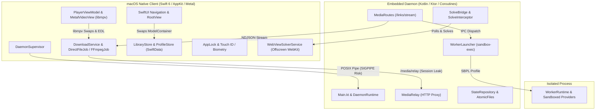
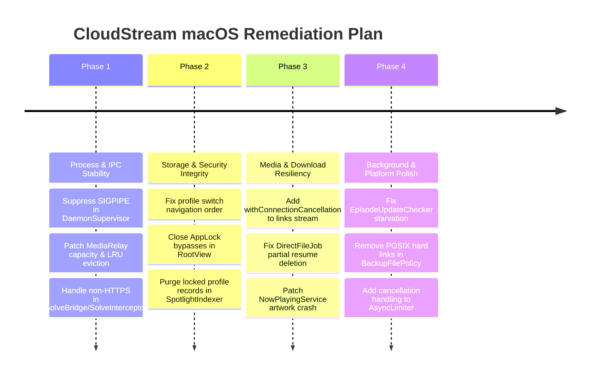

# CloudStream macOS: Adversarial QA & Deep Debugging Audit Report
**Date:** 2026-10-04  
**Auditor:** Adversarial QA Engineering & Senior Systems Debugger  
**Target Codebase:** `macos/` (`macos/client` & `macos/daemon`)  
**Scope:** Client Process Supervisor, Daemon Core & Worker Isolation, Storage & Multi-Profile State, Media Streaming & Metal Render Pipeline, Download Pipeline, Anti-Bot Challenge Solvers, AppLock Security Boundaries.

---

## 1. Executive Summary & Audit Methodology

This adversarial audit evaluates the CloudStream macOS native desktop application and its headless Kotlin/JVM daemon under extreme conditions: unusual sequencing, rapid state switching, process terminations, resource exhaustion, network discontinuities, and edge-case inputs.

Rather than relying purely on static pattern matching, this review traced end-to-end execution paths across Swift 6 concurrency, SwiftData multi-container operations, OkHttp/Ktor streaming pipelines, POSIX IPC boundaries, and libmpv/Metal presentation loops.



---

## 2. Vulnerability & Glitch Matrix

| Defect ID | Severity | Category | Component | Root Cause Summary |
|---|---|---|---|---|
| **CRIT-01** | **Critical** | Process Lifecycle | [`DaemonSupervisor.swift`](file://macos/client/Sources/App/DaemonSupervisor.swift) | Unhandled `SIGPIPE` causes instant kernel abort of macOS app on daemon early exit |
| **CRIT-02** | **Critical** | Resource Exhaustion | [`MediaRelay.kt`](file://macos/daemon/src/main/kotlin/com/lagradost/macos/MediaRelay.kt) | 4-session capacity with 6-hour idle lifetime permanently breaks media relay and leaks sockets |
| **CRIT-03** | **Critical** | Runtime Exception | [`SolveBridge.kt`](file://macos/daemon/src/main/kotlin/com/lagradost/macos/SolveBridge.kt) | OkHttp thread crashes with `IllegalArgumentException` on plain HTTP challenges |
| **HIGH-01** | **High** | Data Integrity | [`ProfileStore.swift`](file://macos/client/Sources/Services/ProfileStore.swift) | Navigation teardown order corrupts multi-profile database by saving draft note to newly selected profile |
| **HIGH-02** | **High** | Security Bypass | [`RootView.swift`](file://macos/client/Sources/UI/Navigation/RootView.swift) | AppLock overlay bypassed by Spotlight, Handoff, Deep Links, and profile switching |
| **HIGH-03** | **High** | Concurrency / IPC | [`MediaRoutes.kt`](file://macos/daemon/src/main/kotlin/com/lagradost/macos/MediaRoutes.kt) | Missing connection cancellation in `/links/stream` leaves worker scrapers running and falsely marks extensions failed |
| **HIGH-04** | **High** | Data Loss | [`DirectFileJob.swift`](file://macos/client/Sources/Services/Downloads/DirectFileJob.swift) | Over-strict RFC 9110 validator deletes multi-gigabyte partial downloads on resume when ETag/strict Date is missing |
| **HIGH-05** | **High** | Sandbox Isolation | [`WorkerLauncher.kt`](file://macos/daemon/src/main/kotlin/com/lagradost/macos/worker/WorkerLauncher.kt) | Generated SBPL profile denies read access to AppCDS shared archive outside runtime root |
| **HIGH-06** | **High** | Scheduler Starvation | [`EpisodeUpdateChecker.swift`](file://macos/client/Sources/Services/EpisodeUpdateChecker.swift) | Missing provider titles permanently block the hourly update queue due to missing timestamp updates |
| **HIGH-07** | **High** | Platform Compatibility | [`BackupFilePolicy.swift`](file://macos/client/Sources/Services/Backup/BackupFilePolicy.swift) | POSIX hard links (`linkItem`) fail completely on external drives formatted with exFAT, FAT32, or SMB |
| **MED-01** | **Medium** | AppKit Crash | [`NowPlayingService.swift`](file://macos/client/Sources/Services/NowPlayingService.swift) | Uncaught Objective-C `NSInvalidArgumentException` when poster image decodes to 0×0 dimensions |
| **MED-02** | **Medium** | Parsing Fragility | [`SolveBridge.kt`](file://macos/daemon/src/main/kotlin/com/lagradost/macos/SolveBridge.kt) | Trailing semicolon in solved cookie header causes false rejection of valid clearance |
| **MED-03** | **Medium** | Interoperability | [`ExternalPlayer.swift`](file://macos/client/Sources/Services/System/ExternalPlayer.swift) | VLC and QuickTime fail silently when opening multi-segment playlist links formatted as `edl://` |
| **MED-04** | **Medium** | Actor Starvation | [`BoundedHTTPResourceLoader.swift`](file://macos/client/Sources/Services/BoundedHTTPResourceLoader.swift) | Cancelled image download tasks in `AsyncLimiter` remain in queue, starving active view renders |
| **MED-05** | **Medium** | Rendering Synchronization | [`MetalVideoView.swift`](file://macos/client/Sources/UI/Player/MetalVideoView.swift) | Dropped `mpv_render_context_report_swap` on render failure causes libmpv frame scheduler to stall |
| **MED-06** | **Medium** | Polling Loop Lockout | [`AppState.swift`](file://macos/client/Sources/ViewModels/AppState.swift) | Non-HTTPS challenge parks indefinitely, causing rapid 2-second failed polling and 90-second daemon block |
| **MED-07** | **Medium** | Unbounded Disk Growth | [`BackupService.swift`](file://macos/client/Sources/Services/Backup/BackupService.swift) | Safety backups in `Safety/` are never pruned and accumulate indefinitely on disk |

---

## 3. Deep Dive Defect Analysis

### 3.1 Critical Severity

#### [CRIT-01] Fatal POSIX `SIGPIPE` Crash on Daemon Early Exit
- **Location:** [`DaemonSupervisor.swift:258-260`](file://macos/client/Sources/App/DaemonSupervisor.swift#L258-L260)
- **Tracing & Trigger:**
  ```swift
  // DaemonSupervisor.swift:256-260
  try prepared.process.run()
  track(child: prepared.process)
  if let line = prepared.inputLine, let pipe = prepared.stdin {
      try pipe.fileHandleForWriting.write(contentsOf: line)
  }
  ```
  If Java fails to launch or exits immediately (due to invalid JVM arguments, missing `.jar`, permission issues, or OOM), the child process exits before Swift writes to the stdin pipe.
- **Impact:** Writing to a pipe with no active reader triggers a POSIX `SIGPIPE` signal (signal 13). In Swift and Cocoa, the default signal disposition is process termination. Because `signal(SIGPIPE, SIG_IGN)` is absent, the entire macOS application crashes instantly, completely bypassing Swift `do/catch` blocks and recovery mechanisms.
- **Recommended Fix:**
  Add signal suppression during app startup in [`CloudStreamMacApp.swift`](file://macos/client/Sources/App/CloudStreamMacApp.swift#L20):
  ```swift
  init() {
      signal(SIGPIPE, SIG_IGN)
  }
  ```

---

#### [CRIT-02] Split-Stream Media Relay 6-Hour Lockout & Response Socket Leak
- **Location:** [`MediaRelay.kt:41, 45, 68, 198-216`](file://macos/daemon/src/main/kotlin/com/lagradost/macos/MediaRelay.kt#L41-L216) & [`DownloadService.swift:1585-1607`](file://macos/client/Sources/Services/DownloadService.swift#L1585-L1607)
- **Tracing & Trigger:**
  1. `MediaRelay.kt` hardcodes `MAX_SESSIONS = 4` and `IDLE_LIFETIME_MS = 6 * 60 * 60 * 1000L` (6 hours).
  2. In [`DownloadService.swift:1585-1607`](file://macos/client/Sources/Services/DownloadService.swift#L1585-L1607), `attemptFFmpeg` registers a relay session for streams with sensitive headers. When an FFmpeg download is paused via `pause()` (`SIGSTOP`), the task stays awaiting in memory and never executes `defer { revokeMediaRelay(...) }`.
  3. In [`MediaRelay.kt:208-216`](file://macos/daemon/src/main/kotlin/com/lagradost/macos/MediaRelay.kt#L208-L216), `response.use` is placed inside `writeTo`. If Ktor cancels before `writeTo` runs, the OkHttp response socket leaks.
- **Impact:** After 4 sessions are paused, crashed, or switched, all subsequent `/media/relay` calls return HTTP 503 (`too many active relay sessions`). Split-stream playback fails across the entire app for up to 6 hours. When `DownloadService` fails to get a relay session, it falls back to exposing plain credentials and cookies in FFmpeg process `argv` (visible to all local users via `ps`).
- **Recommended Fix:**
  1. Implement LRU eviction when `sessions.size >= MAX_SESSIONS` in `MediaRelay.kt`.
  2. Reduce `IDLE_LIFETIME_MS` to 10–15 minutes.
  3. Close `response` in a `try/finally` block if `call.respond()` throws or is cancelled before streaming begins.
  4. Revoke relay sessions in `DownloadService.swift` when paused, and re-acquire on resume.

---

#### [CRIT-03] Unhandled `IllegalArgumentException` in `SolveInterceptor` on HTTP Challenge
- **Location:** [`SolveBridge.kt:59`](file://macos/daemon/src/main/kotlin/com/lagradost/macos/SolveBridge.kt#L59) & [`SolveInterceptor.kt:50`](file://macos/daemon/src/main/kotlin/com/lagradost/macos/SolveInterceptor.kt#L50)
- **Tracing & Trigger:**
  A plain HTTP (`http://`) provider domain encounters an HTTP 403/503 Cloudflare challenge. `SolveInterceptor.isChallenge` evaluates to true, calling `SolveBridge.newTask(prepared.url.toString())`.
  `SolveBridge.newTask` enforces:
  ```kotlin
  require(origin(targetUrl) != null) { "Challenge target must be an HTTPS URL" }
  ```
  Because `origin()` returns `null` for non-HTTPS schemes, `require` throws an unhandled `IllegalArgumentException`.
- **Impact:** The unhandled exception crashes the OkHttp interceptor chain and request thread, terminating the entire scraper execution.
- **Recommended Fix:**
  In [`SolveInterceptor.kt:45`](file://macos/daemon/src/main/kotlin/com/lagradost/macos/SolveInterceptor.kt#L45), verify `prepared.url.isHttps` before triggering `bridge.newTask`.

---

### 3.2 High Severity

#### [HIGH-01] Cross-Profile Note Draft Contamination on Profile Switch
- **Location:** [`ProfileStore.swift:121`](file://macos/client/Sources/Services/ProfileStore.swift#L121), [`WindowSessionRegistry.swift:84`](file://macos/client/Sources/UI/Navigation/WindowSessionRegistry.swift#L84), [`MediaDetailView.swift:720-728`](file://macos/client/Sources/UI/Details/MediaDetailView.swift#L720-L728)
- **Tracing & Trigger:**
  1. User edits a personal note on a media title in Profile A.
  2. User switches to Profile B.
  3. `ProfileStore.select` switches the active SwiftData container and `activeID` to Profile B.
  4. Immediately after, `WindowSessionRegistry.shared.invalidateProfileNavigation()` resets navigation, dismissing `MediaDetailView`.
  5. The dismissed view's `.onDisappear` triggers `saveNote()`.
- **Impact:** `saveNote()` invokes `LibraryStore.shared.setUserNote(...)`. Because `LibraryStore.shared` now points to Profile B's SwiftData database, Profile A's private note is permanently saved into Profile B's database, causing silent data corruption and cross-profile privacy leakage.
- **Recommended Fix:**
  Dismiss and invalidate navigation *before* swapping the active `ModelContainer` in `ProfileStore.select`, or bind note saves strictly to the originating profile's container.

---

#### [HIGH-02] AppLock & Profile PIN Bypass via Spotlight, Handoff & Deep Links
- **Location:** [`RootView.swift:44-48, 115-129`](file://macos/client/Sources/UI/Navigation/RootView.swift#L44-L129), [`AppLock.swift:86-89`](file://macos/client/Sources/Services/AppLock.swift#L86-L89), [`SpotlightIndexer.swift:70-105`](file://macos/client/Sources/Services/System/SpotlightIndexer.swift#L70-L105)
- **Tracing & Trigger:**
  1. In `RootView.swift`, `LockView` is rendered merely as an `.overlay`:
     ```swift
     .overlay {
         if AppLock.shared.isLocked {
             LockView().transition(.opacity)
         }
     }
     ```
  2. While locked, incoming Spotlight search selections (`CSSearchableItemActionType`), Handoff activities (`UserActivityType.viewTitle`), and custom URL scheme deep links (`onOpenURL`) execute immediately, querying the database and navigating behind the lock overlay.
  3. In `AppLock.switchProfile(to:)`, line 87 checks `if profile.requiresUnlock`, allowing anyone to switch away from a locked profile to an unlocked profile without authenticating.
  4. Spotlight indexes private library records even for profiles configured with `requiresUnlock == true`.
- **Impact:** Full bypass of Touch ID and PIN security boundaries, allowing unauthorized viewing of media and library contents.
- **Recommended Fix:**
  1. In `RootView.swift`, guard `.onOpenURL` and `.onContinueUserActivity` with `guard !AppLock.shared.isLocked else { return }`.
  2. In `AppLock.switchProfile`, require authentication when switching *away* from a locked profile.
  3. Purge Spotlight records for profiles where `requiresUnlock == true`.

---

#### [HIGH-03] Missing Connection Cancellation & Error Misattribution in `/links/stream`
- **Location:** [`MediaRoutes.kt:295-315`](file://macos/daemon/src/main/kotlin/com/lagradost/macos/MediaRoutes.kt#L295-L315)
- **Tracing & Trigger:**
  A client initiates `/links/stream` and then disconnects (user closes player window or switches episodes).
- **Impact:**
  1. Unlike `/search/stream`, `/links/stream` does not wrap with `call.withConnectionCancellation`. Long-running extractors and scraping coroutines continue executing in the background for up to 2 minutes, wasting network bandwidth and worker CPU.
  2. When an extractor emits a link to the disconnected client, `writer.write` throws an `IOException` ("Broken pipe"). Because this callback runs inside `safeProvider`, the exception is caught by the provider harness and recorded as an extension network failure (`network_failure`), degrading provider health metrics and risking unwanted safe-mode triggers.
- **Recommended Fix:**
  Wrap `/links/stream` with `call.withConnectionCancellation` and catch `IOException` inside `emit()` so client disconnects are not attributed as provider failures.

---

#### [HIGH-04] Resumable Direct Downloads Wipeout on Servers Lacking ETag/Strict Date
- **Location:** [`DirectFileJob.swift:33-41, 142-161`](file://macos/client/Sources/Services/Downloads/DirectFileJob.swift#L33-L161)
- **Tracing & Trigger:**
  A direct video download (e.g. 4 GB `.mp4`) is paused or interrupted. The remote host supports HTTP Range requests but does not emit a strong `ETag`, and either omits `Date` or returns timestamps where `served.timeIntervalSince(modified) < 60`.
  In `DirectFileJob.ResumeMetadata.validator`:
  ```swift
  var validator: String? {
      if let entityTag { return DirectFileJob.strongEntityTag(entityTag) }
      guard let lastModified, let modified = DirectFileJob.httpDate(lastModified),
            let responseDate, let served = DirectFileJob.httpDate(responseDate),
            served.timeIntervalSince(modified) >= 60 else { return nil }
      return lastModified
  }
  ```
  `validator` evaluates to `nil`. In `start(allowResume:)`, line 142 evaluates `validator != nil` to `false`, executing the `else` branch (lines 157-161): `removePartial()`.
- **Impact:** The app deletes the multi-gigabyte `.part` file from disk and starts over from byte 0, wasting user bandwidth.
- **Recommended Fix:**
  When an `ETag` is absent, allow resumption using standard `Range: bytes=<offset>-` and verify Content-Length and `Accept-Ranges: bytes` rather than immediately deleting the partial file.

---

#### [HIGH-05] Sandbox Profile Rejects Shared AppCDS Archive
- **Location:** [`WorkerLauncher.kt:31, 51-60`](file://macos/daemon/src/main/kotlin/com/lagradost/macos/worker/WorkerLauncher.kt#L31-L60)
- **Tracing & Trigger:**
  Worker process spawned with `-XX:SharedArchiveFile=<path>` inside `sandbox-exec -p <profile>`. The shared archive `.jsa` file is placed in a dedicated cache directory outside `runtimeRoot`.
- **Impact:** The generated SBPL profile does not include `sharedArchive()` in its `file-read*` rules. The macOS kernel sandbox denies read access to the `.jsa` file, causing the JVM to abort on launch.
- **Recommended Fix:**
  Explicitly append `sharedArchive()` to `reads` in `WorkerLauncher.kt:profile()`.

---

#### [HIGH-06] Head-of-Line Starvation in Hourly Episode Update Checker
- **Location:** [`EpisodeUpdateChecker.swift:108-116`](file://macos/client/Sources/Services/EpisodeUpdateChecker.swift#L108-L116) & [`LibraryStore.swift:1879-1887`](file://macos/client/Sources/Services/LibraryStore.swift#L1879-L1887)
- **Tracing & Trigger:**
  `titlesDueForEpisodeCheck` queries up to 12 titles sorted by `lastEpisodeCheck ?? .distantPast`. When a title's provider is uninstalled, disabled, or fails to scrape, `loadDetails` throws. Line 109 catches the error and `continue`s without updating `lastEpisodeCheck`.
- **Impact:** Failed titles remain sorted at `.distantPast`. If 12 such titles exist, they permanently consume the batch limit, completely blocking episode checks for all other titles in the library forever.
- **Recommended Fix:**
  On provider failure or uninstalled provider, update `lastEpisodeCheck` to `Date()` (or a backoff date) so the queue advances to other titles.

---

#### [HIGH-07] Automatic Backup Failure on Non-APFS / External Drives via Hard Links
- **Location:** [`BackupFilePolicy.swift:15-20`](file://macos/client/Sources/Services/Backup/BackupFilePolicy.swift#L15-L20) & [`BackupService.swift:418-426`](file://macos/client/Sources/Services/Backup/BackupService.swift#L418-L426)
- **Tracing & Trigger:**
  `writeBackup()` calls `BackupFilePolicy.writeUnique(data, to: url)`, which executes `try FileManager.default.linkItem(at: temporary, to: url)`. The user has configured the backups folder to an external drive or network share formatted with exFAT, FAT32, or SMB (which do not support POSIX hard links).
- **Impact:** `linkItem` fails with `ENOTSUP` / `EPERM`. All automatic daily and pre-restore safety backups fail completely despite having adequate storage capacity.
- **Recommended Fix:**
  Use atomic rename (`replaceItemAt` or `moveItem`) instead of `linkItem`.

---

### 3.3 Medium Severity

#### [MED-01] Process Crash in `NowPlayingService` on Zero-Dimension Artwork
- **Location:** [`NowPlayingService.swift:186-191`](file://macos/client/Sources/Services/NowPlayingService.swift#L186-L191)
- **Trigger:** Corrupted or empty poster image URL decodes to `NSImage` with `size == .zero` or negative dimensions.
- **Impact:** `MPMediaItemArtwork(boundsSize: image.size)` throws an uncaught Objective-C `NSInvalidArgumentException` (`"boundsSize width and height must be greater than zero"`), crashing the entire application.
- **Recommended Fix:**
  Validate that `image.size.width > 0 && image.size.height > 0` before instantiating `MPMediaItemArtwork`.

---

#### [MED-02] False Rejection of Clearance Cookies with Trailing Semicolons
- **Location:** [`SolveBridge.kt:122-127`](file://macos/daemon/src/main/kotlin/com/lagradost/macos/SolveBridge.kt#L122-L127)
- **Trigger:** Solved cookie header string ends with a semicolon (as emitted by `RequestsHelper.kt:47`: `"${it.name}=${it.value};"`).
- **Impact:** `value.split(';')` produces an empty trailing segment. `part.trim().split('=', limit = 2)` yields size 1, causing `validCookieHeader` to return `false` and drop valid clearance cookies.
- **Recommended Fix:**
  Filter empty segments: `value.split(';').map { it.trim() }.filter { it.isNotEmpty() }.all { ... }`.

---

#### [MED-03] Silent Failure Launching EDL Playlist Streams in External Players
- **Location:** [`ExternalPlayer.swift:53-55, 64-105`](file://macos/client/Sources/Services/System/ExternalPlayer.swift#L53-L105)
- **Trigger:** Opening a multi-segment playlist link (`link.isPlaylist == true`) in VLC or QuickTime.
- **Impact:** `ExternalPlayer.supports(link)` returns `true`, and passes an mpv-only `edl://` pseudo-protocol URL. VLC and QuickTime fail to recognize or open the stream.
- **Recommended Fix:**
  In `ExternalPlayer.supports(link)`, return `false` for VLC and QuickTime when `link.isPlaylist == true`.

---

#### [MED-04] AsyncLimiter Cancellation Starvation in Image Loading
- **Location:** [`BoundedHTTPResourceLoader.swift:156-167`](file://macos/client/Sources/Services/BoundedHTTPResourceLoader.swift#L156-L167)
- **Trigger:** Rapid catalog scrolling causing many poster image tasks to be scheduled and cancelled quickly.
- **Impact:** `withCheckedContinuation` lacks a cancellation handler. Cancelled continuations remain queued in `waiting`, consuming released permits before live visible views, causing poster rendering lag.
- **Recommended Fix:**
  Use `withTaskCancellationHandler` to remove cancelled continuations from `waiting`.

---

#### [MED-05] Missing Swap Report on Frame Render Failure in `MetalVideoView`
- **Location:** [`MetalVideoView.swift:859`](file://macos/client/Sources/UI/Player/MetalVideoView.swift#L859)
- **Trigger:** `mpv_render_context_render` returns a negative status, resulting in `rendered == false`.
- **Impact:** `guard rendered else { return }` exits without calling `mpv_render_context_report_swap(ctx)`. Because `BLOCK_FOR_TARGET_TIME` is enabled in mpv, missing swap reports cause mpv's internal A/V sync clock and frame scheduler to stall.
- **Recommended Fix:**
  Call `mpv_render_context_report_swap(ctx)` even when rendering fails.

---

#### [MED-06] Infinite Solve Polling & 90-Second Lockout on Non-HTTPS Challenges
- **Location:** [`AppState.swift:407-409`](file://macos/client/Sources/ViewModels/AppState.swift#L407-L409), [`WebViewSolverService.swift:31-33`](file://macos/client/Sources/Services/WebViewSolverService.swift#L31-L33), [`SolveBridge.kt:61`](file://macos/daemon/src/main/kotlin/com/lagradost/macos/SolveBridge.kt#L61)
- **Trigger:** A non-HTTPS challenge task is parked in the daemon.
- **Impact:** `WebViewSolverService.solve` rejects non-HTTPS URLs and returns immediately without notifying the daemon. `AppState.startSolvePolling` repeatedly queries `/solve/pending` every 2 seconds, receiving the same rejected task. The daemon thread hangs for the full 90-second timeout, exhausting `MAX_PENDING = 32` and blocking all subsequent challenges.
- **Recommended Fix:**
  If `WebViewSolverService` rejects a task, immediately notify the daemon via a cancel endpoint or fail callback.

---

#### [MED-07] Unbounded Accumulation of Safety Backups on Disk
- **Location:** [`BackupService.swift:418-426, 443-448`](file://macos/client/Sources/Services/Backup/BackupService.swift#L418-L448)
- **Trigger:** Repeated backup imports or restores over weeks/months.
- **Impact:** `pruneAutoBackups` only purges files in `Daily/` matching `.daily.json`. Pre-restore snapshots written to `Safety/` have no pruning mechanism and accumulate indefinitely on disk.
- **Recommended Fix:**
  Apply retention pruning to `Safety/` backups (e.g. keep the last 5 safety copies).

---

## 4. Remediation Roadmap



1. **Phase 1: Process & IPC Stability (Immediate)**
   - Apply `signal(SIGPIPE, SIG_IGN)` to prevent instant kernel aborts.
   - Refactor `MediaRelay.kt` to enforce LRU eviction, lower idle lifetime to 15m, and handle socket cleanup.
   - Guard non-HTTPS challenge interception in `SolveInterceptor.kt`.
2. **Phase 2: Storage & Security Integrity**
   - Reorder container activation and navigation dismissal in `ProfileStore.swift` to stop cross-profile data leakage.
   - Enforce AppLock gates across deep links, Handoff, and Spotlight in `RootView.swift`.
   - Prevent unauthenticated switches out of locked profiles in `AppLock.swift`.
3. **Phase 3: Media & Download Resiliency**
   - Wrap `/links/stream` with connection cancellation in `MediaRoutes.kt`.
   - Relax `DirectFileJob.swift` resume requirements to prevent loss of multi-gigabyte partial downloads.
   - Add bounds checks to `NowPlayingService.swift` before creating `MPMediaItemArtwork`.
4. **Phase 4: Background Schedulers & Platform Compatibility**
   - Update `lastEpisodeCheck` on failed titles in `EpisodeUpdateChecker.swift` to resolve head-of-line blocking.
   - Replace POSIX `linkItem` with atomic renames in `BackupFilePolicy.swift`.
   - Add cancellation handling in `AsyncLimiter` (`BoundedHTTPResourceLoader.swift`).
