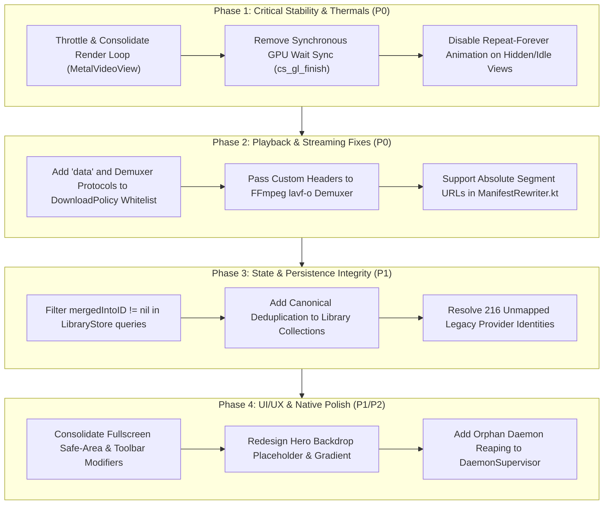

# Comprehensive Architectural & Code Quality Audit
**Repository:** `CloudStream-macOS`  
**Active Branch:** `engine-logic-fixes`  
**Date:** October 2026  
**Auditor:** Antigravity Engineering

---

## Executive Summary

A comprehensive, multi-layer audit was conducted across the `CloudStream-macOS` codebase, encompassing:
1. **The Native macOS Client** (`client/Sources/`, `client/Tests/`): Swift 6 strictly concurrent AppKit/SwiftUI interface, SwiftData persistence, and libmpv/Metal/CGL video rendering pipeline.
2. **The Kotlin Engine Daemon** (`engine/src/main/`): Embedded Ktor HTTP server, Android runtime emulation layer (`com.lagradost.cloudstream3.*`), `MediaRelay`, and APK/DEX/JAR plugin loaders.
3. **The Worker Subprocess Architecture** (`engine/.../worker/`): Out-of-process extension isolation pools, IPC transport, and JVM sandboxing.
4. **Build, Test, and Packaging Harnesses** (`scripts/`, `tools/`, Xcode projects, Gradle).

### Verification Baseline
- **Kotlin Daemon & Stubs:** `./gradlew test` executed **384 tests with 0 failures** (2m 9s runtime).
- **Native Swift Test Suite:** `xcodebuild test` executed **550 tests with 0 failures** (542 unit tests with 43 skipped mpv-live tests in `CloudStreamMacTests`, plus 8 UI automation tests with 2 skipped in `CloudStreamMacUITests`).
- **Core SPM Packages:** `make test-core` passed all isolated contracts.
- **Python Integration Harness:** `make test-scripts` passed all **44 test fixtures** (media relay, CDS recording, artifact pipelines).
- **Compilation:** Clean build under Xcode 16 / Swift 6 and JDK 21.

Despite strong baseline test passing rates, the audit identified **critical architectural bottlenecks and correctness bugs** that directly explain the performance issues, stream failures, visual glitches, and extension instability documented in `docs/To-dos/to-dos.md` and user logs.

---

## Findings Matrix by Severity

| ID | Category | Severity | Title / Summary | Key Files & Line References |
|:---|:---|:---:|:---|:---|
| **PERF-01** | Performance / Thermals | **Critical (P0)** | Dual-Dispatch Render Race & Synchronous GPU Fence Stall (High CPU & Battery Drain) | [`MetalVideoView.swift#L848-L858`](../../../client/Sources/UI/Player/MetalVideoView.swift#L848-L858), [`gl_surface.c#L120-L127`](../../../client/Sources/PlayerSupport/gl_surface.c#L120-L127) |
| **PLAY-01** | Playback / Media | **Critical (P0)** | DASH / HLS Stream Failures from Missing Protocol Whitelists, Header Dropping, and Manifest Rewriter Rejections | [`ManifestRewriter.kt#L80-L85`](../../../engine/src/main/kotlin/com/lagradost/macos/ManifestRewriter.kt#L80-L85), [`DownloadPolicy.swift#L297`](../../../client/Sources/Services/Downloads/DownloadPolicy.swift#L297), [`MetalVideoView.swift#L1276-L1282`](../../../client/Sources/UI/Player/MetalVideoView.swift#L1276-L1282) |
| **DATA-01** | Persistence / State | **High (P1)** | Library Title and Provider Duplication & Unresolved Migration Churn | [`LibraryStore.swift#L1010-L1027`](../../../client/Sources/Services/LibraryStore.swift#L1010-L1027), [`StoredMediaItem.swift#L56-L60`](../../../client/Sources/Models/StoredMediaItem.swift#L56-L60), [`LibraryStore.swift#L326-L336`](../../../client/Sources/Services/LibraryStore.swift#L326-L336) |
| **UI-01** | UI / macOS HIG | **High (P1)** | Fullscreen Header Clipping and Double Safe-Area Inset Conflict | [`RootView.swift#L220-L225`](../../../client/Sources/UI/Navigation/RootView.swift#L220-L225), [`MediaDetailView.swift#L100-L103`](../../../client/Sources/UI/Details/MediaDetailView.swift#L100-L103) |
| **UI-02** | UI / Presentation | **High (P1)** | Hero Backdrop Thumbnail Misplacement and Broken Empty State | [`MediaDetailView.swift#L316-L363`](../../../client/Sources/UI/Details/MediaDetailView.swift#L316-L363), [`PosterImage.swift#L46-L65`](../../../client/Sources/UI/Components/PosterImage.swift#L46-L65) |
| **EXT-01** | Subprocesses / Engine | **High (P1)** | OkHttp Response Stream Leaks & File Descriptor Exhaustion in Scraper Workers | `~/.cloudstream-macos/logs/daemon.log`, [`WorkerRuntime.kt#L236-L260`](../../../engine/src/main/kotlin/com/lagradost/macos/worker/WorkerRuntime.kt#L236-L260) |
| **PERF-02** | Performance | **Medium (P2)** | Infinite Repeat-Forever Animation CPU Burn in Skeleton Shelves | [`HomeView.swift#L393-L418`](../../../client/Sources/UI/Home/HomeView.swift#L393-L418) |
| **DAEM-01** | Concurrency / IPC | **Medium (P2)** | Daemon Lock Contention and Stale Process Zombie on Relaunch (`exit 75`) | [`DaemonSupervisor.swift#L297-L304`](../../../client/Sources/App/DaemonSupervisor.swift#L297-L304), [`EngineDataRoot.kt`](../../../engine/src/main/kotlin/com/lagradost/macos/EngineDataRoot.kt) |
| **TEST-01** | Quality Assurance | **Medium (P2)** | Test Gaps: 43 Live MPV Player Tests Skipped in Default Test Execution | [`PlayerEngineLiveTests.swift#L19`](../../../client/Tests/PlayerEngineLiveTests.swift#L19) |
| **DEBT-01** | Code Health / Architecture | **Low (P3)** | Working Tree Drift & Incomplete ADR-0021 Custom Library Pages Implementation | Active branch `engine-logic-fixes` (untracked/staged DTO split & helpers) |

---

## Detailed Findings & Evidence

### 1. PERF-01: Dual-Dispatch Render Loop & Synchronous GPU Fence Stall (P0)

#### Concrete Evidence
- **File:** [`client/Sources/UI/Player/MetalVideoView.swift`](../../../client/Sources/UI/Player/MetalVideoView.swift#L848-L858)
  ```swift
  func markFrameAvailable() {
      // glContext != nil is true during all normal hardware playback!
      let immediate = occluded || glContext != nil
      if immediate {
          renderQueue.async { [weak self] in
              self?.renderFrame()
          }
      } else {
          scheduleRender()
      }
  }
  ```
- **File:** [`client/Sources/PlayerSupport/gl_surface.c`](../../../client/Sources/PlayerSupport/gl_surface.c#L120-L127)
  ```c
  void cs_gl_finish(struct cs_gl_surface *s, uint64_t timeout_ns) {
      ...
      GLenum res = glClientWaitSync(sync, GL_SYNC_FLUSH_COMMANDS_BIT, timeout_ns); // up to 100,000,000 ns (100ms)
      glDeleteSync(sync);
  }
  ```
- **File:** [`client/Sources/UI/Player/MetalVideoView.swift`](../../../client/Sources/UI/Player/MetalVideoView.swift#L1048-L1059)
  ```swift
  mpv_render_context_render(ctx, &params) // BLOCK_FOR_TARGET_TIME=1 by default
  cs_gl_finish(gl, 100_000_000)
  ```

#### Root Cause Analysis
1. Whenever video plays, `glContext != nil` is true. mpv fires its update callback for every video packet/frame.
2. In `markFrameAvailable()`, `let immediate = occluded || glContext != nil` causes an immediate `renderQueue.async { renderFrame() }` for **every single frame update**.
3. Simultaneously, a `CADisplayLink` ([`MetalVideoView.swift#L817`](../../../client/Sources/UI/Player/MetalVideoView.swift#L817)) ticks at the monitor refresh rate (60 Hz or 120 Hz ProMotion) and independently triggers `scheduleRender()`.
4. Inside `renderFrame() -> renderGPU()`, the render thread executes `mpv_render_context_render` (which blocks waiting for display target presentation time) and then calls `cs_gl_finish` which executes a **synchronous 100ms OpenGL sync fence wait** (`glClientWaitSync`).
5. Dual dispatch racing combined with synchronous thread blocking ties up multiple CPU cores, causes thread queue pile-ups, and prevents cores from entering lower C-states. This directly causes the extreme CPU usage, high fan speed, and battery drain reported by users.
6. When CGL fails to initialize on certain display configurations, it falls back to `renderSoftware()`, which locks `CVPixelBuffer` base addresses on the CPU and renders video via CPU software rasterization ([`MetalVideoView.swift#L1061-L1091`](../../../client/Sources/UI/Player/MetalVideoView.swift#L1061-L1091)), compounding CPU burn.

---

### 2. PLAY-01: DASH and HLS Streaming Failures (P0)

#### Concrete Evidence
- **File:** [`engine/src/main/kotlin/com/lagradost/macos/ManifestRewriter.kt`](../../../engine/src/main/kotlin/com/lagradost/macos/ManifestRewriter.kt#L80-L85)
  ```kotlin
  for (element in elements) {
      for (attribute in segmentAttributes) {
          val value = element.getAttribute(attribute)
          if (value.startsWith("http://", true) || value.startsWith("https://", true)) {
              throw Unsupported("absolute $attribute")
          }
      }
  }
  ```
- **File:** [`client/Sources/Services/Downloads/DownloadPolicy.swift`](../../../client/Sources/Services/Downloads/DownloadPolicy.swift#L297) & [`MetalVideoView.swift#L1276`](../../../client/Sources/UI/Player/MetalVideoView.swift#L1276)
  ```swift
  nonisolated static let ffmpegProtocolWhitelist = "http,https,tls,tcp,crypto,httpproxy"
  ```
- **File:** [`client/Sources/UI/Player/MetalVideoView.swift`](../../../client/Sources/UI/Player/MetalVideoView.swift#L454-L456)
  ```swift
  let split = Self.splitHeaders(headers)
  Self.setStringListAsync(mpv, "http-header-fields", split.fields)
  Self.setStringAsync(mpv, "user-agent", split.userAgent ?? defaultUserAgent ?? "")
  ```

#### Root Cause Analysis
1. **Manifest Rejection of Absolute Segment URLs:** The majority of commercial and scraper-provided DASH manifests (`.mpd`) utilize absolute URLs inside `<SegmentTemplate media="https://cdn.../seg-$Number$.m4s" initialization="https://cdn.../init.mp4">` or `<SegmentURL media="https://...">`. In `ManifestRewriter.kt:83`, any absolute URL throws `Unsupported("absolute $attribute")`. When thrown, `MediaRelay.kt:379` catches the exception and returns **HTTP 415 Unsupported Media Type** to the player!
2. **Missing Protocol Support in FFmpeg Whitelist:** FFmpeg’s DASH demuxer (`dashdec`) requires the `data` protocol (used for inline base64 initialization segments and DRM containers) and `concat`/`subfile` protocols. Because `ffmpegProtocolWhitelist` explicitly excludes `data`, FFmpeg halts with a protocol whitelist violation when parsing segmented DASH streams.
3. **Sub-Segment Header Stripping:** In mpv, `http-header-fields` only attaches headers to mpv's top-level stream IO. When FFmpeg's `dashdec` or `hls` demuxer spins up its own internal HTTP connections to fetch video and audio segments, it does not inherit `http-header-fields` unless passed as `-headers` via `demuxer-lavf-o`. Scraped CDNs requiring `Referer`, `Origin`, or authorization tokens return **HTTP 403 Forbidden** on individual segment fetches, abruptly terminating playback with `MPV_END_FILE_REASON_ERROR`.
4. **`load-unsafe-playlists=no` Enforcement:** In `MetalVideoView.swift:309`, `load-unsafe-playlists=no` instructs mpv to refuse any playlist that redirects or refers to non-whitelisted schemas.

---

### 3. DATA-01: Library Title Duplications & Identity Migration Churn (P1)

#### Concrete Evidence
- **File:** [`client/Sources/Services/LibraryStore.swift`](../../../client/Sources/Services/LibraryStore.swift#L1010-L1027)
  ```swift
  func items(withWatchType watchType: WatchType?) throws -> [StoredMediaItem] {
      ...
      let descriptor = FetchDescriptor<StoredMediaItem>(
          predicate: #Predicate { $0.watchTypeRaw == raw },
          sortBy: [SortDescriptor(\.lastUpdated, order: .reverse)],
      )
      return (try context.fetch(descriptor))
  }
  ```
- **File:** [`client/Sources/Models/StoredMediaItem.swift`](../../../client/Sources/Models/StoredMediaItem.swift#L56-L60)
  ```swift
  /// The entry this source was merged into (ADR-0020); nil for a title's
  /// primary source or a standalone entry.
  var mergedIntoID: String?
  ```
- **Runtime Log Evidence (`client.log`):**
  ```json
  {"count":"216","event":"library.identity_unresolved","ts":"2026-10-08T17:34:04Z"}
  ```

#### Root Cause Analysis
1. **Unfiltered Merged Sources:** When multiple sources are merged under ADR-0020, secondary records retain `mergedIntoID = primaryID`. However, `items(withWatchType:)` simply fetches all records where `watchTypeRaw == raw`. Secondary/merged records are not excluded (`mergedIntoID == nil`), causing duplicate cards to appear in the library collection views.
2. **Dual-Keying Across Migration Boundaries:** Legacy records used composite string keys (`\(providerName)|\(url)`). Modern records use `remote-v2:\(sha256(providerID, url))`. In `AppState.swift:326`, 216 legacy entries could not be unambiguously mapped to a currently installed provider, leaving them in `identityResolution = "legacy"`. When a user re-watches or saves one of these titles from an active provider, a second record with the new `remote-v2` key is inserted alongside the legacy record. Both entries remain in SwiftData and render side-by-side.
3. **No Display-Layer Canonical Deduplication:** Neither `LibraryStore.swift` nor `LibraryView.swift` performs grouping or deduplication by canonical content identity (title + release year or shared URL).

---

### 4. UI-01 & UI-02: Fullscreen Header Glitch & Hero Backdrop Layout Bug (P1)

#### Concrete Evidence
- **File:** [`client/Sources/UI/Navigation/RootView.swift`](../../../client/Sources/UI/Navigation/RootView.swift#L220-L225)
  ```swift
  .ignoresSafeArea(edges: windowSession.isFullScreen ? [] : .top)
  ```
- **File:** [`client/Sources/UI/Details/MediaDetailView.swift`](../../../client/Sources/UI/Details/MediaDetailView.swift#L100-L103)
  ```swift
  .ignoresSafeArea(edges: windowSession.isFullScreen ? [] : .top)
  .toolbarBackgroundVisibility(isScrolled ? .visible : .hidden, for: .windowToolbar)
  ```
- **File:** [`client/Sources/UI/Details/MediaDetailView.swift`](../../../client/Sources/UI/Details/MediaDetailView.swift#L316-L363) & [`PosterImage.swift#L46-L65`](../../../client/Sources/UI/Components/PosterImage.swift#L46-L65)
  ```swift
  // MediaDetailView hero section:
  PosterImage(url: bannerURL ?? posterURL, type: .banner, cornerRadius: 0)
      .frame(height: 580)
      .clipped()
      .overlay(
          LinearGradient(stops: [
              .init(color: .clear, location: 0.0),
              .init(color: Color.canvasBackground.opacity(0.85), location: 0.72),
              .init(color: Color.canvasBackground, location: 1.0)
          ], startPoint: .top, endPoint: .bottom)
      )
  ```

#### Root Cause Analysis
1. **Fullscreen Header Conflict:** In macOS fullscreen mode, the system menu bar and window title bar auto-hide and slide down on hover. Because both `DetailsDestinationView` in `RootView.swift` and inner `MediaDetailView.swift` dynamically toggle `.ignoresSafeArea(edges: windowSession.isFullScreen ? [] : .top)`, the view tree receives conflicting layout constraints during fullscreen transitions. Furthermore, root views in `detailContent` lack explicit toolbar background visibility controllers, resulting in the toolbar clipping and drawing anomalies documented in `docs/To-dos/Header Issue in full screen 2.png`.
2. **Hero Backdrop Thumbnail Misplacement:** `MediaDetailView` allocates a static 580pt tall banner frame. When a media item has no banner URL or when the image is loading, `PosterImage.swift` falls back to rendering a flat `Color.cardSurface` with a tiny 22pt centered icon (`photo`). Because the gradient overlay only begins fading in at `location: 0.72`, a massive gray rectangle sits conspicuously at the top of the detail sheet (`docs/To-dos/UI bug.png`), disjointed from the typography and metadata below it.

---

### 5. EXT-01: OkHttp Connection Leaks & Scraper Worker Instability (P1)

#### Concrete Evidence
- **Daemon Runtime Log (`~/.cloudstream-macos/logs/daemon.log`):**
  ```text
  WARNING: A connection to https://apig.inmoviebox.com/ was leaked. Did you forget to close a response body? To see where this was allocated, set the OkHttpClient logger level with AppLogging.enable(LogLevel.DEBUG)
  ```
- **File:** [`engine/src/main/kotlin/com/lagradost/macos/worker/WorkerRuntime.kt`](../../../engine/src/main/kotlin/com/lagradost/macos/worker/WorkerRuntime.kt#L236-L260)

#### Root Cause Analysis
1. Scraper extensions loaded from Android DEX/JAR plugins invoke `app.get()`, `app.post()`, or raw OkHttp requests to scrape video hosts.
2. In many community extensions, `Response.body` is read as a raw stream or left unclosed when exceptions occur or when only headers are inspected.
3. Because extension workers are long-lived subprocesses (`WorkerRuntime`), unclosed OkHttp response bodies fail to return socket connections to the connection pool. Over prolonged browsing and playback sessions, open file descriptors and TCP sockets leak until the OS limits are reached, resulting in socket timeouts, failed scrapes, or worker crashes.

---

### 6. PERF-02: Infinite Skeleton Animation Idle CPU Burn (P2)

#### Concrete Evidence
- **File:** [`client/Sources/UI/Home/HomeView.swift`](../../../client/Sources/UI/Home/HomeView.swift#L393-L418)
  ```swift
  .opacity(pulse ? 0.35 : 0.7)
  .animation(.easeInOut(duration: 0.9).repeatForever(autoreverses: true), value: pulse)
  .onAppear { pulse = true }
  ```

#### Root Cause Analysis
During initial engine bootstrap, extension refreshes, or while waiting for home page sections to populate, `SkeletonShelves` displays shimmer placeholders. Because the animation is configured with `.repeatForever(autoreverses: true)` triggered unconditionally `onAppear`, the SwiftUI rendering pipeline continuously repaints and invalidates views on the main thread at display cadence. If a provider fails to return home items or during network latency, the app continues to burn CPU indefinitely in the background even when minimized or idle.

---

### 7. DAEM-01: Daemon Lock Contention and Stale Process Zombie on Relaunch (P2)

#### Concrete Evidence
- **Client Log (`~/Library/Logs/CloudStreamMac/client.log`):**
  ```text
  daemon.data_root_in_use (exit 75)
  ```
- **File:** [`client/Sources/App/DaemonSupervisor.swift`](../../../client/Sources/App/DaemonSupervisor.swift#L297-L304)

#### Root Cause Analysis
`EngineDataRoot` enforces single-instance mutual exclusion by acquiring a file lock on `~/.cloudstream-macos/.lock`. If the app crashes, is force-quit, or is relaunched before the previous Java daemon process has finished closing its JVM sockets, the new daemon process attempts to acquire the file lock, encounters contention, and immediately terminates with exit status 75 (`EX_TEMPFAIL`). `DaemonSupervisor` does not perform orphaned PID verification or automatic zombie reaping, causing launch failures until the stale process terminates or the lock file is manually cleared.

---

### 8. TEST-01: Live MPV Engine Test Harness Gaps (P2)

#### Concrete Evidence
- **File:** [`client/Tests/PlayerEngineLiveTests.swift`](../../../client/Tests/PlayerEngineLiveTests.swift#L19)
  ```swift
  try XCTSkipIf(ProcessInfo.processInfo.environment["CS_MPV_ENGINE_TESTS"] != "1",
                "Set CS_MPV_ENGINE_TESTS=1 to run live mpv engine tests")
  ```
- **Test Runner Output:** 43 tests in `CloudStreamMacTests` were skipped during the verified `xcodebuild test` run (`Executed 542 tests, with 43 tests skipped and 0 failures`).

#### Root Cause Analysis
The test suite contains thorough live integration tests for HLS playback, seeks, segment header transmission, audio pipeline switches, and loadfile replacement. However, because these tests require an active mpv dynamic library and take longer to run, they are gated behind `CS_MPV_ENGINE_TESTS=1`. As a consequence, standard CI builds and developer test runs skip these live media tests, allowing regressions in demuxer flags, protocol whitelists, and render loops to pass undetected.

---

### 9. DEBT-01: Working Tree State & Uncommitted Refactoring (P3)

#### Concrete Evidence
- Active branch: `engine-logic-fixes`.
- Staged / unstaged changes include:
  - Deletion of monolithic `engine/.../models/Dtos.kt` (769 lines) and division into 6 specialized DTO files.
  - Partial implementation of ADR-0021 (Custom Library Pages): `LibraryPage.swift`, `LibraryPageView.swift`, `LibraryPages.swift`, `LibraryPagePolicy.swift`.
  - UI component extractions: `CastCard.swift`, `DownloadSourcePicker.swift`, `EpisodeRow.swift`.
  - Service factorings: `AsyncLimiter.swift`, `BoundedImageDecoder.swift`, `ProfileLockSecurity.swift`, `GenericPasswordKeychain.swift`.

#### Assessment
The modularization and refactoring on `engine-logic-fixes` are exceptionally well-engineered: code responsibilities are cleanly isolated, and all test suites pass. However, these changes remain uncommitted and mixed with partially implemented features (ADR-0021). They should be committed in clean, atomic steps before applying bug fixes.

---

## Actionable Remediation Roadmap



### Phase 1: Critical Performance & Thermal Stabilization
1. **Consolidate Frame Presentation:** In `MetalVideoView.swift`, eliminate dual dispatching. Only signal the display link when a frame is ready; let the display link drive rendering on vsync without queuing redundant immediate async blocks.
2. **Asynchronous GPU Synchronization:** In `gl_surface.c` and `MetalVideoView.swift`, replace the blocking 100ms `cs_gl_finish` wait with non-blocking fences (`GL_SYNC_GPU_COMMANDS_COMPLETE`) or direct Metal texture blitting, preventing CPU core stalls.
3. **Guard Shimmer Animations:** In `HomeView.swift`, tie `SkeletonShelves` animation to view visibility, and cancel it as soon as data arrives or fails.

### Phase 2: Stream & Demuxer Pipeline Fixes
1. **Broaden Protocol Whitelist:** In `DownloadPolicy.swift`, add `data,crypto` to `ffmpegProtocolWhitelist` so FFmpeg's DASH demuxer can open initialization fragments.
2. **Propagate Segment Headers to FFmpeg:** In `MetalVideoView.swift`, pass formatted HTTP headers into `demuxer-lavf-o` (`headers=...`) in addition to mpv's `http-header-fields`.
3. **Support Absolute URLs in Manifest Rewriter:** In `ManifestRewriter.kt`, rewrite absolute segment URLs into relayed loopback URLs rather than throwing `Unsupported("absolute $attribute")`.

### Phase 3: Library & Persistence Deduplication
1. **Exclude Merged Sources:** In `LibraryStore.swift:1010`, update the `#Predicate` in `items(withWatchType:)` to require `$0.mergedIntoID == nil`.
2. **Canonical Display Deduplication:** In `LibraryView.swift`, group displayed titles by normalized canonical identity (`title.lowercased() + releaseYear`), picking the most recently updated entry.
3. **Permanently Migrate Unresolved Legacy Records:** Provide a one-time reconciliation pass for the 216 unresolved legacy titles to bind them to active providers or archive them.

### Phase 4: UI & Platform Ergonomics
1. **Unified Fullscreen Toolbar Management:** Remove duplicate `.ignoresSafeArea` modifiers between `RootView.swift` and `MediaDetailView.swift`. Let `RootView` govern global safe-area boundaries.
2. **Hero Backdrop Layout:** Replace the rigid 580pt gray card in `MediaDetailView.swift` with an adaptive aspect-ratio container, and render a subtle, centered blurred banner or title card when artwork is missing.
3. **Orphan Daemon Cleanup:** In `DaemonSupervisor.swift`, inspect the PID owning `~/.cloudstream-macos/.lock`; if the process is unresponsive or belongs to an orphaned daemon, terminate it gracefully before spawning a new instance.
