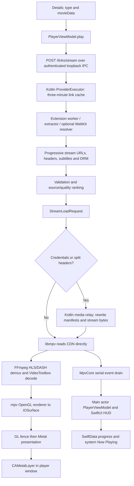

# Live playback architecture audit

Date: 1 November 2026. Baseline commit: `a23a928`, plus the current working tree.

The reported symptom is consistent across channels: playback starts with roughly the last minute, consumes that material, then ends instead of remaining live. This audit changes no application code. Other UI work was changing in the working tree during the audit; that work was left untouched.

## Finding that matters most

**The application recognises “Live” as a catalogue category but has no corresponding playback mode, live timeline, or live recovery policy.** A stream ending is handled as completion of a movie/episode. Mirror switches reuse a movie-style elapsed timestamp. Playback progress and seeking also assume a finite timeline.

However, **absence of an application live mode does not by itself stop a valid HLS stream from refreshing**. The bundled mpv/FFmpeg can follow a rolling playlist. This was checked against a synthetic local origin using the production network options. We must distinguish the confirmed application defects from the still-unproven reason an affected channel's manifest stops advancing.

No failing channel manifest or captured session was available. This audit therefore does **not** claim to have proven whether affected streams arrive as a finite playlist, a segment snapshot, an expired URL, a stopped playlist, or a demuxer reload failure. The first remediation should make that distinction observable.

## Actual architecture

The Kotlin daemon resolves links and carries media bytes only for relayed sources. A directly played channel does not send its media through the daemon. ffmpeg's command-line download process is not the playback engine. The default renderer is an OpenGL-to-Metal bridge, with a software fallback; it is not a direct Metal mpv render API.

## Evidence and validation

### Controlled native playback

The probe source (`native_live_probe.py`) and its recorded observations (`native-probe.json`) are in `docs/audit/live-playback-2026-11-01/` on the `sprint-experimental` branch.

The probe uses the bundled `libmpv`, synthetic H.264 segments, a loopback origin, and the application's cache, network, protocol whitelist and HLS demuxer options. It compares a six-second rolling playlist with a six-second finite playlist carrying `EXT-X-ENDLIST`. It runs for eighteen seconds, spanning three initial playlist windows.

| Input | Observed behavior |
| --- | --- |
| Rolling HLS, no ENDLIST | Nineteen playlist reads; sequence 8 → 25; clock reaches 18 seconds; EOF remains false |
| Finite HLS, ENDLIST | Duration 6 seconds; first sampled EOF at second 7 |

Observed native versions: mpv v0.41.0 and FFmpeg 9.0.2.

The native engine also reports a positive, changing `duration` for the rolling live input. **A positive duration is not evidence that a stream is VOD.**

Scope: this isolates native demuxing/network behavior. Null audio/video outputs are used. It does not exercise the Swift application, Kotlin relay, GPU rendering, real CDN authentication, or long-running playback. It does not prove the behavior of an affected provider.

### Existing application tests

A current-source Xcode build and focused test run passed: **62 tests, zero failures**.

| Suite | Tests |
| --- | ---: |
| MediaResourcePolicyTests | 21 |
| PlayerFeatureTests | 23 |
| PlayerLifetimeTests | 2 |
| PlayerRemediationTests | 16 |

Result bundle: `/tmp/cloudstream-live-audit-tests-retry.xcresult`; build/test log: `/tmp/cloudstream-live-audit-xcodebuild-retry.log`.

The first attempt was blocked by the execution sandbox preventing Swift macro compiler startup. The same focused build/tests succeeded outside that sandbox. This was an environment restriction, not a failing playback test. No full-suite, production-channel, GPU performance or packaged-app certification is claimed.

## Prioritized defects and bottlenecks

Labels: **confirmed** means directly established by source or the stated probe; **conditional** means the code fails under a particular input/condition; **profiling candidate** means a real architectural cost whose contribution to the user's glitches has not been measured. P1 is a playback/recovery correctness priority; P2 is performance, compatibility or diagnosis work.

### 1. P1 — Live identity does not become playback behavior — confirmed

Evidence: `ProviderExecutor.kt:545` maps `LiveStreamLoadResponse.dataUrl` into `movieData`; `DetailsDto.type` retains the catalogue type. `PlayerViewModel.swift:45,69,303` defines the load request/session and starts playback without a live-mode or capability field. `MediaPresentation.swift:38` recognises the live category only for presentation/filtering.

The type is available, so this is not wholesale loss of provider metadata. The player simply never turns it into a policy. It cannot distinguish VOD, an ongoing live channel, a live DVR window, an ended event, and an unknown stream.

**Change:** introduce a playback mode seeded by catalogue metadata and refined by the actual manifest/engine. Carry capabilities such as live edge, seekable ranges and whether timeline resume is meaningful. Preserve an unknown mode for incomplete provider metadata; do not infer VOD from positive duration.

### 2. P1 — EOF terminates a live session — confirmed; directly relevant to the symptom

Evidence: `MetalVideoView.swift:584,609` turns `eof-reached` into one end notification. `PlayerViewModel.swift:1164` closes playback unless series auto-advance applies. It does not branch on live status or try to restore the stream.

This explains the application's response when the short window ends. It does not explain why a particular manifest first becomes finite or stops refreshing.

**Change:** for an ongoing live session, enter bounded recovery: inspect whether the manifest advanced, reopen/re-resolve at the live edge when appropriate, then fall back to another source. Distinguish an intentionally ended event from a transient loss. Never solve this by blindly looping the final minute.

### 3. P1 — Saved resume and mirror failover use the wrong clock for live — confirmed

Evidence: `MediaDetailView.swift:191` uses the non-series resume path; `PlayerViewModel.swift:1114` uses `startAt ?? elapsed` on failover; `MetalVideoView.swift:492` converts it into a per-file `start=`. `PlayerViewModel.swift:1209` treats an unseekable resume as a reason to move to another mirror. `engineReconnected()` at line 822 also resumes a relayed source at `elapsed`.

A channel watched for twenty minutes cannot safely be reopened at “1200 seconds” in a new sliding window. Independent mirrors may also have unrelated timestamp origins. This can jump backward, request material outside the window, or exhaust mirrors that are correctly unseekable.

**Change:** reopen ordinary live channels at the live edge. For deliberate DVR playback, preserve an explicitly defined wall-clock/program-time position or an offset behind the live edge, clamped to the new seekable window. Keep last-watched channel history separate from movie-style resume.

### 4. P1 — A stalled final/only mirror can remain stuck indefinitely — confirmed

Evidence: `PlayerViewModel.swift:1263` detects stalls; `switchMirrorForStalls()` at line 1285 resets tracking and returns if there is no next mirror. It does not reopen, re-resolve, report a terminal stall, or schedule another attempt. The first-frame deadline protects `.loading`, not established `.ready` playback.

Recovery also depends on `paused-for-cache`; an advancing audio clock with frozen video, or a non-buffering native freeze, is not covered by that signal alone.

**Change:** add a playback liveness watchdog and a bounded recovery sequence. Respect explicit pause and seeking. Include stalled video separately from network starvation; an occluded window intentionally does not present video and must not trigger a false alarm.

### 5. P1 — Recovery consumes old links and cannot force fresh resolution — confirmed

Evidence: `PlayerViewModel.swift:1145` only advances through `session.links`, then fails. `ProviderExecutor.kt:334,419` reuses successful link responses for three minutes; `LinksRequestDto` contains only provider and data. There is no playback refresh/cache-bypass request.

For short-lived signed live URLs, reopening within the cache lifetime can return the same expired URL. Increasing a buffer cannot repair it. A stream that plays for hours can outlive every initially resolved URL.

**Change:** add an explicit fresh-resolution operation, expiry-aware caching where available, and bounded backoff. Refresh credentials/links under the same playback generation. Retain normal cache hits for ordinary repeated lookups.

### 6. P1 — Late progressive links do not revive an exhausted player — conditional, established by source

Evidence: `PlayerViewModel.swift:503` appends links after a resolution has started. If the currently known mirrors fail first, `handlePlaybackError()` sets `.failed`; later links are appended without issuing a new load.

A fast broken link can therefore leave playback failed even when a working alternative arrives shortly afterwards. Existing mirror order also follows arrival order for these late additions rather than rerunning the ranker.

**Change:** track tried source identities and whether resolution remains open. Accept and rank new candidates, and resume recovery when an untried candidate arrives. Bound the wait for the resolver to finish.

### 7. P2 — Reconnect configuration is split across different network layers — confirmed configuration gap; nested failure impact needs reproduction

Evidence: `MetalVideoView.swift:1414` puts reconnect options into `stream-lavf-o`. `demuxer-lavf-o` at line 1429 contains the protocol whitelist and extension permissions, plus per-file headers/decryption when needed. It does not carry the same reconnect policy. `MediaRelay.kt:196` clears provider interceptors and cookies and uses its own upstream timeout policy.

The presence of reconnect flags on mpv's stream layer is not proof that every nested HLS/DASH segment or key request uses them. mpv documents nested option propagation through `demuxer-lavf-o`. The current flags also omit explicit HTTP-status retry and EOF-reconnect selection. FFmpeg distinguishes these from ordinary reconnect.

**Change:** define and verify bounded, media-specific retries at the actual owner of each request. Test manifest, segment, key and relay failures independently. Treat 403/token expiry differently from transport resets or 503. Do not turn on EOF retries globally for VOD or retry an intentionally ended event forever.

References: [mpv manual](https://mpv.io/manual/stable/#options-demuxer-lavf-propagate-opts), [FFmpeg HTTP options](https://ffmpeg.org/ffmpeg-protocols.html#http).

### 8. P2 — Buffering and quality selection have no live feedback loop — confirmed configuration; performance effect unmeasured

Evidence: `MetalVideoView.swift:339` configures a 128 MiB forward limit, 32 MiB backward limit, thirty-second readahead and one-second rebuffer threshold for every stream. `LinkRanker.swift` ranks provider links by source and quality. The player does not set `hls-bitrate`, inspect throughput, track live latency, or adapt quality after starvation.

These values are ceilings/thresholds, not a guarantee of thirty seconds buffered or thirty seconds of latency. The one-second resume threshold can allow repeated stop/start cycles on a jittery connection. An extractor may return one master playlist with several renditions; the UI's quality cap only ranks that one link and does not constrain rendition selection inside it. mpv's documented default HLS selection is the highest bitrate.

**Change:** use separate VOD/live buffer policies; measure live-edge distance and buffer health. Apply an explicit rendition/bandwidth policy to master playlists, and make fallback bandwidth-aware. Select thresholds from measured segment cadence and network behavior, not arbitrary larger cache sizes.

Reference: [mpv HLS and cache options](https://mpv.io/manual/stable/#options-hls-bitrate).

### 9. P2 — Live seeking and system controls advertise finite-media behavior — confirmed

Evidence: `PlayerHUDView.swift:133` always exposes seek buttons; the timeline enables scrubbing from `duration > 0` at line 573. `PlayerViewModel.swift:1351` accepts seeks with no live-window capability check. `NowPlayingService.swift:41,123` installs seek commands and publishes duration without a live indicator/capability policy.

The probe demonstrates why this is wrong: a rolling input can have positive duration. The scrubber can expose a changing pseudo-total instead of a DVR range. Keyboard/media-key seeks also bypass the timeline's limited guard.

**Change:** expose “Live” and “Go Live”, show a DVR range only when actually seekable, and gate all seek entry points with the same capability model. Publish matching Now Playing semantics.

### 10. P2 — Relay directory state grows over the session lifetime — conditional

Evidence: `MediaRelay.kt:59,134` allows at most 64 directory/header combinations per session. Each new directory is retained until session revocation; there is no rolling-window retirement.

Segment numbers or query-token changes in the same directory do not consume new entries. Time-partitioned directories or rotating CDN hosts can. After 64 unique directories, `pathFor()` refuses another one and manifest serving returns 415. This can terminate a long-running live session even though the current playlist is small.

**Change:** preserve the security bound while tracking active/recent manifest generations, retiring safe obsolete mappings, or rotating the relay session under controlled ownership. Add a long-run directory-rotation fixture.

### 11. P2 — Root relay refresh parameters are not forwarded — conditional compatibility gap

Evidence: root `/media/relay/{id}` routes in `MediaRoutes.kt:374` pass no query information to `MediaRelay.serve()`. The relay opens the original registered URL. Directory routes preserve a raw suffix/query through `relayRest()` at line 573.

Ordinary polling of an unchanged HLS URL works. A root manifest request whose client adds low-latency HLS reload parameters such as `_HLS_msn` or `_HLS_part` does not forward those parameters upstream. The relevance depends on what the bundled client and channel actually use; this audit does not claim full low-latency HLS support.

**Change:** implement a narrowly validated query policy for supported reload controls, without exposing arbitrary upstream URLs or overwriting signed provider parameters. Test at the real relay boundary.

### 12. P2 — Relay cancellation and timeout ownership need tightening — confirmed blocking design; contention effect unmeasured

Evidence: `MediaRelay.kt:196,271,386` uses synchronous OkHttp calls and body reads in `Dispatchers.IO`, with fifteen-second connect and thirty-second read timeouts and no total call timeout. The underlying `Call` is not tied to coroutine cancellation. Byte streaming uses a fixed 64 KiB buffer and flushes each chunk, which is a sensible bounded design.

A disconnected player can leave an upstream connect/read blocked until it returns or times out; a coroutine cancellation does not itself close that blocking operation. Native playback's twenty-second network timeout can expire before the relay's thirty-second read timeout. Shared IO/pools can also contend with downloads, but no saturation was measured.

**Change:** own the upstream call/response for the request lifetime and cancel it promptly. Align layered deadlines and bound concurrent relay work. Preserve streaming and backpressure; do not collect whole media segments in memory to solve cancellation.

### 13. P2 — Renderer has real synchronization costs, but is not proven to cause the short-window ending — profiling candidates

Evidence: `MetalVideoView.swift:664,843,990,1099` creates an OpenGL context, schedules visible presentation from a main-run-loop display link, polls a GL fence, creates a Metal texture, requests a drawable and submits a second GPU pass. A pending GL fence may defer presentation to a later display tick. `createRenderContext()` also compiles the blit shader during main-actor setup and waits synchronously for render-context creation. Progress writes synchronously reach `ModelContext.save()` through `PlayerViewModel.swift:1977` and `LibraryStore.swift:591`.

Costs to measure: display tick lateness under UI/store load, GL-to-Metal handoff delay, drawable acquisition time, GPU queue saturation, software-render fallback, and 50/60 fps or interlaced broadcasts. At 3840×2160, one BGRA surface is about 31.6 MiB; three retained surfaces are about 95 MiB before decode buffers, cache and drawable storage. These are size calculations, not measured resident memory.

Existing protections are present: a serial render queue, frame coalescing, three in-flight slots, pooled IOSurfaces, off-main teardown, 4 Hz clock forwarding and an isolated clock observable. Do not replace these with an unbounded per-frame Task pipeline. Increasing cache or rewriting the renderer is not justified as the first fix for playback ending at EOF.

**Change:** instrument and profile before changing the bridge. Move measured UI-thread startup/store costs off the presentation-critical path where ownership allows. Validate the software fallback separately.

### 14. P1 — Errors lose the information needed for correct recovery — confirmed

Evidence: `MpvCore.swift:237` reads the end reason but discards `mpv_event_end_file.error`; `MetalVideoView.swift:390` reduces an error to a no-argument callback. Production observes buffering percent, not throughput, cache duration, A/V drift, frame-drop counts or live window state. `PlayerViewModel.swift:1145` cannot distinguish token expiry, missing segments, decoder failure and other end-file errors.

The event pipeline has an engine-lifetime fence and an END_FILE playlist-entry check, but file-loaded, playback-restart and property projections are not tagged with `StreamLoadRequest.id`. A delayed event from an old load is a race candidate during rapid failover; it is not a reproduced root cause in this audit.

**Change:** carry a typed, redacted failure with native error code, stage, recovery class and load generation. Tag projections by load ownership. Maintain a bounded local diagnostic ring containing live mode, playlist type/sequence movement, cache duration, bytes/sec, retry reason, seekable ranges, A/V drift and frame-drop counters. Keep tokens, keys, cookies and signed URL queries out of logs.

### 15. P1 — The tests do not enforce sustained live playback — confirmed

Evidence: `PlayerEngineLiveTests.swift:252` treats more than one second of playback and ten frames as success. The HLS safety fixture at line 692 includes `EXT-X-ENDLIST`. `scripts/lib_bench_media.sh:28` generates HLS with `-hls_playlist_type vod`. The sixty-two passing focused tests cover policies/lifetimes but not a moving broadcast timeline.

“Live” in several existing test names means a real running engine or real extension rather than a continuous live broadcast. A test can therefore pass before the reported minute-long failure occurs.

**Change:** add application-path tests that run beyond at least three playlist windows, through the relay and GPU as applicable. Assert sequence advancement, continued playback, live-edge behavior and absence of erroneous completion. A first-frame check remains useful as a separate startup check.

## Remediation order and acceptance criteria

1. **Capture the actual failure boundary.** Add local redacted diagnostic capture for the resolved link kind and live metadata, manifest ENDLIST/playlist type, sequence advancement, native end reason/error, and load generation. Confirm whether mpv stops polling or receives a manifest that stops changing. Do not log complete signed URLs or credentials.
2. **Introduce playback capabilities and fix live semantics together.** Seed mode from `DetailsDto.type`; validate it against manifest/engine behavior. Live start/reopen targets the live edge, history does not supply an absolute resume timestamp, and EOF starts bounded recovery unless the event is explicitly ended. All seek controls share the same capabilities.
3. **Implement a bounded recovery coordinator.** Try permitted transient recovery, fresh resolution with cache bypass, then untried ranked alternatives. Handle late links and a single-source channel. Fence every asynchronous action by session/load generation and stop on explicit close or replacement.
4. **Verify transport behavior.** Apply retries to the layer that owns each connection, fix cancellation/deadline mismatch, and test rotating directories, authenticated keys/segments, supported reload parameters and engine replacement. Preserve credential scoping and protocol restrictions.
5. **Tune buffering/quality and profile rendering.** First collect buffer/throughput/live-latency data. Then tune start/rebuffer thresholds, master-playlist rendition selection and downgrade strategy. Profile frame pacing and CPU/memory on actual broadcasts before modifying the renderer.

Required fixtures: rolling HLS without ENDLIST; moving DVR window; EVENT playlist that legitimately ends; dynamic DASH; expired signed URLs; a frozen playlist; 403/404/429/503 and connection resets; segment/key authentication; timestamp discontinuity; a single mirror; a good late mirror; engine restart while relayed; and UI load while 50/60 fps video renders. Confirm that closing/replacing the session cancels recovery and that VOD completion/resume behavior remains correct.

The decisive regression for the reported symptom is simple: **a channel with a roughly sixty-second playlist window must still be advancing after several windows, without restarting the same minute, inventing an absolute resume point, or closing at the first recoverable live EOF.**
