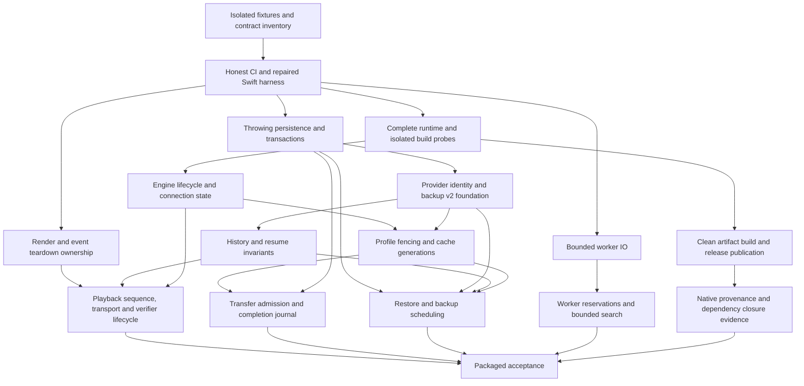

# CloudStream macOS audit remediation implementation plan

**Status: approved implementation plan, 1 October 2026. Implementation progress is tracked in [Audit-Remediation-Status.md](Audit-Remediation-Status.md).** The plan addresses all 53 findings in the [engineering audit](../audit/macos-engineering-audit-2026-10-01.md) and its cross-cutting engineering observations. It is based on the audited working tree and the current source contracts. The two existing modifications in `CloudStreamMac.xcodeproj/project.pbxproj` and `scripts/clean.sh` remain the user's work.

The implementation should repair specific invariants while retaining SwiftUI/AppKit, Observation, SwiftData, the authenticated Ktor engine, isolated extension workers, libmpv/Metal, existing direct/ffmpeg transports, extension trust/provenance and deterministic fixtures. This plan introduces small ownership/policy boundaries where the audit demonstrated a need. It does not call for a framework migration, wholesale service rewrite, visual redesign or higher deployment target.

## Preserved behavior and implementation rules

- Keep macOS 15+, arm64, Swift 6 strict concurrency and JDK 17 as the supported baseline. Choose APIs available on that baseline; newer appearance APIs are outside this remediation.
- Preserve signed and user-consented community extensions, offline installation restoration, developer-mode imports, provider settings, progressive search/link resolution, mirrors, split media, local playback, playlists, subtitles, autoplay and system media controls.
- Preserve the five watch-list states and the distinction between curated lists, favorites and playback history. Removing a title from a list must not silently erase independent user data.
- Keep library/history/playback memory private to each profile; downloads, extension installation and app settings remain shared per Mac. Profile ownership of library writes becomes explicit.
- Keep tokens/credentials in their existing ephemeral/Keychain scopes and diagnostics local. Backup files continue to exclude credentials/cookies and downloaded media paths.
- Use additive model fields with defaults where possible. Durable ID or backup-format changes require migration fixtures, recovery artifacts and explicit compatibility tests before rollout.
- Keep working code paths and pure policies. Extract responsibilities only when needed to make an ownership, validation, transaction or admission invariant testable.
- Follow [AI-POLICY.md](https://github.com/recloudstream/cloudstream/blob/master/AI-POLICY.md) for eventual code submissions: disclose AI involvement, verify changes and preserve human review. No implementation PR, commit, merge or publication is part of this planning task.

## Work ordering and dependency strategy

“Quick” means a bounded change without a persisted-schema migration, broad service split or new transport. It is not a calendar estimate. Larger work can start alongside quick fixes; **P1 does not wait behind P2/P3 polish**. The order below is a dependency graph, not a requirement to finish every item in a row before starting the next row.

| Track/order | Packages | Purpose and dependency gate |
| --- | --- | --- |
| 0. Evidence and contracts | P00, Q01 | Establish isolated tests, source baseline and honest failure propagation. Required before treating subsequent CI as proof. |
| 1. Immediate containment | Q02–Q05, R01, W01, D01 | Start all P1 fixes: packaged runtime/build isolation, native resource boundary, lock/backup/range guards, player races, blocking worker writes, truthful persistence. D02 also starts here because provider identity is P1. |
| 2. Application/engine ownership | W02, L01, D02, D03 | Capacity, serialized recovery, one application observer, stable identity and profile fencing. Requires relevant containment contracts, not completion of unrelated UI polish. |
| 3. Durable behavior and media integration | D04, D05, T01, R02, N01 | History/merge/scheduler/restore correctness, crash-consistent downloads, playback sequencing and headers, bounded payloads. Depends on ownership, identity and transactions. |
| 4. Distribution correctness | B01, B02 | Clean staging, full native closure, final publication/signing, native provenance. Start after Q01/Q02; validate the final remediated artifact after functional packages. |
| 5. Independent smaller repairs | Q06–Q08 | Retry/auth semantics, pagination/artwork/query/merge repairs, chronological logging and real smoke checks. Land early where independent; they must not delay P1 work. |
| 6. Measured consolidation and acceptance | E01, V01 | Profile large-data/idle/render behavior, remove proven obsolete paths, update acceptance documentation, run packaged-app gates. |

### Dependencies that must remain explicit

Q03/Q04/Q05/Q06/Q07/Q08/N01 have their detailed dependencies below. The graph omits independent leaves to keep it readable. “Parallel” here means independent work can be scheduled concurrently by maintainers; this plan does not create agents or chats.

## P00 — Baseline, fixtures and shared contracts

**Type/priority:** small enabling work. **Depends on:** nothing. **Supports:** all findings.

**Files/components:** [Tests](../../../client/Tests), [UITests](../../../client/UITests), [macos](../../../engine/src/test/kotlin/com/lagradost/macos), [project.yml](../../../client/project.yml), [qa-ui-checklist.md](../../qa-ui-checklist.md), the audit's source inventory and probe evidence.

**Changes:**

1. Record the commit, existing working-tree changes, compiler/runtime versions and audit reproduction inputs. Re-run the two demonstrated probes through production code as regressions rather than rewriting their faulty behavior into mock implementations.
2. Create reusable fixtures for local HTTP ranges/redirects/oversized bodies, configurable/blocked worker processes, provider-name collisions, persisted profile stores, database error injection and deterministic clocks. Expand existing fixtures where they already cover the boundary.
3. Inject a clock, process factory and narrow store/transport interfaces only into code that needs deterministic lifecycle/failure tests. Keep `.shared` facades for current call sites while adding internal/test initializers.
4. Record the existing IPC version and all planned request/response/schema changes in one compatibility checklist. Group coordinated client/daemon protocol changes into one planned version increment; do not increment for internal-only fixes.
5. Make tests use explicit temporary engine roots, preference suites, download directories and profile stores. `CS_IN_MEMORY_DB=1` alone does not isolate Keychain/UserDefaults or external processes.

**Acceptance:** the original audit source reproductions remain inspectable; each package below names an executable regression and owns its compatibility change. The initial daemon result is 295 passed/3 intentionally skipped, and the original Swift harness failure is a baseline defect, not a skipped success.

**Risk/control:** do not overwrite the user's generated Xcode project or cleanup changes. Once implementation begins, edit XcodeGen's source configuration deliberately, review generated diffs and reconcile those existing changes.

## Quick fixes and bounded containment

### Q01 — Make CI fail honestly and restore the isolated Swift test path

**Findings:** A09, A44. **Type:** quick. **Depends on:** P00.

**Files:** [macos.yml](../../../.github/workflows/ci.yml), [Makefile](../../../Makefile), [test_extensions_core.sh](../../../scripts/test_extensions_core.sh), [DaemonClient.swift](../../../client/Sources/Services/DaemonClient.swift), [MediaResolverService.swift](../../../client/Sources/Services/MediaResolverService.swift), [ExtensionPreferencesSheet.swift](../../../client/Sources/UI/Extensions/ExtensionPreferencesSheet.swift), [IPC values](../../../client/Sources/Models/IPC/). **Proposed:** proposed `client/Sources/Services/Contracts/DaemonServiceContracts.swift`.

**Exactly what changes:** explicitly run workflow pipelines under bash with `set -euo pipefail`; use a raw `tee` log plus a formatter, and preserve the upstream status. Set the Makefile recipe shell/options or capture `xcodebuild`'s status correctly instead of returning `tail`'s status. Install the formatter explicitly or remove it as a requirement. Preserve `.xcresult` and raw build/test output on success/failure.

Move `MediaResolveClient` and `ExtensionPreferencesClient` into the Foundation/DTO-only contracts file without changing their method signatures. Remove duplicate declarations from the WebKit service and SwiftUI sheet. Include that contract source in the existing isolated harness. Keep `DaemonClient` conformances and the sheet's injection unchanged; do not copy an entire UI/WebKit subsystem just to compile the transport.

**Acceptance:** an intentionally failing shell producer, compiler input and XCTest all fail CI/`make`; the isolated extension suite compiles and executes actual tests. Missing harness prerequisites fail visibly. Unit tests can run without invoking dist publication or production engine launch.

**Compatibility/risk:** no IPC or data migration. Generated project source discovery must include the moved declarations exactly once. Q01 will expose previously hidden build problems; B01 fixes those prerequisites rather than suppressing failures.

### Q02 — Correct jlink modules and isolate every build-time engine run

**Findings:** A07, A08. **Type:** quick; release-critical. **Depends on:** Q01.

**Files:** [bundle_runtime.sh](../../../scripts/bundle_runtime.sh), [Handler.kt](../../../engine/src/main/kotlin/android/os/Handler.kt), [ActivityManager.kt](../../../engine/src/main/kotlin/android/app/ActivityManager.kt), [Main.kt](../../../engine/src/main/kotlin/com/lagradost/macos/Main.kt), [ExtensionPolicy.kt](../../../engine/src/main/kotlin/com/lagradost/macos/ExtensionPolicy.kt), [CloudDirs.kt](../../../engine/src/main/kotlin/com/lagradost/macos/CloudDirs.kt), [macos.yml](../../../.github/workflows/ci.yml).

**Exactly what changes:** include `java.management` and `jdk.management` in the jlink image to preserve the shims' existing API behavior. Replace the hand-maintained forbidden-import grep with a check consistent with the image plus executable shim/runtime conformance tests. Retain checks for genuinely absent modules. Assert the bundled JVM architecture/version and exercise the actual methods in the reduced runtime, not only a full-JDK JVM.

For CDS recording, create a private temporary data root and explicitly pass `-Dcs.cloudstream.home=...`; provide deterministic launch options with safe mode and production worker isolation, or a dedicated no-extension fixture recording mode. Never inherit developer roots or permissive `CS_DAEMON_OPTIONS`. Supply the token through an isolated stdin launch contract, discover the actual ephemeral port, use fresh logs and guarantee cleanup on normal exit/failure/timeout. Keep CDS optional: failed recording must not corrupt the jar/runtime or block a usable non-CDS build. Bind CDS validity to the jar and exact JRE hash.

**Acceptance:** both shim methods work in the jlink image; invalid module references are caught; a build with sentinel files/installed hostile fixture in the normal user root never reads/modifies that root or loads that extension. Interrupted recording leaves no child process or temporary root. Measure image size and cold/warm startup against existing budgets.

**Compatibility/risk:** adding modules slightly increases bundle size; measure it rather than replacing useful Android APIs with inaccurate stubs. CDS options/settings must match launch behavior; rebuilding invalid archives is safer than reusing a stale one.

### Q03 — Enforce the remote-media boundary and lock-sensitive service entry points

**Findings:** A01, A04. **Type:** quick-to-medium containment. **Depends on:** P00; contracts from Q01 when used.

**Files:** [WorkerRuntime.kt](../../../engine/src/main/kotlin/com/lagradost/macos/worker/WorkerRuntime.kt), [Sanitizer.kt](../../../engine/src/main/kotlin/com/lagradost/macos/Sanitizer.kt), [PlayerViewModel.swift](../../../client/Sources/ViewModels/PlayerViewModel.swift), [MetalVideoView.swift](../../../client/Sources/UI/Player/MetalVideoView.swift), [DownloadPolicy.swift](../../../client/Sources/Services/Downloads/DownloadPolicy.swift), [ExternalPlayer.swift](../../../client/Sources/Services/System/ExternalPlayer.swift), [AppLock.swift](../../../client/Sources/Services/AppLock.swift), [CloudStreamMacApp.swift](../../../client/Sources/App/CloudStreamMacApp.swift), [BackupService.swift](../../../client/Sources/Services/Backup/BackupService.swift). **Proposed:** proposed `client/Sources/Services/Playback/MediaResourcePolicy.swift`.

**Exactly what changes:**

- Introduce typed provenance: provider remote HTTP(S), application-generated playlist/split plan, or explicitly authorized local file. Validate all provider URLs, playlist entries, audio, subtitles and raw trailers before constructing player requests. Require a parseable HTTP(S) URL, host, no userinfo/control characters; preserve signed URL query bytes. Reject extension-supplied `file`, raw paths, `edl`, `concat`, `subfile`, `data`, magnets and unknown schemes. Generated EDL is permitted only after each component is validated.
- Make tracking cleanup and protocol validation separate operations. Add daemon output validation as defense in depth, with typed rejected-resource errors; the native consumer remains the final boundary. Do not silently turn an invalid nested resource into a valid-looking plan.
- Reuse a consistent header validator across player/download/external launch: reject CR/LF, invalid names, NUL and prohibited connection/framing headers; preserve legitimate Referer, User-Agent, Cookie and Authorization with per-resource scope. Keep mpv argv APIs; include a positional separator for external players where supported.
- Preserve downloaded-file/drop playback through an explicit authorized local URL path, including authorized subtitle sidecars. Do not “fix” A01 by banning all local playback. For redirects/manifests, configure supported protocol restrictions in the pinned libmpv/FFmpeg builds and prove them with local fixtures; consumer validation of a starting URL alone is insufficient. If mpv cannot confine nested access, R02's narrow transport adapter is required before claiming the boundary closed.
- Disable import/export commands while locked and check the lock in `exportInteractively`, `importInteractively`, `restore` and the document-export entry point. Recheck authorization after file-panel/async suspension before reading sensitive state or mutating a profile. Return an actionable locked/cancelled outcome. Continue using the existing authenticator; no new password system.

**Acceptance:** malicious root/nested/redirect URLs and header injection never cause local file access; signed HTTP(S), generated playlists, external playback and authorized local downloads remain functional. Menu/keyboard import/export and operations that become locked mid-flow cannot bypass the lock.

**Compatibility/risk:** unusual provider protocol output must be reported as unsupported, not interpreted with native privileges. Legitimate new protocols need an explicit constrained adapter, not an expanding unrestricted allowlist. HTTP remains supported for existing providers; repositories retain their stricter HTTPS policy.

### Q04 — Validate backups before mutation and preserve unique safety snapshots

**Findings:** A10, A20. **Type:** quick containment. **Depends on:** P00; D01 later supplies fully reliable snapshots.

**Files:** [BackupDocument.swift](../../../client/Sources/Services/Backup/BackupDocument.swift), [BackupService.swift](../../../client/Sources/Services/Backup/BackupService.swift), [UserPreferences.swift](../../../client/Sources/Services/UserPreferences.swift), [BackupProfileTests.swift](../../../client/Tests/BackupProfileTests.swift).

**Exactly what changes:** introduce a `ValidatedRestorePlan`/validated preference patch prepared before any library mutation. Validate finite numeric values, supported ranges and checked integer conversion for every backed-up numeric field; use exact conversion for integer settings and reject fractional/out-of-range values with field-specific diagnostics. Apply checks to positions/durations, delays, speed, timestamps and intro intervals as well as preferences. Use each field's domain: positions/durations cannot be negative, speed must be positive, while signed subtitle/audio delays remain valid within their supported bounds. Do not blanket-reject every negative Double. Unknown preference keys remain ignored with optional warnings; known invalid keys produce a clear validation error before commit. Keep the file/record-count limits and perform validation before allocating/mutating large SwiftData graphs.

Give every automatic/safety snapshot a UUID plus high-resolution timestamp, reason and profile ID in metadata/path. Use unique-create publication rather than replacing an existing path; an atomic temp-to-final write alone is not uniqueness. Separate pre-restore safety retention from rolling daily retention. The UI continues to export only the selected profile and no media paths/secrets.

**Acceptance:** `1e100`, fractional integers, negative positions/durations, non-finite model values, invalid intervals and future/invalid versions fail recoverably without changing library/preferences; valid version-1 backups, including supported negative subtitle delays, still import. Two restores in the same minute, including different profiles, preserve both safety copies. Inject snapshot-read/write failure; Replace never proceeds without a verified recoverable snapshot.

**Compatibility/risk:** preserve documented normalization for valid inputs. Stricter semantic validation can reject malformed backups previously accepted; expose the exact field and do not partially apply a silently “repaired” document. New metadata is additive until D02 versions the format.

### Q05 — Restore direct-download integrity and route split media correctly

**Findings:** A02, A27, A28. **Type:** quick-to-medium. **Depends on:** P00, Q03 resource/header policy.

**Files:** [DirectFileJob.swift](../../../client/Sources/Services/Downloads/DirectFileJob.swift), [DownloadPolicy.swift](../../../client/Sources/Services/Downloads/DownloadPolicy.swift), [DownloadService.swift](../../../client/Sources/Services/DownloadService.swift), [DownloadReliabilityTests.swift](../../../client/Tests/DownloadReliabilityTests.swift).

**Exactly what changes:** parse all Content-Range bounds strictly and validate start/end/total/body length. A mismatched range cancels the current response, closes its writer, discards/reconciles invalid partial metadata, then performs at most one fresh request without Range. Never call `restartFromZero` and consume that same nonzero-range body. An unsolicited 206 is accepted only if it demonstrably covers the complete entity starting at zero; otherwise request a full body or fail explicitly. Ensure retry/cancellation cannot deliver a continuation twice or race two writers.

Resume only when the saved representation has a strong ETag or a usable matching date validator, sent through If-Range, and the response validates the expected range. If no trustworthy representation validator exists, restart; equal total length and mirror key are not byte identity. Reject weak/ambiguous validator responses. The existing “already full part” recovery must require validated saved metadata, not only file size.

`isDirectFile` must require no separate audio tracks. Split video/audio uses the existing ffmpeg remux implementation with per-input validated headers, preserving selected audio and optional alternate-track behavior. Do not add transcoding.

**Acceptance:** reproduce and then fix the audit's 512 KiB resume/1 MiB wrong tail; compare completed file bytes, not just returned status. Cover unsolicited/malformed/changed-total/short/oversized ranges, matching validators, changed equal-size content, pause/cancel/fresh retry and direct video plus separate audio.

**Compatibility/risk:** hosts without validators lose partial-resume optimization but retain correct downloads. Old sidecars with insufficient validators are safely restarted. Signed URL changes alone do not invalidate a matching strong entity validator. Existing HLS/DASH and format fallback stay intact.

### Q06 — Preserve retry semantics, clear credentials explicitly and merge challenge cookies

**Findings:** A33, A45, A46. **Type:** quick-to-medium. **Depends on:** Q01, Q03; coordinate IPC changes through P00.

**Files:** [DaemonClient.swift](../../../client/Sources/Services/DaemonClient.swift), [DownloadService.swift](../../../client/Sources/Services/DownloadService.swift), [ExtensionsView.swift](../../../client/Sources/UI/Extensions/ExtensionsView.swift), [ProviderCredentialStore.swift](../../../client/Sources/Services/ProviderCredentialStore.swift), [IPC values](../../../client/Sources/Models/IPC/), [ProviderOverrides.kt](../../../engine/src/main/kotlin/com/lagradost/macos/ProviderOverrides.kt), [WorkerMain.kt](../../../engine/src/main/kotlin/com/lagradost/macos/worker/WorkerMain.kt), [WorkerProtocol.kt](../../../engine/src/main/kotlin/com/lagradost/macos/worker/WorkerProtocol.kt), [Dtos.kt](../../../engine/src/main/kotlin/com/lagradost/macos/models/Dtos.kt), [SolveInterceptor.kt](../../../engine/src/main/kotlin/com/lagradost/macos/SolveInterceptor.kt), [SolveBridge.kt](../../../engine/src/main/kotlin/com/lagradost/macos/SolveBridge.kt).

**Exactly what changes:** classify `.operationFailure` using its retryable flag/code/remote status before generic `.http`, retaining the current bounded backoff and cancellation path. Capacity/timeout/worker termination/network failures retry; incompatibility/unsupported/provider-missing remain terminal. Do not infer retryability from the user-facing message.

Represent provider URL/credential patches as unchanged/set/clear. Add explicit clear flags or patch operations with legacy null = unchanged; empty strings can be normalized to clear for current clients. Validate a nonempty URL only for set. In the worker, clear must replace the live credential with empty/default state as defined by the provider, or restart the worker to restore defaults—never fall back to the old stored credential. Make remote configure failures propagate instead of returning applied=true. Keep a failed desired configuration marked unapplied and retryable, while revoking/clearing old live credentials promptly.

Coordinate Keychain and engine acknowledgement with an explicit small transaction: retain the previous Keychain value for rollback, do not report success until both stores agree, and compensate/restart if either side fails. Secret clearing takes precedence over preserving stale active credentials. Resend only committed desired values after restart.

Merge provider Cookie and solved clearance by cookie name within the exact authorized origin. Preserve unrelated login cookies, replace the relevant clearance names, reject invalid cookie bytes and do not share worker login material through a global cache. Preserve existing one-retry loop prevention. Any UA-binding improvements require evidence from an actual fixture/provider and should be separate from the proven cookie replacement fix.

**Acceptance:** actual typed 503 route responses retry; typed terminal 422 does not. Set/unchanged/clear/reset and remote/Keychain failures yield truthful outcomes. An authenticated challenged request retries with both session and clearance cookies; other workers/origins receive neither login secret.

**Compatibility/risk:** client/daemon/worker changes must ship together with the agreed protocol increment. Old backups hold no credentials and must not reset Keychain values. Provider “clear” versus “reset defaults” semantics must be documented and tested with configurable fixtures.

### Q07 — Repair small asynchronous UI and encoding defects

**Findings:** A37, A48, A49, A50. **Type:** quick. **Depends on:** P00; use D03's generation shape when available, without waiting for its broader migration.

**Files:** [DiscoverStore.swift](../../../client/Sources/ViewModels/DiscoverStore.swift), [NowPlayingService.swift](../../../client/Sources/Services/NowPlayingService.swift), [SearchSuggestionService.swift](../../../client/Sources/Services/SearchSuggestionService.swift), [LibraryDiscoveryTests.swift](../../../client/Tests/LibraryDiscoveryTests.swift), [SystemIntegrationTests.swift](../../../client/Tests/SystemIntegrationTests.swift).

**Exactly what changes:** own page-one and pagination tasks; increment a load generation on clear/provider change/refresh and check generation, provider and expected page after every await. Clear cancels both tasks and resets pagination state; only the owning task may reset its busy flag. Update `seen` on each accepted item for both shelf merge branches.

Give artwork fetches a session/URL token, cancel superseded work and validate the token after ImageCache returns. An old task must neither modify current metadata nor clear a newer task reference. Build TMDB request parameters with URLComponents/URLQueryItem; leave debounce/limits and person filtering unchanged.

**Acceptance:** late page-two/page-one responses cannot repopulate cleared or refreshed shelves; duplicate IDs are eliminated; old artwork never appears after switch/clear; `&`, `=`, `+`, `%` and Unicode search queries remain a single exact query value.

**Compatibility/risk:** no wire/schema change. Use existing homepage caching/failed-load retention only when the retained rows belong to the current provider/generation.

### Q08 — Make logs chronological and smoke verification meaningful

**Findings:** A52, A53. **Type:** quick; full smoke isolation depends on Q02/L01. **Depends on:** Q02; final process checks align with L01.

**Files:** [DaemonSupervisor.swift](../../../client/Sources/App/DaemonSupervisor.swift), [build_dev.sh](../../../scripts/build_dev.sh), [DiagnosticsExporter.swift](../../../client/Sources/Services/DiagnosticsExporter.swift), [DaemonLog.kt](../../../engine/src/main/kotlin/com/lagradost/macos/DaemonLog.kt).

**Exactly what changes:** use bounded append/rotation or one file per launch generation, mark process start/exit and explicitly own/close stdout/stderr handles after child exit. Do not mix stale tails into a new generation. Retain existing diagnostic redaction; logs must not include bearer tokens, credentials or signed-URL secrets.

The smoke run gets a temporary engine/store/preferences/download root, fresh logs and the launched app's PID. Obtain readiness from its current authenticated endpoint/generation, not grep of a historical log or broad pgrep. Kill/wait only owned processes; verify bounded clean shutdown and fail nonzero on dead app, failed health, unusable player prerequisites or remaining child. A skipped optional smoke run is distinct from a passed one.

**Acceptance:** two restarts produce ordered distinguishable logs; intentional app/engine failure and orphan fixture fail the smoke command; running another app/daemon is untouched; no production library/root is read or changed.

**Compatibility/risk:** diagnostics exporters must include the new rotated files without retaining unbounded logs. Run shell tests for failure propagation before relying on a manual smoke-launch result.

## P1 native and daemon ownership repairs

### R01 — Make player teardown and callbacks obey one ownership model

**Finding:** A03. **Type:** medium, P1; begin with immediate containment. **Depends on:** Q01/P00; independent of data migrations.

**Files:** [MetalVideoView.swift](../../../client/Sources/UI/Player/MetalVideoView.swift), [MpvPlayerView.swift](../../../client/Sources/UI/Player/MpvPlayerView.swift), [PlayerViewModel.swift](../../../client/Sources/ViewModels/PlayerViewModel.swift), [PlayerRemediationTests.swift](../../../client/Tests/PlayerRemediationTests.swift), [PlayerEngineLiveTests.swift](../../../client/Tests/PlayerEngineLiveTests.swift).

**Exactly what changes:** assign render resources—including pixel buffer pool/cache/size—to the render queue. `performShutdown` first marks the generation torn down and detaches producer callbacks under the existing guard, then enqueues destruction behind any in-flight render work. It must not clear a render-owned reference from the main/event queue. Preserve the existing GPU frame-resource retention and semaphore budget; do not free buffers before completion handlers finish.

Make `MpvEventSink` handlers main-actor owned. The drain queue may produce immutable events but may not mutate handler closures. Enqueue a generation stop/clear on the main queue in the same FIFO delivery order, and reject any later event for that generation. Do not use extra `@unchecked Sendable` annotations to conceal shared mutation. Retain the C callback's stable retained context until both callback detachment and queue draining have completed.

**Acceptance:** sanitizer-backed repeated close/reopen, mirror replacement, window close during render, queued event delivery and app shutdown produce no races, deadlocks, double destruction or stale-session UI updates. Verify callbacks detach before destroying mpv and that expensive destroy remains off the main thread.

**Compatibility/risk:** preserve existing A/V pacing, event order, frame-budget and hardware-decode/software-render fallback. Teardown queue waits must never form main→render→main cycles. Broad renderer modernization is outside R01.

### W01 — Bound worker pipe IO, cancellation and shutdown independently of writes

**Finding:** A11. **Type:** medium, P1. **Depends on:** P00; Q01 for executable regression gates.

**Files:** [WorkerClient.kt](../../../engine/src/main/kotlin/com/lagradost/macos/worker/WorkerClient.kt), [WorkerProtocol.kt](../../../engine/src/main/kotlin/com/lagradost/macos/worker/WorkerProtocol.kt), [WorkerMain.kt](../../../engine/src/main/kotlin/com/lagradost/macos/worker/WorkerMain.kt), [WorkerRuntime.kt](../../../engine/src/main/kotlin/com/lagradost/macos/worker/WorkerRuntime.kt), [WorkerIsolationTest.kt](../../../engine/src/test/kotlin/com/lagradost/macos/WorkerIsolationTest.kt).

**Exactly what changes:** arm a monotonic call deadline before enqueueing any frame; use the remaining deadline across queueing, writing and waiting. Introduce one ordered writer per process with byte-bounded outbound buffering and existing frame-size limits. A dedicated blocking writer thread alone is insufficient: timeout/force-kill must run independently, destroy the process and unblock/close IO without waiting for that writer's monitor.

CANCEL and SHUTDOWN are best-effort messages with independent escalation timers armed first. Do not synchronously send or close a stuck buffered writer before scheduling the kill. Own child pending-call/solve/media/extract jobs under a client lifecycle scope and cancel them on exit. Complete every pending request once with the actual outcome; reject sends after closing and retain typed failure codes/retryability. Apply the same send-deadline rule to worker-initiated bridge requests in `WorkerMain`.

**Acceptance:** a worker that never reads stdin and a frame large enough to fill the pipe cannot exceed the configured call deadline plus kill grace. Test queue saturation, cancellation during write, shutdown while blocked, nested bridge requests, abrupt exit and protocol corruption. Parent shutdown completes and no jobs/threads/processes remain owned indefinitely.

**Compatibility/risk:** frame format and ordering need not change. Choose outbound byte budget from existing maximum frame/call budgets and measure stress behavior; do not silently drop RESULT/CANCEL frames. Avoid killing a healthy shared startup merely because one caller cancelled; W02 owns startup deadlines separately.

### D01 — Make persistence health, transactions and failure results explicit

**Finding:** A06; foundation for A05 and all durable fixes. **Type:** medium-to-large, P1. **Depends on:** P00/Q01; can start while other P1 work runs.

**Files:** [LibraryStore.swift](../../../client/Sources/Services/LibraryStore.swift), [ProfileStore.swift](../../../client/Sources/Services/ProfileStore.swift), [BackupService.swift](../../../client/Sources/Services/Backup/BackupService.swift), [DownloadService.swift](../../../client/Sources/Services/DownloadService.swift), [PlayerViewModel.swift](../../../client/Sources/ViewModels/PlayerViewModel.swift), affected library/history/detail/download UI. **Proposed:** proposed `client/Sources/Services/Persistence/LibraryTransaction.swift`.

**Exactly what changes:** expose store health (`available`, `opening`, `failed` with a recovery action) and profile/shared-store availability separately. Fetch/export operations throw on error; empty arrays are successful empty results only. Mutation APIs return/throw explicit persistence results rather than using a log-only `save` or nil-context early return. Audit every `try?` at a correctness boundary and preserve genuinely best-effort operations with named policy.

Keep `LibraryStore` as the public facade, but run each ordinary mutation in an owned transaction/context, rollback failed changes, and publish `version`/structural updates only after successful commit. Save high-frequency playback through its existing throttled path; avoid one new context per tick and flush it before profile switch/quit. A failed progress flush remains visible/retryable rather than being declared durable.

Restore uses a dedicated context, validates reads/referential state before mutation, builds its full change set, saves once, and rolls back only its own work. SwiftData does not provide atomicity across profile/shared stores, UserDefaults and engine state: return a structured result for each phase and define compensation rather than promising a universal transaction. Backup safety export uses the same throwing snapshot boundary.

Inject container/fetch/save failure seams in tests without changing release behavior. Do not recover a failed store by silently replacing it with an empty one; expose diagnostics and a recoverable reopen/import flow.

**Acceptance:** simulated open/fetch/save failures never produce a “saved/backed up/deleted/completed” success; failed restore preserves unrelated pending work; successful changes become visible across contexts; both default/nondefault profile and shared download stores are covered. Crash/reopen tests confirm durable state.

**Compatibility/risk:** changing return types touches many callers; migrate them in a coherent branch with compilation gates. Verify SwiftData cross-context refresh on macOS 15 before moving more work off main. Preserve aggregate mutation ordering and existing progress batching; no generic repository rewrite is required.

## Application/engine ownership and durable identity

### W02 — Reserve worker capacity across startup, running and termination; bound every search path

**Finding:** A12. **Type:** medium. **Depends on:** W01; can develop concurrently behind its process ownership contract.

**Files:** [WorkerRuntime.kt](../../../engine/src/main/kotlin/com/lagradost/macos/worker/WorkerRuntime.kt), [WorkerLauncher.kt](../../../engine/src/main/kotlin/com/lagradost/macos/worker/WorkerLauncher.kt), [ProviderExecutor.kt](../../../engine/src/main/kotlin/com/lagradost/macos/ProviderExecutor.kt), [MediaRoutes.kt](../../../engine/src/main/kotlin/com/lagradost/macos/MediaRoutes.kt), [WorkerIsolationTest.kt](../../../engine/src/test/kotlin/com/lagradost/macos/WorkerIsolationTest.kt), [LinksStreamingTest.kt](../../../engine/src/test/kotlin/com/lagradost/macos/LinksStreamingTest.kt).

**Exactly what changes:** replace “count published clients” admission with an explicit pool-owned reservation for `starting`, `running`, `stopping`, `released`. Reserve before home preparation/process launch; release on every failed preparation/launch/init path and only after confirmed exit for a running process. Keep one shared startup per handle, separately deadline-bound from callers. Stopping an idle victim does not instantly create a free process slot. Track active/routed call leases so an extractor needed by a provider is not evicted as idle; preserve existing overflow capacity for nested extraction and refuse excess work with retryable capacity failures.

Apply the same search semaphore/admission helper to batch and streaming search. Hold a provider permit only for the actual operation, release in `finally`, retain progressive results and per-provider timeout, and cancel jobs when their stream client disconnects. Do not serialize all search or wait for the slowest provider before emitting results.

**Acceptance:** N concurrent cold starts cannot exceed configured base/overflow reservations; failure at each pre-launch/init boundary releases exactly once. Nested extraction works without capacity deadlock. Streaming/batch queries share the bound, emit fast results immediately and retain cancellation/timeout behavior.

**Compatibility/risk:** intentional bounded refusal is different from silently dropping a provider. Capacity accounting should count actual processes including stopping ones; use retryable errors to permit recovery. Preserve extension trust and retirement/generation semantics.

### L01 — Serialize engine lifetime and publish one generation-bound connection state

**Findings:** A13–A17. **Type:** medium-to-large. **Depends on:** Q01/Q02; coordinate process/output ownership with Q08.

**Files:** [DaemonSupervisor.swift](../../../client/Sources/App/DaemonSupervisor.swift), [CloudStreamMacApp.swift](../../../client/Sources/App/CloudStreamMacApp.swift), [AppState.swift](../../../client/Sources/ViewModels/AppState.swift), [DaemonClient.swift](../../../client/Sources/Services/DaemonClient.swift), [ExtensionsStore.swift](../../../client/Sources/ViewModels/ExtensionsStore.swift), [MediaResolverService.swift](../../../client/Sources/Services/MediaResolverService.swift), [WebViewSolverService.swift](../../../client/Sources/Services/WebViewSolverService.swift), [DownloadService.swift](../../../client/Sources/Services/DownloadService.swift). **Proposed:** proposed `client/Sources/App/EngineConnection.swift`.

**Exactly what changes:**

1. Give each engine process a launch ID and owned process/output handles. `restart` coalesces requests: request stop, wait for exit with bounded TERM/KILL escalation, retain ownership until exit, then launch the replacement. Only the current process/generation may change state. Use `Process` exit ownership for escalation rather than delayed kills of potentially reused bare PIDs. Never kill unrelated app instances via a broad “stray” pattern; establish parent/session ownership before cleanup.
2. Separate desired safe mode from the active launch snapshot. Latch it until explicit user clear, preserving managed-policy safe mode. Add capped exponential backoff with an injected clock, a retry budget and a recoverable terminal error; reset crash/backoff history only after sustained health or an explicit retry. Use monotonic time for deadlines.
3. A live but never-healthy process is subject to the same bounded recovery policy. A slowly healthy replacement is either accepted for its generation or terminated/retried; it cannot remain a running, disconnected engine forever. Stop/cancellation cannot publish a late ready/error state.
4. Start application-scoped observation once from an idempotent lifecycle coordinator, outside `WindowGroup.task`. Remove per-window cancellation/reconsumption of stored AsyncStreams. Prefer an observable current snapshot plus an explicit replayable subscription; keep separate supervisor diagnostics if useful, but derive UI/provider gates from one ordered connection reducer.
5. Model `launching → verifying endpoint/IPC → restoring providers → usable`, with disconnected/recovering/failed states. Update `DaemonClient` endpoint and verify IPC before publishing connection ready. Provider-dependent work becomes usable only after restoration reaches a valid completed state; healthy safe mode with zero loaded providers is a completed state, not endless “restoring.” Partial restore exposes provider-specific failures without blocking healthy providers forever.
6. Retry transient health/restore-watch failures within the generation. Credential resend completes/reports failures at the appropriate restore phase. Reset solve/media sessions and stale tasks on generation change; clear transport endpoint on stop. Downloads wait on a cancellable connection signal, distinguish safe-mode/provider absence from temporary restoration, and receive a finite actionable failure for unrecoverable connection state.
7. Introduce an idempotent common shutdown path: persist player state, pause/flush downloads, cancel application tasks, stop owned processes, release activities. Route normal quit, SIGTERM and SIGINT through it. Keep existing user confirmation for an ordinary quit with active downloads.
8. Preserve multiple main windows through a small per-window navigation/session state (`selection`, detail path and window sheets); keep engine/player/downloads application-scoped. Move navigation incrementally behind adapters. Do not silently remove `WindowGroup`/multiwindow functionality just to solve observer lifetime.

**Acceptance:** slow lock release, repeated crashes, safe-mode crashes, failed spawn, never-healthy/live process, late old health result, endpoint replacement, stop during startup and second-window opening produce exactly one valid current engine and connection. A restored download waits for providers and then runs; safe-mode or permanent failure yields a truthful action. Signals persist last playback position. Startup/idle budgets are measured again.

**Compatibility/risk:** existing views using `isEngineReady`/`isEngineBootstrapped` should read derived compatibility accessors while their call sites migrate. Avoid a second authoritative readiness boolean. No handshake version change for internal state alone; add fields only if current health cannot express required completion. Graceful restart must not kill independent active ffmpeg transfers unless the existing shutdown policy explicitly requires it.

### D02 — Carry stable provider identity end to end and introduce compatible backup v2

**Finding:** A05. **Type:** large, P1 migration; starts as soon as D01's reliable transactions exist. **Depends on:** D01, Q04; uses L01 generations for provider lookup/invalidation.

**Files:** [LibraryStore.swift](../../../client/Sources/Services/LibraryStore.swift), [StoredMediaItem.swift](../../../client/Sources/Models/StoredMediaItem.swift), [EpisodeProgress.swift](../../../client/Sources/Models/EpisodeProgress.swift), [TitlePlaybackPrefs.swift](../../../client/Sources/Models/TitlePlaybackPrefs.swift), [DownloadRecord.swift](../../../client/Sources/Models/DownloadRecord.swift), [IPC values](../../../client/Sources/Models/IPC/), [BackupDocument.swift](../../../client/Sources/Services/Backup/BackupDocument.swift), [DeepLinkRouter.swift](../../../client/Sources/Services/System/DeepLinkRouter.swift), [SpotlightIndexer.swift](../../../client/Sources/Services/System/SpotlightIndexer.swift), [RootView.swift](../../../client/Sources/UI/Navigation/RootView.swift), [SystemIntegration.swift](../../../client/Sources/UI/Navigation/SystemIntegration.swift), download/detail/library callers. **Proposed:** proposed `client/Sources/Services/Persistence/LibraryIdentity.swift`.

**Exactly what changes:** define one media identity helper using stable provider ID plus the original content URL, length-prefixed/hash encoded to avoid separator ambiguity. Do not normalize signed/content URL query bytes as an identity shortcut. Display names remain presentation metadata. Preserve an explicit namespace for local download entries and link them to shared DownloadRecord UUID where appropriate; do not manufacture remote provider ownership for local files.

Carry `providerId` through both `detailsPreview` constructors, context menus, save/progress/notes/rating operations, resume/detail coordinates, queued downloads, Spotlight/Handoff/deep-link activities and backup snapshots. Current name-only activity/URL payloads remain readable through unambiguous legacy resolution; new payloads include stable identity.

Add optional/defaulted migration metadata (legacy item key/identity version and resolution state) rather than renaming every SwiftData model. For a resolvable row, rekey the item and dependent EpisodeProgress/TitlePlaybackPrefs in one transaction; rewrite derived episode IDs and preserve all user fields. Record the key mapping needed by legacy activities and diagnostics. Never merge colliding provider installations because their display names match. If a legacy record has no provider ID, bind only when the saved name/source metadata resolves to exactly one installed provider. Ambiguous/unavailable records remain readable as unresolved and offer provider reassignment; do not delete them or guess during launch.

Backup v2 adds stable provider ID, optional legacy identity/source metadata, per-field update metadata and the existing `TitlePlaybackPrefs.updatedAt`. Version-1 decoding remains supported through explicit DTO adapters; export v2 once the required fields are present. New format validation must reject inconsistent duplicate identities and preserve unresolved legacy records. Defaults for old fields must not fabricate “newer” timestamps.

**Migration gate:** before durable rekey, obtain a verified full-store recovery snapshot using D01, including all profile data and shared download records where affected. A consistent closed-store/SQLite-safe snapshot is required for downgrade recovery; copying a live database without WAL coordination is not a backup. Use a dry-run key/conflict report, then an idempotent per-profile transaction and durable completion marker. Lazy migration of an unopened profile is acceptable if its data cannot be overwritten before migration; don't force all profiles open or resolve via network at launch.

**Acceptance:** two repositories/installations exposing identical name+URL remain independent through save/play/history/backup/system activities. Existing default/nondefault stores reopen without data loss. Test repeated/interrupted migration, duplicate conflicts, missing providers, v1/v2 round trips and old activity identifiers. All title fields/dependent records survive rekey.

**Compatibility/risk:** older application versions may not understand new durable keys or v2 backups. Do not claim automatic downgrade support; keep a verified pre-migration snapshot and document the rollback procedure. Version-1 backups cannot supply identity they never recorded; unresolved restoration must be truthful. Prefer additive migration on macOS 15; use a versioned schema only if fixture testing proves it necessary.

### D03 — Fence profile operations, provider caches and Spotlight by ownership

**Findings:** A18, A38, A39. **Type:** medium. **Depends on:** D01/D02 and L01; immediate capture/cancel guards can land earlier.

**Files:** [ProfileStore.swift](../../../client/Sources/Services/ProfileStore.swift), [AppLock.swift](../../../client/Sources/Services/AppLock.swift), [LibraryStore.swift](../../../client/Sources/Services/LibraryStore.swift), [EpisodeUpdateChecker.swift](../../../client/Sources/Services/EpisodeUpdateChecker.swift), [DownloadService.swift](../../../client/Sources/Services/DownloadService.swift), [AppState.swift](../../../client/Sources/ViewModels/AppState.swift), [DiscoverStore.swift](../../../client/Sources/ViewModels/DiscoverStore.swift), [SpotlightIndexer.swift](../../../client/Sources/Services/System/SpotlightIndexer.swift), [ProviderCredentialStore.swift](../../../client/Sources/Services/ProviderCredentialStore.swift).

**Exactly what changes:** define a `ProfileOperationContext` with profile ID, generation and owned repository/store reference. Capture value snapshots rather than passing managed SwiftData objects across awaits. Resume, episode checks, restore/import, export, and profile-attributed download library writes validate the context and lock before/after each suspension. Switching profiles first invalidates/cancels outgoing work, flushes progress, closes playback, then activates the next store and reindexes. Invalidated late work cannot start a player or mutate the newly active store.

For shared downloads, record the initiating profile ID as optional/defaulted metadata when the user enqueues; completion writes the optional library entry to that profile's owned repository, not whichever profile is open. Do not switch the visible active store to do background writes. If the originating profile is gone/unavailable, keep the shared completed download and report that library insertion could not occur. Legacy queue items with no owner remain shared and require an explicit add-to-current-library action rather than guessing ownership at completion.

Add provider/engine configuration generation and freshness to details/discovery cache entries. Invalidate on restart, extension generation replacement, URL/credential changes, enable state changes and explicit refresh. Preserve offline snapshots as clearly stale display data; revalidate playable details before launch when needed. Use a small predictable LRU/freshness policy instead of arbitrary dictionary trimming.

Serialize Spotlight deletion/indexing for a captured profile generation. After every await recheck profile generation and enabled state. Mark successful version only after completion; retain retryable failures and cancel/invalidate when disabled or switching. Keep only the active profile's intended index and never allow an older indexing task to reinsert items after `removeAll`.

**Acceptance:** delayed resume/check/restore/index operations from A cannot affect B. Locking during a pending resume does not start playback. A download completing while B is selected remains shared but files into A only if authorized/available. Cache hits are invalidated by provider generation/configuration; late old Spotlight inserts and failure-cached-success cannot occur.

**Compatibility/risk:** no profile ID is added to every library model—the separate-store design remains. Download ownership is an additive field and does not make downloads private. Treat background profile operations and profile deletion as mutually coordinated, and preserve custom per-show preferences.

## Durable behavior and media integration

### D04 — Unify movie/episode history, migration markers and resume identity

**Findings:** A22, A23, A24, A26. **Type:** medium. **Depends on:** D01/D02; profile async call sites align with D03.

**Files:** [EpisodeProgress.swift](../../../client/Sources/Models/EpisodeProgress.swift), [StoredMediaItem.swift](../../../client/Sources/Models/StoredMediaItem.swift), [TitlePlaybackPrefs.swift](../../../client/Sources/Models/TitlePlaybackPrefs.swift), [LibraryStore.swift](../../../client/Sources/Services/LibraryStore.swift), [PlaybackPolicies.swift](../../../client/Sources/Services/PlaybackPolicies.swift), [HistoryView.swift](../../../client/Sources/UI/History/HistoryView.swift), [MediaDetailView.swift](../../../client/Sources/UI/Details/MediaDetailView.swift), [SettingsView.swift](../../../client/Sources/UI/Settings/SettingsView.swift), [WatchHistoryTests.swift](../../../client/Tests/WatchHistoryTests.swift), [LibraryAndUrlTests.swift](../../../client/Tests/LibraryAndUrlTests.swift).

**Exactly what changes:** extend the existing progress/history model with defaulted playback-kind/edition metadata; retain the model rather than replacing the database. Use a stable movie progress key derived from the media item identity, independent of a rotating `movieData` URL. Record movie position/duration and include it in title/time stats; keep “episodes watched” an episode-only statistic. The History read model supplies the proper movie/episode label, resume payload and item reference.

Make the legacy history backfill a versioned, once-per-profile migration whose marker is committed with its writes. An empty history after user deletion never reruns it. Migrate existing movie resume positions once without double counting. Deleting a history record updates the matching denormalized current resume pointer in the same transaction; recompute from the latest remaining valid row or clear it when none remains. Do not clear a newer different episode's resume pointer when deleting an old row.

Resume first matches exact episode data/identity. Only then use a separate non-nil season+episode fallback constrained by selected audio/edition. If a series episode is unavailable, surface selection/reload rather than passing nil into a movie path. Use the common playback sequence in R02. Switching episodes resets stale duration/coordinates rather than retaining an unrelated episode's values until a new duration arrives.

Keep aggregate deletion semantics explicit: removing watch-list status leaves favorites, notes, ratings, history and learned playback settings intact. Physically delete a title only when no retained dependent data requires it. Existing operations that truly forget/delete an aggregate remove its dependents transactionally. Validate imported references; preserve recoverable legacy orphan data with a warning instead of silently pruning it. Use explicit aggregate operations initially; introducing SwiftData cascade relationships is unnecessary unless they improve the verified migration path.

**Acceptance:** movie-only history/stats/privacy clear works; deletion of the last row followed by reopening does not resurrect it; deleting an old row preserves the latest resume; exact data beats nil-coordinate candidates and dub/sub alternatives. List removal preserves independent data, and backups/stats do not contain unexplained hidden orphans.

**Compatibility/risk:** default old rows to episode kind, preserve existing IDs until D02's controlled rekey, and adapt v1 backup history accordingly. History semantics are corrected; watched thresholds and curated status promotion remain unchanged unless a test reveals an audited defect.

### D05 — Complete restore, chronological merge, per-profile daily backups and Android import

**Findings:** A19, A21, A25, A51. **Type:** medium-to-large. **Depends on:** Q04/Q06, D01–D04 and L01 usable-provider state.

**Files:** [BackupService.swift](../../../client/Sources/Services/Backup/BackupService.swift), [BackupDocument.swift](../../../client/Sources/Services/Backup/BackupDocument.swift), [AndroidBackupImporter.swift](../../../client/Sources/Services/Backup/AndroidBackupImporter.swift), [LibraryStore.swift](../../../client/Sources/Services/LibraryStore.swift), [UserPreferences.swift](../../../client/Sources/Services/UserPreferences.swift), [ProfileStore.swift](../../../client/Sources/Services/ProfileStore.swift), [StoredMediaItem.swift](../../../client/Sources/Models/StoredMediaItem.swift), [TitlePlaybackPrefs.swift](../../../client/Sources/Models/TitlePlaybackPrefs.swift), [SettingsView.swift](../../../client/Sources/UI/Settings/SettingsView.swift), [DaemonClient.swift](../../../client/Sources/Services/DaemonClient.swift), [RepositoryService.kt](../../../engine/src/main/kotlin/com/lagradost/macos/RepositoryService.kt), [ExtensionRoutes.kt](../../../engine/src/main/kotlin/com/lagradost/macos/ExtensionRoutes.kt), both DTO files, [0012-backup-format.md](../../adr/0012-backup-format.md).

**Exactly what changes:**

- Preserve the one-time `/repos/import` migration. Add a separate ordinary idempotent repository registration/import endpoint that validates policy/HTTPS/limits and returns applied/already-present/rejected per URL, without automatically syncing, installing or granting community consent. Backup restore uses this endpoint; migration markers remain untouched. Preserve trust anchors/proofs only through their authorized existing lifecycle, never by accepting arbitrary backup trust claims.
- Export disabled providers by stable provider IDs, not display names or extension-level enable inference. Restore after provider readiness, retain v1 name-only entries as unambiguous legacy matches, and return per-provider outcomes. Do not use `try?` to erase failed operations.
- Stage a validated restore plan and safety snapshot, atomically commit the owned library transaction, then apply preferences and engine setup with separate result/warning fields. Use exact desired profile ownership throughout. Retry failed external phases idempotently without replacing the library again or overwriting the original safety copy. Do not advertise all-or-nothing across unrelated stores.
- Advance item modification metadata for notes, rating, list status and favorite mutations, including explicit clears. Add optional per-field timestamps where title-level playback updates would otherwise overwrite user edits. In v2 merge, apply newer fields including note=nil, rating=0 and favorite=false. Include existing playback `updatedAt` in snapshots and apply only newer settings. Use a deterministic documented equal-timestamp rule that preserves local values and reports conflict where required.
- Version-1 data cannot distinguish all missing/cleared fields or carry playback timestamps. Adapt it conservatively: absent/unversioned fields do not erase newer local values in Merge; Replace applies the validated snapshot as requested. Make this distinction explicit in the restore summary rather than fabricating timestamps from import time.
- Schedule due checks during application lifetime with an injected clock/background task and on launch/profile activation/wake. Backups must not depend on engine availability: snapshot profile data when due, include cached extension configuration with its freshness status, and never label missing engine setup as a complete configuration snapshot. Track `lastSuccessfulAutoBackup` per profile, with global settings still shared. Preserve at least the configured rolling history per profile; keep safety snapshots in their separate retention policy. Back up due inactive profiles through owned read repositories when permitted; do not swap the visible profile to access them. Coalesce a scheduled check and manual restore snapshot safely.
- Preserve Android account identity through parsing. Offer “all accounts” or a selected account at import; default all accounts to retain existing functionality. Convert each account separately, then resolve same-title conflicts using meaningful source timestamps and explicit conservative unions where timestamps are absent. Resume ID lookup uses account+numeric ID. Present unresolved conflicts/counts instead of relying on dictionary order.

**Acceptance:** repeated restores add missing repositories after normal bootstrap; policy rejection/disabled-provider failure appear as warnings; no consent is invented. Older merge cannot replace newer note/rating/playback settings, newer explicit clears work, and equal timestamps are deterministic. A long-running app backs up daily; every profile has independent coverage/retention. Android conflicting same-ID accounts retain inspectable data and deterministic outcomes.

**Compatibility/risk:** coordinate IPC endpoint/DTO additions; the client and bundled daemon ship together. New backup exports are v2 and old imports stay supported. Shared preferences are restored only when selected. Background backups of locked profiles are internal protection, not permission for user-visible export or another profile to inspect them; implement access capabilities accordingly.

### T01 — Centralize transfer admission and journal download finalization/deletion

**Findings:** A29, A30, A31. **Type:** medium-to-large. **Depends on:** Q05/Q06, D01/D03, L01. **Uses:** N01 bounded sidecars.

**Files:** [DownloadService.swift](../../../client/Sources/Services/DownloadService.swift), [FFmpegJob.swift](../../../client/Sources/Services/Downloads/FFmpegJob.swift), [DirectFileJob.swift](../../../client/Sources/Services/Downloads/DirectFileJob.swift), [DownloadPolicy.swift](../../../client/Sources/Services/Downloads/DownloadPolicy.swift), [DownloadRecord.swift](../../../client/Sources/Models/DownloadRecord.swift), [LibraryStore.swift](../../../client/Sources/Services/LibraryStore.swift), [DownloadsView.swift](../../../client/Sources/UI/Downloads/DownloadsView.swift), [DownloadReliabilityTests.swift](../../../client/Tests/DownloadReliabilityTests.swift). **Proposed:** proposed `client/Sources/Services/Downloads/DownloadScheduler.swift`.

**Exactly what changes:** retain DownloadService as the facade, extracting an admission/state policy rather than the whole service. All transitions into resolving/transferring/resuming acquire an owned global/per-provider lease. A suspended ffmpeg process may remain alive but cannot receive SIGCONT until it reacquires admission and the network is online. Separate user pause, network hold, queued-resume intent and transfer state; preserve paused jobs across relaunch. After link resolution returns, recheck network/profile/generation/admission before starting IO. Account for cancellation/exit before releasing or replacing a lease.

Add defaulted durable finalization metadata (planned final path, finalizing phase, byte count and validated representation/checksum when available). Preserve existing status numeric values; append a finalizing enum value rather than renumbering old ones. Persist the finalization intent before rename; if that save fails, keep the recoverable part and report persistence failure. Rename in the same filesystem, commit durable completed-video state immediately afterward, then perform bounded best-effort sidecars as a separate enrichment phase. Notification/library insertion follows committed completion. Sidecar failure must not turn a saved playable video into an unrecorded transfer.

On launch reconcile finalizing records, original parts, metadata and planned final paths. A matching final file becomes completed without redownload; a recoverable part continues; absence/conflict produces an explicit failure. Never overwrite another item's file. This also covers a crash between rename and completion save; do not delete resume metadata until reconciliation is safe.

Deletion returns a structured result. Persist an owned deletion-intent journal before touching the file; if that persistence fails, leave the file/record intact. Remove a record only after the video deletion succeeds or the user explicitly chooses to forget an already missing file. Report sidecar-specific failures and retain retry information. If file deletion succeeds but the final database commit fails, the already-durable deletion intent remains available for reconciliation; do not assume a new journal save will succeed after a database failure. Reconcile/retry without silently recreating or losing metadata. Treat unplugged volume as unavailable, not definitely absent.

**Acceptance:** pause three/start three/resume three never exceeds a limit of three; offline/manual resume and resolution completion respect the hold. Crash injection at every journal/save/rename/sidecar boundary is recoverable without duplicates. Read-only/unplugged volumes and failed database commits yield truthful deletion/completion states. Shared downloads retain access and intended profile library ownership.

**Compatibility/risk:** default old records to existing queued/completed behavior and preserve statuses/paths. Finalization adds a durable state—test downgrade/import behavior and do not rely on older clients to understand it. A file and SwiftData record cannot be committed atomically; the journal explicitly repairs that gap.

### N01 — Bound poster/subtitle network and decode memory

**Finding:** A32. **Type:** medium containment; may land before T01. **Depends on:** Q03; uses Q01 tests.

**Files:** [PosterImage.swift](../../../client/Sources/UI/Components/PosterImage.swift), [DownloadService.swift](../../../client/Sources/Services/DownloadService.swift), [AppCaches.swift](../../../client/Sources/Services/AppCaches.swift), relevant poster/download tests. **Proposed:** proposed `client/Sources/Services/BoundedHTTPResourceLoader.swift`.

**Exactly what changes:** replace full-body collection with a byte-budgeted stream/delegate loader that checks both Content-Length and actual received/decoded bytes, follows only authorized HTTP(S) redirects and cancels promptly at the cap. Retain the existing 5 MiB subtitle limit and enforce it during receipt. Introduce a named/configurable image response budget (initially 32 MiB) plus decode pixel/dimension checks before allocating a full image; downsample large valid backdrops to a bounded display rendition using ImageIO. Initial limits are testable implementation defaults, not a claim about all real providers; tune from measured valid fixture/corpus coverage.

Bound concurrent loads, in-flight cache work and disk retention. Include relevant headers/resource provenance in cache request identity, avoiding accidental cross-credential reuse for the same URL. Reject non-success responses/type mismatches; propagate a recoverable unavailable-image/subtitle result. A failed optional poster or sidecar does not fail playback or completed video.

**Acceptance:** oversized declared, chunked, compressed and slow bodies are stopped before exceeding budget; high-dimension small compressed images do not cause a decode allocation spike. Normal artwork/subtitles/backdrops, shared in-flight deduplication and cache clearing remain functional. Measure peak memory under simultaneous loads.

**Compatibility/risk:** caps may reject unusually large valid artwork; downsampling should preserve visible quality and diagnostics should distinguish budget rejection from ordinary offline absence. Never log authorization headers or raw signed URLs when rejecting a resource.

### R02 — Preserve playback sequence, resource headers, error feedback and keepalive lifetime

**Findings:** A34, A35, A36, A47. **Type:** medium-to-large. **Depends on:** R01, Q03/Q06, D02/D04, L01. **N01:** supplies shared bounded resource policy where needed.

**Files:** [MediaDetailView.swift](../../../client/Sources/UI/Details/MediaDetailView.swift), [PlayerViewModel.swift](../../../client/Sources/ViewModels/PlayerViewModel.swift), [PlaybackPolicies.swift](../../../client/Sources/Services/PlaybackPolicies.swift), [MetalVideoView.swift](../../../client/Sources/UI/Player/MetalVideoView.swift), [MpvPlayerView.swift](../../../client/Sources/UI/Player/MpvPlayerView.swift), [DaemonClient.swift](../../../client/Sources/Services/DaemonClient.swift), [VerifierJobs.kt](../../../engine/src/main/kotlin/com/lagradost/macos/VerifierJobs.kt), [MediaRoutes.kt](../../../engine/src/main/kotlin/com/lagradost/macos/MediaRoutes.kt), existing player/audio/policy/remediation tests. **Proposed:** proposed `client/Sources/Services/Playback/MediaLoadPlan.swift`.

**Exactly what changes:** put ordered episodes/edition in a value `PlaybackSequence` shared by details, resume and player session. It keeps exact identities, selected sub/dub and season/episode ordering with stable provider order for missing coordinates. Neighbors, autoplay, Up Next and prefetch use that sequence. Preserve user selection of an alternate edition rather than forcing a global setting after playback begins; cancel/recreate countdown/prefetch on session/sequence replacement.

Represent each video/audio/subtitle/playlist resource with its own validated URL/headers. Preserve the working EDL merge for same-header split streams. For different per-audio headers, perform a focused capability test against the pinned libmpv: use supported per-resource options only if fixtures prove header isolation, seek and A/V behavior. The plan's fallback is a **narrow session-scoped HTTP transport adapter**, not a player replacement or transcoder. Prefer the existing authenticated Ktor listener over a new server/dependency; register only validated HTTP(S) resources under opaque expiring IDs, stream bounded bytes, support Range/206/HEAD, apply each resource's headers to its own origin, and revoke on session close. No general URL-forwarding endpoint or filesystem proxy is allowed. If needed, keep this adapter as a separate subpackage/review with coordinated DTO/IPC changes. Do not claim split-header support resolved until seek/auth fixtures pass.

Deliver a typed player event envelope keyed by engine/session/load/command IDs. Report mpv create/initialize/render/shader failures and async command replies into the view model. Clear pending seek reconciliation on a rejected seek; show screenshot success only after a successful command and verified output. Define a startup/loading deadline that respects existing stream/network timeouts and declared buffering state, then fail over or show a recoverable error. Use immutable drain events and R01's FIFO ownership.

Start the existing extractor verifier for the active link's source/extractorData and stop it on mirror switch, session close, generation change and failed load. Fence its async start: if an old start returns a job ID, stop it immediately instead of attaching it to the new session. Treat unavailable capacity/transient verifier failure according to a visible retry policy and the daemon's lifetime cap; trailers/non-verifier links remain unaffected.

**Acceptance:** next/previous/prefetch/autoplay match the chosen details order/edition. Split streams requiring different cookies/referrers play with correct audio, seeking and header isolation. Forced initialization/command failures reach UI and recover without permanent loading; screenshot/seek notices are truthful. A fixture whose link requires verifier polling survives playback and releases its job on every exit path.

**Compatibility/risk:** the transport adapter is conditional on measured pinned-engine capability and is the largest optional addition. Isolate it behind the existing load-plan interface. Preserve local playback, playlist quoting, progressive links/subtitles, mirrors, track preferences, clocks, full screen and current render fallback. Neither a new renderer nor blanket global headers is an acceptable shortcut.

## Distribution and dependency work

### B01 — Build a clean artifact and publish it once, after verification

**Findings:** A40–A43. **Type:** larger build/release change; start preparation early. **Depends on:** Q01, Q02. **Release gate:** all applicable functional packages and V01. B01 first creates a private signed/verified candidate; V01 tests that candidate before the publisher exposes it. This separates artifact construction from publication and avoids a circular dependency.

**Files:** [macos.yml](../../../.github/workflows/ci.yml), [project.yml](../../../client/project.yml), [project.pbxproj](../../../client/CloudStreamMac.xcodeproj/project.pbxproj), [build_dev.sh](../../../scripts/build_dev.sh), [package_app.sh](../../../scripts/package_app.sh), [bundle_media.sh](../../../scripts/bundle_media.sh), [build_media_stack.sh](../../../scripts/build_media_stack.sh), `build_mpv_metal.sh` (since removed), `build_slim_ffmpeg.sh` (since removed), [check_min_os.sh](../../../scripts/check_min_os.sh), [CloudStreamMac.entitlements](../../../client/CloudStreamMac.entitlements), [java.entitlements](../../../client/java.entitlements). **Proposed:** proposed `scripts/publish_artifact.sh`. Build metadata remains `BUILD_INFO.json`, generated into the distribution rather than maintained as source.

**Exactly what changes:**

1. Make fresh-checkout CI explicitly prepare the daemon, jlink runtime and pinned media stack before Xcode builds. Cache using source/dependency versions, architecture, deployment target, patches and build flags; verify a cache hit against that manifest. Never accept stale staged resources as proof that prerequisites exist. Use a macOS/arm64 runner and Xcode capable of building **and executing** the macOS 15 target; assert `sw_vers`, architecture and SDK/tool versions. Select the available runner at implementation time instead of hard-coding a speculative hosted-runner label or lowering the product deployment target.
2. Stage each build in a fresh private directory. Resolve native dependencies recursively, including `@rpath`, `@loader_path`, `@executable_path` and relative paths, using each binary's actual load commands and runpaths. Exclude verified system libraries; copy every other resolved dependency into the app's closure, normalize install names/runpaths and re-inspect. Fail on a missing dependency, failed rewrite or unexpected outside-bundle reference. Do not suppress `install_name_tool` errors with `|| true`; test whether an existing runpath already satisfies the requirement. Check architecture and minimum macOS for **every** nested Mach-O, then probe the packaged `java`, `ffmpeg` and libmpv entry points. Preserve the development Homebrew override where explicitly supported, but prohibit it in distributable releases unless its entire closure passes the same minimum-OS contract.
3. Remove dist publication from Xcode's post-build phase. Limit that phase to deterministic work inside its own product, such as the Frameworks symlink, and ensure it runs before final signing. Prepare daemon/media/runtime inputs through one explicit prerequisite path used by both CLI and Xcode. Xcode may retain a checked prerequisite phase for developer convenience, but it must not silently rebuild unrelated components or mutate shared dist/resources during concurrent builds.
4. Give `build_dev.sh` and `package_app.sh` one publisher. Write the final app, DMG and metadata into a private generation, verify them, then place it under `dist/generations/<buildID>` and atomically replace the relative `dist/current` symlink using a rename operation. Keep stable compatibility links such as `dist/CloudStream.app`, `CloudStream.dmg` and `BUILD_INFO.json` pointing through `current`; update script consumers to resolve one generation once for each operation, so a concurrent publication cannot mix files during verification/launch. Preserve the last good generation on failure. Prevent concurrent publishers with a bounded build/publish lock; don't put the long compilation behind a global app runtime lock. The release workflow consumes the path returned by packaging, consistently under `dist`, instead of assuming a different output directory. Metadata includes commit/dirty state, architecture, minimum OS, daemon/runtime/media hashes, signing mode and final artifact hashes.
5. Separate an explicit unsigned development mode from a signed distribution mode. The latter must fail early if the actual signing identity or notarization credentials cannot be used. Provision an ephemeral CI keychain and import the certificate/private key; install the notary credential profile, then delete that keychain in cleanup. Setting an identity/profile string alone is insufficient. Keep secrets out of command output and artifacts.
6. Rewrite/load-command edits precede signing. Enumerate nested executable code once, sign libraries/tools and Java with the existing required Java entitlements, then sign the outer app last. Verify each nested signature and the outer bundle. Preserve the current DMG notarization flow where only the DMG is published; require successful submission, stapling and validation before publication. If also publishing a standalone app for offline installation, notarize/staple that app before capturing it into its final DMG, then notarize/staple the DMG. Do not change a signed app after copying it into a public artifact. Gatekeeper/minimum-OS launch checks apply to the artifact that is actually delivered.

**Acceptance:** a clean checkout builds with caches disabled; a missing media prerequisite, unresolved relative dylib, newer minimum-OS dependency, failed rewrite, absent certificate or rejected notarization fails visibly. No pre-sign app appears in dist. Concurrent builds cannot mix jar/JRE/media generations. A failed release leaves the previous published artifact intact. The published app works from a moved/quarantined location without Homebrew or the source checkout, on the minimum supported OS and a current supported OS.

**Compatibility/risk:** this affects developer workflow, CI time and cache size. Keep fast incremental development preparation as an explicit mode. Preserve the existing arm64 delivery and entitlement requirements; do not add universal binaries, new targets or broad sandbox permissions. Reconcile the user's existing project/clean-script edits before regeneration. Signing/notarization tests require provisioned release credentials and actual machines; a dry run cannot certify them.

### B02 — Make the shipped dependency graph reproducible and inspectable

**Scope:** dependency/provenance observations in the audit; supports A07/A40/A42. **Type:** medium build maintenance. **Depends on:** Q02, B01's manifest/closure work.

**Files:** [build.gradle.kts](../../../engine/build.gradle.kts), [libs.versions.toml](../../../gradle/libs.versions.toml), [bundle_runtime.sh](../../../scripts/bundle_runtime.sh), [build_media_stack.sh](../../../scripts/build_media_stack.sh), `build_mpv_metal.sh` (since removed), `build_slim_ffmpeg.sh` (since removed), [bundle_media.sh](../../../scripts/bundle_media.sh), existing daemon SBOM generation and extension-runtime tests, [Architecture.md](../../Architecture.md).

**Exactly what changes:** align declared OkHttp/DoH coordinates with the **actually resolved** compatible version graph; the audited daemon declared OkHttp 4.12.0 while resolving the 5.3.2 JVM line through DoH. Use one version source and dependency constraints/lock verification, then run the existing NewPipe/provider/header/TLS fixtures. Do not downgrade the graph merely to match an old declaration or upgrade every dependency as part of remediation. Make the intended version explicit and prove the API behavior.

Record source archive URLs, exact versions/commits, checksums, patches, compiler flags, licenses and minimum-OS settings for libmpv, ffmpeg and their non-system dependency closure. Include bundled OpenJDK provenance and modules in the artifact inventory, beside the daemon SBOM. Prefer reproducible pinned sources over whatever a packaging machine currently has installed. License/compliance reporting describes the actual included build/features; do not infer it from an unused upstream option.

Validate the fat-jar assembly rules against the resolved graph. The audit found no duplicate `META-INF/services` providers in the current classpath; do **not** add a speculative service-file rewrite. Add a merge strategy only when a fixture demonstrates a real collision or missing provider, preserving all providers and signatures appropriately. Run version-specific advisory/license checks against the final inventory and triage concrete results; the audit did not establish a CVE finding.

**Acceptance:** rebuilds with the same manifest resolve the same jars/native sources and produce explainable artifact hashes; the inventory covers every bundled non-system binary. Intentional version drift fails a manifest/lock check. Existing resolver, HTTP, DNS/TLS and extension conformance tests pass.

**Compatibility/risk:** avoid changing the Android application's shared dependency behavior unintentionally. Prefer daemon-local constraints unless a repository-wide catalog adjustment has explicit compatibility coverage. Byte-for-byte reproducibility may require normalizing timestamps/toolchain inputs; document residual nondeterminism instead of promising it without measurement.

## Measured consolidation and final acceptance

### E01 — Reduce maintenance cost only where measurements and callers justify it

**Scope:** cross-cutting engineering observations; not a wholesale rewrite. **Type:** medium, follow-through. **Depends on:** D01–D05, L01, T01, R01/R02 and B01 where relevant.

**Files/components:** [CloudStreamMacApp.swift](../../../client/Sources/App/CloudStreamMacApp.swift), [DaemonSupervisor.swift](../../../client/Sources/App/DaemonSupervisor.swift), [LibraryStore.swift](../../../client/Sources/Services/LibraryStore.swift), [DownloadService.swift](../../../client/Sources/Services/DownloadService.swift), [AppState.swift](../../../client/Sources/ViewModels/AppState.swift), [PlayerViewModel.swift](../../../client/Sources/ViewModels/PlayerViewModel.swift), [MetalVideoView.swift](../../../client/Sources/UI/Player/MetalVideoView.swift), [PlayerHUDView.swift](../../../client/Sources/UI/Player/PlayerHUDView.swift), [PlayerWindowController.swift](../../../client/Sources/UI/Player/PlayerWindowController.swift), existing library/search/download view models and tests, [scripts](../../../scripts), [docs](../..).

**Exactly what changes:**

- Keep current public facades; route their work through the small boundaries established above: library transactions/profile context, connection state, worker reservations, download admission and playback load plans. Move methods only when the separation owns real mutable state or allows failure injection. Do not mechanically split every large file or replace Observation with another state framework. Eliminate duplicate state booleans only when a single enum/state transition now expresses the same behavior.
- Profile launch, library operations and import/merge with representative 1,000/10,000-title and large-history fixtures. D01's transaction ownership must not cause repeated full-store fetches or one context/save per playback tick. Use bounded batches, cached immutable read models and owned background model contexts where measurements identify main-thread work. Preserve ordering, filtering, profile isolation and cancellation. Do not cross actor/context boundaries with live SwiftData model objects.
- Measure idle CPU/wakeups, engine polling and retained tasks. Scope app activity assertions to active playback/download or an operation that needs them. An idle daemon alone must not keep the entire app permanently out of App Nap. Prefer current event signals and demand-aware/backed-off polling; a new websocket/event protocol is unnecessary unless measurements show those cannot meet readiness/recovery requirements.
- Retain the existing software renderer fallback and documented fidelity limits. Measure dropped frames, GPU/CPU, render-pool residency and resize/close behavior with R01's changes. Verify the audit's SDR/downscaling tradeoff against actual output and document it accurately. A new HDR/EDR/4K renderer is a separate feature decision, not an automatic remediation rewrite; any later change needs reference media, color/energy measurements and a preserved fallback.
- Clamp player-window geometry to the current screen's usable bounds while preserving aspect ratio. Extend existing geometry tests with extreme aspect ratios, narrow/multi-display screens and restore-on-disconnected-display cases. Run keyboard/focus/VoiceOver, Reduce Motion, Reduce Transparency, light/dark and scale-factor checks for modified HUD/error/status flows. Use system controls/materials already compatible with macOS 15; no visual restyle is required.
- After a caller census (`rg`, build phases, workflow references and documented commands), remove only obsolete build/diagnostic helpers or merge identical policies with identical semantics. Android compatibility shims, protocol adapters and extension behavior are not “unused” merely because Swift has no direct caller. Keep audit evidence/history; mark outdated plans as superseded rather than erasing them.
- Update [README.md](../../../README.md), [Architecture.md](../../Architecture.md), [Implementation.md](Implementation.md), [ipc-api.md](../../ipc-api.md), [qa-ui-checklist.md](../../qa-ui-checklist.md) and affected ADRs. Describe actual ownership, readiness, persistence failure policy, backup v2/migration/merge semantics and final artifact provenance. Keep operator-facing errors actionable and secret-free; avoid exposing implementation vocabulary in product UI.

**Acceptance:** measurements before/after explain every performance/energy change; startup and playback stay within the existing Rules budgets or a documented, reviewed exception. No regression in large-library interaction or frame pacing. Removed helpers have no remaining consumers. Documentation and fixtures agree on the final contracts.

**Compatibility/risk:** performance tuning can obscure correctness and cancellation bugs. Land it after the relevant invariant is tested, and reject optimizations that break profile or transaction ownership. Accessibility fixes must retain all keyboard operations and existing preferences.

### V01 — Accept the packaged product, not just passing units

**Type:** required completion gate. **Depends on:** all applicable packages. **Files:** [Tests](../../../client/Tests), [UITests](../../../client/UITests), [macos](../../../engine/src/test/kotlin/com/lagradost/macos), [test_extensions_core.sh](../../../scripts/test_extensions_core.sh), [build_dev.sh](../../../scripts/build_dev.sh), [qa-ui-checklist.md](../../qa-ui-checklist.md), [macos.yml](../../../.github/workflows/ci.yml).

Run these gates on the implemented branch, with an explicit report of executed/skipped checks:

| Gate | Required evidence |
| --- | --- |
| Compilation and isolated units | Swift harness executes; Swift strict-concurrency and Xcode app/unit/UI targets compile; daemon tests pass; intentional CI/build failures return nonzero. |
| Packaged runtime and IPC | jlink shim methods work; worker blocked-write/cancellation/reservation limits pass; repeated abnormal shutdown/restart never creates competing root-lock owners; startup/restore timeout and safe mode produce actionable states. |
| Native lifetime and network boundary | Stress playback/resize/close with Thread Sanitizer and memory tooling where supported; invalid remote/nested schemes and framing fail; authorized local playback remains; redirect/playlist behavior is proven on the pinned libmpv or constrained by the adapter. |
| Storage and migration | Read/save failure injection; old-store fixtures, provider-name collisions, interrupted rekeys and repeated migrations; v1/v2 backups; explicit note/rating/favorite clearing and profile switching; no fabricated success or silent empty-store replacement. |
| Downloads and recovery | Range/validator fixtures, split-audio remux, offline/resume/admission, finalization crash points, unplugged/deletion failures, background owner-profile insertion, bounded image/subtitle payloads. |
| Product behavior | Movies/episodes/history/resume/sub-dub sequencing; mirrors/verifier; lock-sensitive menu/service operations; multiwindow streams; credentials clear/retry/cookies; search/artwork stale work; Spotlight fencing; backup cadence and Android multi-account conflict reports. |
| Distribution | Fresh build with cache disabled; complete dylib/JRE inventory and minimum-OS checks; actual final signatures/notarization; moved/quarantined app on supported machines; honest smoke PID/endpoint/failure assertions. |
| User experience and resource budget | Existing launch/size budgets, large-library responsiveness, idle energy, playback/frame pacing, accessibility/focus and geometry checks; diagnostics/log chronology/redaction. |

Use deterministic injected failures for races and persistence rather than waiting for a real disk failure. Force-terminate at each completion/migration journal boundary and reopen the **same test store**. Loopback fixtures cover correctness without public-provider flakiness; separately run a small authorized live-provider matrix for compatibility. Network/provider failure must remain distinguishable from an app regression.

The previous audit's 295 daemon passes/3 skips and individual probes are **baseline evidence only**. Full Xcode/native playback, signed/notarized distribution, minimum-OS launch and live-provider behavior were not established by the audit; they must be executed for implementation acceptance. This planning task does not reclassify them as passed.

Close a finding only when its stated regression/acceptance condition passes on the final code and required compatibility evidence exists. Keep any external-machine/credential gate explicitly pending. A capability spike, visible warning or passing mock alone does not close the underlying issue. Do not call the entire audit resolved while A01's native confinement, A05's old data, A06's save failures or release verification remains unproven.

## Compatibility and rollback register

| Boundary | Planned change | Compatibility/rollback requirement |
| --- | --- | --- |
| Client ↔ bundled daemon/worker | Typed configuration clear semantics, optional repository-registration operation, any chosen media adapter/verifier changes | Version coordinated request/response changes together; handshake rejects incompatible engines. Keep internal ownership fixes version-neutral. Bundle the matching jar/JRE/client as one verified generation; never fall back to an arbitrary daemon. Document unsupported mixed versions. |
| SwiftData profile stores | Defaults for identity/history/origin/finalization fields; controlled durable-key rekey | Test real old fixtures and interruption. Snapshot the complete store before irreversible key changes; transaction plus idempotent migration marker. Rollback uses a known compatible pre-migration store/app pair, never an old binary over a partly migrated store. Do not copy a live SQLite file without its WAL/snapshot semantics. |
| Shared download store | Optional owning-profile and finalization fields, new status values | Preserve existing status raw values; append new ones and default old records safely. Missing origin is an explicit legacy case. Preserve files across migration; recover from journal before cleanup. |
| Backup documents | v2 provider identity and per-field clear/timestamp semantics | Read v1; write v2 after migration. Missing legacy identity/timestamps stay unresolved/conservative, not guessed. Reject unsupported future versions before side effects. Older apps may not import v2; say so and retain verified v1 recovery artifacts. |
| History and list behavior | Movie history, durable backfill marker, exact edition identity, dependent-data retention | Additive behavior with explicit filtering/statistics; user-deleted history stays deleted. List removal preserves independent history/notes/favorites. Legacy ambiguous items stay available for reassignment. |
| Credentials and provider settings | Explicit unchanged/set/clear, live-state acknowledgment, cookie merge | Never put secrets in backups/diagnostics. Preserve existing non-cleared settings and legitimate request headers. Compensate failed updates honestly; test legacy requests if supported by handshake policy. |
| Remote/local media | Validated provenance and bounded native transport | Signed URL bytes and permitted headers retain semantics. App-authorized local files remain usable. Scheme/redirect confinement may reject previously accepted unsafe resources; that is the audited correction. Compatibility exceptions cannot reopen arbitrary filesystem/native protocols. |
| Release artifacts | One clean stage and final publisher | Developer unsigned mode remains explicit. Last good artifact remains available on failure. Reproducibility/provenance replaces machine-local staging, without changing deployment target or platform architecture. |

Each implementing change records its affected boundary, migration fixture, rollback limits and acceptance result in the PR. Use the repository's review/AI disclosure policy. No new user confirmation flow is needed for ordinary implementation choices; irreversible release publication remains a separate authorized action outside this plan.

## Suggested implementation slices

Keep each slice independently reviewable. These are a practical grouping, not a demand for one PR per package. Do not combine all migrations and all runtime changes into one PR.

| Slice | Work | Completion criterion before dependent work lands |
| --- | --- | --- |
| 1 | P00 + Q01 | Repaired harness and failure propagation; fixture seams without behavior rewrite. |
| 2 | Q02 | Reduced-runtime conformance and isolated build recording pass. |
| 3 | Q03 native/lock validation + Q04 backup scalar/safety-name guards | Entry-point regression coverage; record native confinement capability outcome. |
| 4 | Q05 | Strict range/resume/remux tests through actual transports. |
| 5 | R01 and W01 as separate ownership changes | Render lifetime and blocked-write stress tests pass; no unchecked concurrency masking. |
| 6 | D01 | Read/save/export errors and transaction visibility are truthful; persistent failure fixtures pass. |
| 7 | W02 + L01, sequenced within the slice | Reservations first; serialized engine recovery and app-scoped subscriptions next. |
| 8 | D02 | Controlled ID migration and v2 foundation pass old/collision/interrupted fixtures. |
| 9 | D03, then D04 | Profile fences/cache/Spotlight, followed by history/resume semantics on stable IDs. |
| 10 | Q06 and D05 as separately reviewed changes | Auth acknowledgment/cookie behavior before external restore phases; backup/import merge and scheduling pass. |
| 11 | T01 + N01 as separate changes | Admission/journal recovery and bounded body consumption pass. |
| 12 | R02, with optional transport adapter isolated | Sequence/error/verifier fixes; split-header and native confinement capability evidence resolves required fallback. |
| 13 | Q07 + Q08 | Small UI/query fixes and honest diagnostics/smoke assertions. May land much earlier when independent. |
| 14 | B01 + B02 | Fresh final artifact, coherent hashes/signatures and complete native inventory. Prepare this track earlier; final QA uses the completed app. |
| 15 | E01 + V01 | Measured cleanup/documentation and complete packaged acceptance with honest remaining gates. |

If sequencing capacity is constrained, prioritize slices 1–6 plus D02's P1 identity migration over polishing search/artwork. Begin B01 infrastructure preparation early because CI cannot validate native behavior until the media/JRE prerequisites are correct. No calendar estimate is implied: D02/D05/T01/R02/B01 carry migration/lifetime/artifact risk and should receive deeper review than a query-encoding change.

## Finding-to-work traceability

Every audit finding has one primary implementation owner below. Cross-package dependencies are specified in each package; secondary validation does not replace primary ownership. The companion [CSV](../audit/macos-remediation-traceability.csv) can be imported into a tracker without changing this repository.

| Finding | Priority | Primary package | Audit issue |
| --- | --- | --- | --- |
| A01 | P1 | Q03 | Worker-provided URLs are not restricted before native playback |
| A02 | P1 | Q05 | A mismatched HTTP 206 response is saved as a complete video |
| A03 | P1 | R01 | Native-player teardown contains two unsynchronized shared-state races |
| A04 | P1 | Q03 | File-menu backup commands bypass the application lock |
| A05 | P1 | D02 | Stable provider identity is lost in the library and backup pipeline |
| A06 | P1 | D01 | SwiftData failures are converted into empty data or apparently successful mutations |
| A07 | P1 | Q02 | The bundled JRE cannot support APIs used by the Android shims, and CI rejects those references |
| A08 | P1 | Q02 | Runtime packaging starts an engine against the developer's real data in in-process mode |
| A09 | P1 | Q01 | CI and `make test-client` can report success after `xcodebuild` fails |
| A10 | P1 | Q04 | A syntactically valid backup preference can trap the application after library restore |
| A11 | P1 | W01 | Worker IPC writes can block before deadlines and before forced shutdown are armed |
| A12 | P2 | W02 | Worker startup reservations and streaming-search bounds are ineffective |
| A13 | P2 | L01 | Restart spawns the replacement before the previous engine releases its data lock |
| A14 | P2 | L01 | Crash recovery has no backoff and can turn safe mode off on the next crash |
| A15 | P2 | L01 | A live engine that misses the startup deadline is left permanently unmanaged for health recovery |
| A16 | P2 | L01 | “Ready” and “bootstrapped” can become true before the client or providers are usable |
| A17 | P2 | L01 | Opening another main window can break the singleton engine observation |
| A18 | P2 | D03 | Profile switches do not cancel or fence profile-specific asynchronous work |
| A19 | P2 | D05 | Backup repository restore calls an API that intentionally stops working after one migration |
| A20 | P2 | Q04 | Safety backups overwrite each other within the same minute |
| A21 | P2 | D05 | “Automatically every day” means only “when the engine bootstraps,” with one clock for all profiles |
| A22 | P2 | D04 | Movie playback is omitted from history and watch statistics |
| A23 | P2 | D04 | Deleted history can reappear, and its Continue Watching position is retained |
| A24 | P2 | D04 | Continue Watching can resume the wrong episode |
| A25 | P2 | D05 | Backup merge does not implement consistent “newer wins” semantics |
| A26 | P2 | D04 | Deleting library items leaves unowned history and playback-preference records |
| A27 | P2 | Q05 | Direct resume without a validator can splice different files of identical length |
| A28 | P2 | Q05 | Direct video downloads omit separate audio tracks |
| A29 | P2 | T01 | Resuming frozen ffmpeg jobs bypasses concurrency and offline admission |
| A30 | P2 | T01 | Download completion is not crash-consistent across rename, subtitles and database state |
| A31 | P2 | T01 | Failed file deletion still removes the download's records |
| A32 | P2 | N01 | Poster and subtitle downloads buffer unbounded remote bodies in the main process |
| A33 | P2 | Q06 | Clearing provider credentials does not clear credentials in an already running provider |
| A34 | P2 | R02 | Native next/previous and autoplay do not use the selected episode order |
| A35 | P2 | R02 | Split-stream playback discards per-audio request headers |
| A36 | P2 | R02 | Player initialization and asynchronous command failures do not reliably reach the player state machine |
| A37 | P2 | Q07 | Discover pagination can append stale results after refresh or provider clearing |
| A38 | P2 | D03 | Cached details survive provider/engine configuration changes indefinitely |
| A39 | P2 | D03 | Spotlight can retain stale profile items and suppress retries after failure |
| A40 | P2 | B01 | The fresh-checkout client CI job does not stage its required native dependencies |
| A41 | P2 | B01 | Release publication points to the wrong DMG and does not provision signing credentials |
| A42 | P2 | B01 | Media staging does not prove dependency closure and accepts stale resources |
| A43 | P2 | B01 | Multiple build paths publish a mutable distribution app before final verification |
| A44 | P2 | Q01 | The isolated Swift test harness is broken and the key integration boundaries lack demonstrated coverage |
| A45 | P2 | Q06 | Download resolution ignores the daemon's typed retryable failures |
| A46 | P2 | Q06 | Anti-bot retries replace the provider's login cookies |
| A47 | P2 | R02 | Playback never starts the implemented extractor keepalive verifier |
| A48 | P3 | Q07 | Now Playing artwork can be applied to the wrong session |
| A49 | P3 | Q07 | Search suggestions incorrectly encode query parameter values |
| A50 | P3 | Q07 | Discover's existing-shelf merge does not deduplicate within the incoming page |
| A51 | P3 | D05 | Android backup import drops account identity before resolving conflicts |
| A52 | P3 | Q08 | The development smoke check reports failures without failing |
| A53 | P3 | Q08 | Supervisor logs overwrite old prefixes and can retain misleading stale tails |

## Definition of completion

All 53 findings have an implementation result and the associated acceptance evidence, or an explicitly named external/capability gate remains pending. The final source, runtime, migrated stores, backup format and shipped artifact agree on their contracts. Existing behavior is preserved except for the unsafe or incorrect behavior identified in the audit. All source changes are reviewable, documented and disclosed according to the repository policy; no speculative framework or UI rewrite is bundled into remediation.
