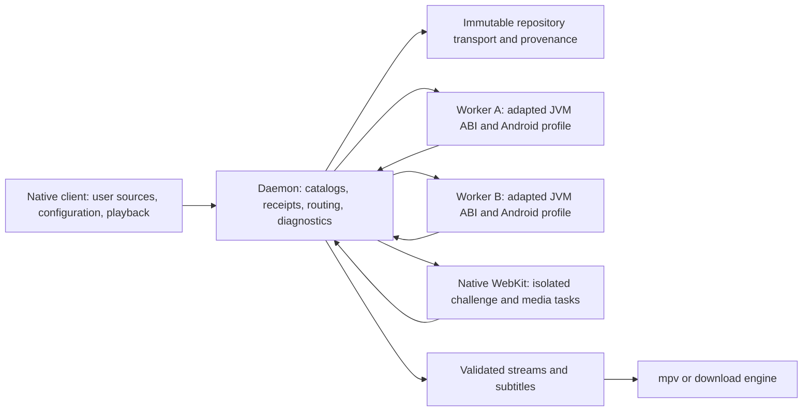
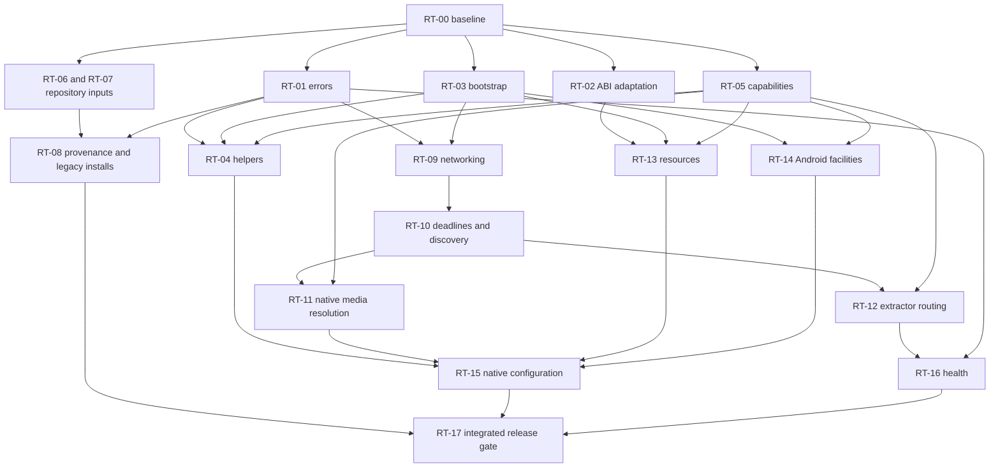

# CloudStream macOS extension runtime implementation plan

**Prepared:** 1 October 2026, Asia/Kolkata. **Status:** proposed implementation; no runtime fixes are claimed. **Baseline:** local commit `de03bd9e7c34aa61fd0a11a491cfbb528f7efcbd`, daemon 1.2.0, IPC 4, state schema 2. **Scope:** all fifteen findings in the [runtime audit](../audit/extension-runtime-2026-10-01/REPORT.md), including the Android compatibility follow-up.

The objective is a native extension system in which users choose repositories, legacy community catalogs can be installed under truthful consent and provenance rules, supported extensions execute the host APIs they were compiled against, and failures remain identifiable through installation, search, details, extraction, and playback.

The immediate priority is fixing the host method/class and worker initialization failures that generate local 502s. Repository compatibility, JavaScript resolution, Android resources/settings, and extractor routing follow with separate acceptance gates. A repository being reachable, an extension registering, or a unit suite passing will not count as playback verification.

## 1. Relationship to the existing remediation work

This is an incremental implementation plan. The earlier [Extensions-Remediation-Plan](Extensions-Remediation-Plan.md) and [remediation ledger](../audit/extensions-repository/REMEDIATION.md) remain historical records of the repository/state/isolation work. Their older finding numbers refer to a different audit; this document uses task IDs `RT-00`–`RT-17` and current findings `F01`–`F15` from the runtime audit only.

Retain the implemented `InstallationManager`, transactional generation changes, repository-scoped IDs, verified cache bytes, installation receipts, staged registration, background restore, worker isolation, cancellation, safe mode, and Swift generation guards. Extend these mechanisms rather than adding a second installation path or returning to executing community extensions in the control daemon.

The old T6 compatibility completion and D4 resource rejection are insufficient for the current scope. Supported preference/encoding descriptors stay supported; Kotlin ABI adaptation, app-level helper APIs, worker initialization, resource functionality, and settings availability require additional work. The old mandatory-publisher-digest decision is replaced by the proposed legacy community policy below; that replacement requires an explicit schema/proof implementation, not removal of one guard.

The [source snapshot](../audit/extension-runtime-2026-10-01/source-snapshot.json), [catalog evidence](../audit/extension-runtime-2026-10-01/catalog-results.json), and [28-check Android follow-up](../audit/extension-runtime-2026-10-01/android-probe-results.json) define the starting evidence. They are not a release compatibility certification.

## 2. Implementation decisions

These are the recommended choices for delivering the user's requested compatibility. This planning document does not apply them to production state.

| Decision | Planned behavior | Consequence |
| --- | --- | --- |
| Repository ownership | Fresh installs start with an empty repository set. Remove CNC and other compiled recommendations, source aliases, and source-specific URL overrides. Preserve repositories already chosen by users. | Users select their sources; maintenance does not substitute a different source behind their input. |
| Legacy community catalogs | Allow unsigned, hashless catalogs after per-repository consent and applicable policy checks. Compute and record the downloaded artifact's hash locally. | Ecosystem compatibility improves; local byte identity is displayed separately from publisher verification. |
| Stronger verification | If a publisher digest or valid signed chain exists, require it to verify. A malformed signature or mismatched declared digest never falls back to legacy mode. | Compatibility support preserves existing verification guarantees. |
| Execution model | Keep one sandboxed worker per extension. Implement helper APIs and cross-worker capabilities through bounded host contracts. | A compatibility fix does not remove isolation or execute third-party callbacks in the control plane. |
| Android support | Implement a named, tested compatibility profile for scraper-critical APIs, resources, and audited settings flows. Classify optional UI separately from required startup behavior. | Missing required functionality stays open work; an empty class or clearer rejection does not close a compatibility finding. |
| Browser resolution | Use native WebKit for challenge and JavaScript resolution through separate typed operations. Prove media-request capture before selecting the interception design. | A cookie solver alone cannot count as a media resolver. |
| Health | Report registration, worker lifecycle, compatibility assessment, and dated operation results independently. | “Running” no longer implies that details or playback was tested. |
| Versioning | Coordinate the breaking client/daemon contracts as IPC 5; explicitly version worker protocol, runtime profile, and installation proof. Migrate state 2 to 3 for new receipt authority. | Stale client/daemon combinations are detected; old signed/community receipts can be restored safely. |

Record these choices in the new runtime-compatibility and repository-provenance ADRs before their dependent code lands. Any alternative must still satisfy the task's acceptance criteria; keeping all hashless catalogs blocked does not close F04 for the requested broad community compatibility.

## 3. Target architecture and contracts



### 3.1 Operation errors

Introduce a common serializable failure record and typed success/partial/failure results. Proposed fields:

```text
OperationFailure {
  code, stage, installationId?, providerId?, requestId,
  retryable, publicMessage, redactedCause?, remoteStatus?, elapsedMs
}
OperationResult<T> = success(T) | partial(T, failures) | failure(OperationFailure)
```

Stages cover catalog fetch, artifact fetch, translation, initialization, configuration, search, home, details, challenge, media resolution, extraction, and media HTTP. Codes distinguish runtime incompatibility, unsupported capability, timeout, worker termination, challenge failure, provider-returned-no-data, repository policy/integrity failures, and remote HTTP failures.

For IPC 5, local runtime incompatibility/unsupported capability should return a typed 422; exhausted operation deadlines return typed 504; actual upstream HTTP failures retain their remote status in the error record and use the documented gateway mapping. Cancellation propagates as cancellation and does not become an empty result. Publish one explicit streaming terminal result, including partial failures when usable links were emitted. Preserve the Swift client's ability to begin playback progressively.

Search/home aggregation retains results from successful providers while reporting which providers failed. Empty successful searches remain distinguishable from failed searches. Diagnostics retain a request correlation ID without storing title query strings, signed media tokens, credentials, or cookie headers.

### 3.2 Artifact provenance and receipts

Keep `TrustTier` for repository trust and add an explicit artifact verification mode rather than inventing a locally verified publisher:

| Repository/artifact condition | Artifact mode | Required evidence |
| --- | --- | --- |
| Valid signed catalog chain and bound artifact digest | `signed_catalog` | Current signing authority plus accepted exact catalog/list evidence and matching bytes |
| Consented unsigned catalog with publisher digest | `publisher_digest` | Exact accepted list entry, consent, and matching publisher digest |
| Consented unsigned catalog without publisher digest | `local_observation` | Exact accepted list entry, consent, resolved artifact identity, and the locally observed digest |
| Explicit local developer import | Existing developer authority | Explicit import and exact local bytes; existing developer-mode policy still applies |

Receipts continue to contain `artifactHash` for the actual bytes. Add verification mode, optional `publisherHash`, proof format version, and observation/acceptance evidence. `record.metadata` remains the authoritative original catalog entry: do not fill a missing `fileHash` and then pretend it came from the publisher.

For hashless artifacts, use a unique bounded temporary download, compute the digest, and publish content-addressed bytes atomically before preparing the candidate generation. Bind the receipt to the accepted entry and observed hash. A restart verifies those same bytes against the observation proof; a later download from the same URL is a new candidate and cannot inherit the old hash blindly.

### 3.3 Runtime and capabilities

Introduce one worker-local `ProviderRuntimeBootstrap`, a versioned `HostAbiRegistry`, and a capability report. Required startup symbols, dynamically reached provider symbols, resource features, and optional UI dependencies have different classifications. Static scanning is evidence, not a complete reachability proof. Ambiguous optional references produce a warning, while an actual unresolved required call produces a structured compatibility error.

Bootstrap binds installation-scoped context and preferences, applies immutable network configuration, initializes NewPipe and helper bridges, then loads the extension. Process-global state is initialized separately in every worker; callbacks and pending tasks are released when its generation retires.

### 3.4 Browser and extractor operations

Browser operations carry installation/generation ownership, parent request ID, deadline, URL/method/headers/body, requested capture behavior, and bounded returned request/script data. Closure callbacks remain in the worker; only callback events and decisions cross IPC.

Extractor routing uses descriptors and generation handles independent of provider descriptors. A worker can ask the host to dispatch a URL to another eligible extractor, while that extractor executes only inside its owning worker. Host routing tracks visited extractors and depth, excludes the current path from recursion, and reapplies output validation. Credentials, preference files, and clearance cookies remain installation-scoped.

## 4. Phases, dependencies, and effort

Effort ranges are engineering days for someone familiar with Kotlin/JVM, Swift/WebKit, and this repository. They include task-local tests; release integration is RT-17. They are planning estimates, not delivery commitments. Resource parsing and WebKit capture must be re-estimated after their initial spikes.

| Phase | Tasks | Exit gate |
| --- | --- | --- |
| P0 — Baseline and contract | RT-00, RT-01, RT-05 | Reproducible supported/unsupported fixtures; typed failures and explicit capability vocabulary |
| P1 — Host runtime | RT-02, RT-03, RT-04 | Kotlin method adaptation and helpers work in real workers; startup and details fixtures succeed |
| P2 — Repositories and networking | RT-06, RT-07, RT-08, RT-09, RT-10 | User-owned sources, legacy installs, restore/update proofs, consistent DNS, and coherent deadlines |
| P3 — Extraction | RT-11, RT-12 | JavaScript-only media and cross-worker/lazy extractors resolve through the native path |
| P4 — Android facilities and configuration | RT-13, RT-14, RT-15 | Functional supported resources/scheduling/settings; required capabilities do not fail behind placeholders |
| P5 — Health and release | RT-16, RT-17 | Honest status, packaged end-to-end checks, migrations, and dated compatibility results |

Phases describe milestones, not an instruction to serialize every task. Repository removal/parser changes can start after P0 while runtime work proceeds. Resource and WebKit spikes should start early enough to expose architectural limits before release planning.



| ID | Work item | Dependencies | Owner role | Effort |
| --- | --- | --- | --- | ---: |
| RT-00 | Baseline fixtures and Swift harness | None | Test/runtime | 1–2 |
| RT-01 | Preserve structured failures through every layer | RT-00 | Kotlin + Swift | 3–5 |
| RT-02 | Descriptor-aware DEX/JVM adaptation | RT-00 | JVM compatibility | 3–6 |
| RT-03 | Shared worker-local bootstrap | RT-00 | Kotlin runtime | 1–2 |
| RT-04 | Functional CloudflareKiller and DataStore adapters | RT-01, RT-03, RT-05 | Kotlin compatibility | 4–7 |
| RT-05 | Versioned capability inventory and assessment | RT-00 | JVM compatibility | 2–3 |
| RT-06 | Remove compiled source choices, preserve user state | RT-00 | Swift + repository | 1–2 |
| RT-07 | Generic Android-compatible shortcode parsing | RT-00 | Repository | 1–2 |
| RT-08 | Legacy hashless provenance and migration | RT-01, RT-06, RT-07 | State/trust | 5–8 |
| RT-09 | Apply consistent network policy | RT-01, RT-03 | Kotlin networking | 2–4 |
| RT-10 | Shared budgets and bounded discovery | RT-01, RT-09 | Kotlin networking | 2–4 |
| RT-11 | Native JavaScript media resolver | RT-01, RT-03, RT-05, RT-09, RT-10 | Swift WebKit + Kotlin | 8–15 |
| RT-12 | Extractor descriptors and cross-worker routing | RT-01, RT-03, RT-05, RT-10 | Kotlin runtime | 5–9 |
| RT-13 | Real extension assets and resource access | RT-02, RT-03, RT-05 | JVM/resource compatibility | 8–15 |
| RT-14 | Android scheduling/context facilities | RT-03, RT-05 | JVM compatibility | 4–7 |
| RT-15 | Support missing configuration for extensions we use (conditional) | RT-01, RT-04, RT-05, RT-11, RT-13, RT-14 | Swift + compatibility | Estimate per confirmed gap |
| RT-16 | Accurate lifecycle and operation health | RT-01, RT-05, RT-12 | Kotlin + Swift | 2–4 |
| RT-17 | Packaged verification and release rollout | RT-01–RT-16 | Release/test | 5–8 |

Historical total planning effort before narrowing RT-15: **63–115 engineering days**, approximately **13–23 working weeks for one engineer**. With three complementary engineers, the original **8–12 week** calendar envelope was subject to spikes and integration. RT-15 is now conditional and must be estimated against a confirmed configuration gap in an extension we use, rather than treated as a blanket settings project. These estimates cover the named compatibility profile and audited flows; arbitrary Android activities/layouts are not silently included in that estimate. If an affected extension requires additional facilities, add its work and tests to RT-13–RT-15 before declaring the issue closed.

## 5. Detailed implementation tasks

### RT-00 — Freeze reproducible evidence and repair the test harness

**Findings:** F12; enables every fix.

**Existing seams:** [test_extensions_core.sh](../../../scripts/test_extensions_core.sh), [PluginBridgeTest](../../../engine/src/test/kotlin/com/lagradost/macos/PluginBridgeTest.kt), [AndroidStubConformanceTest](../../../engine/src/test/kotlin/com/lagradost/macos/AndroidStubConformanceTest.kt), and the [audit probe sources](../audit/extension-runtime-2026-10-01/README.md).

1. Add the actual managed-policy/crash-loop sources to the Swift helper's source inventory. Move `ExtensionVersion` from the view file to a shared model utility so app and helper compile the same declaration.
2. Add Kotlin-compiled Android DEX fixtures for `Result`, suspend/default/value-class calls, helper initialization, resources, scheduling, settings, and extractor-only plugins. Retain the current Java fixtures for isolation/lifecycle coverage.
3. Compile relevant conformance fixtures against the pinned Android API JAR, not only the daemon stubs. Pin Kotlin, d8, SDK API, fixture source, and expected host profile. Record a repeatable rebuild command.
4. Keep original negative characterization probes as evidence. Add positive regression tests to the normal source set as fixes land; do not keep tests expecting the original defect as proof of remediation.
5. Use isolated homes, fake signed/unsigned catalogs, deterministic media pages, and local synthetic media. Keep optional live tests separate and never reset production extension state to run a test.

**Done when:** the repository Swift helper passes all existing extension tests; the broken baseline Kotlin fixture demonstrates the audited method mismatch; the fixture set builds reproducibly and the runtime fixtures run in actual worker processes.

### RT-01 — Preserve operation failures through worker, daemon, and client

**Finding:** F06. **Dependencies:** RT-00.

**Existing seams:** [ProviderExecutor](../../../engine/src/main/kotlin/com/lagradost/macos/ProviderExecutor.kt), [WorkerProtocol](../../../engine/src/main/kotlin/com/lagradost/macos/worker/WorkerProtocol.kt), [WorkerMain](../../../engine/src/main/kotlin/com/lagradost/macos/worker/WorkerMain.kt), [WorkerRuntime](../../../engine/src/main/kotlin/com/lagradost/macos/worker/WorkerRuntime.kt), [MediaRoutes](../../../engine/src/main/kotlin/com/lagradost/macos/MediaRoutes.kt), [DaemonClient](../../../client/Sources/Services/DaemonClient.swift), and [PlayerViewModel](../../../client/Sources/ViewModels/PlayerViewModel.swift).

1. Implement the result/error contract in section 3.1 and classify linkage failures, unsupported APIs, timeouts, worker exits, remote HTTP errors, and genuine no-data returns.
2. Replace exception-to-null/empty conversion in executor operations. Propagate causes through details/search payloads and worker ERROR/RESULT frames. Preserve aggregation and partial-link behavior explicitly.
3. Update `/details`, `/links`, `/links/stream`, search/home, and `/extract` routes. SSE-like streams emit link/subtitle events, optional failure records, and exactly one terminal status; an exception with zero links is not a successful empty completion.
4. Decode typed errors in Swift and show a stage-specific message with provider identity. Separate retryable site/network errors from deterministic compatibility failures; keep useful partial streams playable.
5. Coordinate IPC 5 in both health DTOs, client validation, worker handshake, documentation, and tests. Attach correlation IDs to local redacted diagnostics.

**Tests:** missing method/class → typed compatibility failure; remote 502 → remote status preserved; timeout → 504; cancellation → no false failure; partial links plus exception → playable partial result and recorded failure; empty normal search → success with no matches; broken search → failure; worker crash → owning generation only.

**Done when:** a harmless broken provider reaches the UI with its actual category and stage; all errors survive both in-process and real-worker paths; the original local generic-502/empty-200 probes have positive replacements.

### RT-02 — Adapt DEX host symbols to the JVM ABI

**Finding:** F01. **Dependencies:** RT-00.

**Existing seams:** [PluginBridge.translate](../../../engine/src/main/kotlin/com/lagradost/macos/PluginBridge.kt:143), [VerifiedClassLoader](../../../engine/src/main/kotlin/com/lagradost/macos/VerifiedClassLoader.kt), and [exact method evidence](../audit/extension-runtime-2026-10-01/host-method-results.txt).

1. Build a versioned host symbol index from packaged class definitions: owner, member name, descriptor, static/interface kind, and visibility.
2. Insert an ASM adaptation pass after dex2jar and before reproducible ZIP normalization/hashing. Seed an exact mapping for demonstrated `kotlin.Result` underscore names to JVM hyphen names. A mapping requires matching owner/descriptor and an unambiguous host target.
3. Handle relevant method instructions, method handles, and bootstrap references consistently. Scan translated plugin-owned definitions/value-class calls as well as host references; any necessary plugin-owned mapping must preserve definitions and every use together.
4. Do not globally replace underscores. Reject ambiguous host mappings and report the unresolved symbol. Verify output classes against the packaged host ABI and bytecode verifier.
5. Bump `TRANSLATION_PROFILE`, include adapter/host-profile identity in translation cache keys, and update receipt JAR hashes through transactional prepare. Never alter the verified source artifact.

**Tests:** compiled Kotlin `Result` success/failure, boxing/unboxing, suspend functions, default parameters, value classes, intentional underscore methods, multidex, interface/static invocation, and cache migration. Run tests on the bundled JRE, not solely the development JDK.

**Done when:** all demonstrated cached `Result` references resolve; the positive Kotlin fixture executes search/details/links in a real worker; old cached translations cannot be reused under the new profile.

### RT-03 — Initialize each worker's provider environment

**Findings:** F03 and part of F15. **Dependencies:** RT-00.

**Existing seams:** [Main](../../../engine/src/main/kotlin/com/lagradost/macos/Main.kt), [WorkerMain.init](../../../engine/src/main/kotlin/com/lagradost/macos/worker/WorkerMain.kt:146), [NewPipeBridge](../../../engine/src/main/kotlin/com/lagradost/macos/NewPipeBridge.kt), [CloudStreamApp](../../../engine/src/main/kotlin/com/lagradost/cloudstream3/CloudStreamApp.kt), and [ContextHelper.jvm](../../../library/src/main/kotlin/com/lagradost/api/ContextHelper.jvm.kt).

1. Introduce a shared bootstrap called before provider/plugin execution in both execution modes. Bind the worker's installation context to the app shim and functional platform context holder.
2. Apply network configuration, initialize `NewPipe.init(NewPipeBridge(...))`, set challenge/media callbacks, then run entry construction/load and provider overrides. Make initialization idempotent for a process/profile.
3. Give NewPipe an intentionally configured client rather than an unrelated default OkHttp instance. Clear appropriate caches when network configuration changes.
4. Define bootstrap teardown on generation retirement, worker shutdown, and initialization failure. Do not leak callback/context state into another in-process test installation.

**Tests:** fresh worker initialized without starting the control daemon's provider runtime; YouTube/NewPipe fixture sees a downloader; context setter/getter round-trip; two installations have distinct preferences; teardown and restart reinitialize correctly.

**Done when:** official YouTube operations no longer fail because of an uninitialized downloader, and worker initialization depends on no singleton previously initialized in the parent process.

### RT-04 — Supply functional CloudflareKiller and DataStore contracts

**Findings:** F02 and F13. **Dependencies:** RT-01, RT-03, RT-05.

**Existing seams:** [upstream CloudflareKiller](https://github.com/recloudstream/cloudstream/blob/master/app/src/main/java/com/lagradost/cloudstream3/network/CloudflareKiller.kt), [upstream DataStore](https://github.com/recloudstream/cloudstream/blob/master/app/src/main/java/com/lagradost/cloudstream3/utils/DataStore.kt), [SolveInterceptor](../../../engine/src/main/kotlin/com/lagradost/macos/SolveInterceptor.kt), [SolveBridge](../../../engine/src/main/kotlin/com/lagradost/macos/SolveBridge.kt), and [FileSharedPreferences](../../../engine/src/main/kotlin/android/content/FileSharedPreferences.kt).

1. Add the expected fully qualified JVM helper classes in the macOS compatibility layer without importing the Android app module wholesale. Match constructors, companion/object fields, public methods, and generated descriptors actually referenced by the artifact set.
2. Implement `CloudflareKiller` using the existing worker-owned native challenge service. Preserve original method/URL/body/headers, merge scoped cookies correctly, return the WebView user agent used to obtain them, close superseded responses, and bound retries. Prevent global interceptor/adapter recursion.
3. Preserve required `savedCookies`, cookie parsing/header APIs, and lifecycle behavior. Constructor cleanup must not clear another extension's native cookie store. Surface challenge failure through RT-01.
4. Implement `DataStore` preference access and key/folder operations against the installation context. Preserve JSON serialization/default semantics used by inlined Kotlin helpers, and distinguish app settings from extension preference names.
5. Replace relevant volatile shim storage with durable namespaced behavior where the upstream contract persists values. Existing credentials remain protected by the native credential path; never introduce an unscoped plaintext secret store for new native configuration.

**Tests:** compile against Android helper APIs; constructor/companion/member descriptor checks; challenged request retry with matching user agent/cookies and no cross-installation leakage; cancellation; persistent `DataStore` reads after worker restart; two installations with the same keys; CineStream-like initialization before first provider registration.

**Done when:** the cached helper symbols resolve and harmless helper-dependent DEX fixtures initialize and operate in real workers. Validate the affected live extensions in RT-17; a no-op class is not acceptance.

### RT-05 — Make the supported capability profile explicit

**Findings:** F01, F02, F13–F15. **Dependencies:** RT-00.

**Existing seams:** [PluginBridge.prepare](../../../engine/src/main/kotlin/com/lagradost/macos/PluginBridge.kt:75), [InitResult](../../../engine/src/main/kotlin/com/lagradost/macos/worker/WorkerProtocol.kt:102), and [expanded ABI scan](../audit/extension-runtime-2026-10-01/android-abi-results.json).

1. Publish a runtime profile version and an ABI/capability inventory for Android storage, app helpers, scheduling, resources, media resolution, settings, and external actions.
2. Turn the static scanner into a reusable compatibility assessment inside the sandboxed preparation worker. Inspect definitions, references, descriptors, field kinds, signatures, and multidex dependencies without executing code in the control plane.
3. Add capability assessment metadata to INIT and installed diagnostics. Record required/optional/unknown evidence and unsupported method names. Read declared API metadata where present; do not invent compatibility guarantees from a missing version field.
4. Avoid rejecting a whole extension because unused settings code references an unsupported widget. Use declaration/entry-path evidence conservatively and structured runtime errors for calls static analysis cannot classify.
5. Reassess cached descriptors after runtime-profile changes. Labels distinguish “assessed for profile X” from “last provider operation succeeded.”

**Tests:** optional missing UI dependency still permits a functional provider; required startup helper fails before publication with a precise error; unavailable dynamic reflection is recorded when called; class/field/static-kind mismatch; capability assessment bounded against large/malformed artifacts.

**Done when:** the supported profile and unsupported features are inspectable, and the engine neither treats `requiresResources=false` as complete compatibility nor counts placeholder types as functional support.

### RT-06 — Restore user ownership of repositories

**Finding:** F07. **Dependencies:** RT-00.

**Existing seams:** [UserPreferences](../../../client/Sources/Services/UserPreferences.swift:228), [AppState.bootstrap](../../../client/Sources/ViewModels/AppState.swift:269), [ExtensionsView presets](../../../client/Sources/UI/Extensions/ExtensionsView.swift:926), and [RepositoryService aliases](../../../engine/src/main/kotlin/com/lagradost/macos/RepositoryService.kt:133).

1. Remove compiled community presets, popularity badges, default URL seeding, the well-known source map, and source-specific move/shutdown substitution logic.
2. Preserve the authoritative existing repository state. Do not delete an existing default-looking URL: it may have been deliberately chosen by its user.
3. Import only an explicitly persisted legacy preference array. A fresh preference object must not fabricate a legacy list just because the migration flag is absent. Keep import idempotent.
4. Offer an empty-state Add Repository action and explain URLs/shortcodes. If a user-facing directory link exists, keep it an explicit navigation choice, not installation authority or compiled source data.

**Tests:** fresh install empty; stored legacy array imported once; removed source stays removed after restart; current repositories unchanged after upgrade; explicit input is never substituted by source name.

**Done when:** production source selection contains no named third-party repositories. Test fixtures and dated compatibility evidence may contain sample URLs; they never seed application state.

### RT-07 — Match shortcode semantics generically

**Finding:** F08. **Dependencies:** RT-00.

**Existing seams:** [Android parseRepoUrl](https://github.com/recloudstream/cloudstream/blob/master/app/src/main/java/com/lagradost/cloudstream3/plugins/RepositoryManager.kt#L132), [macOS parser](../../../engine/src/main/kotlin/com/lagradost/macos/RepositoryService.kt:220), and [client normalization](../../../client/Sources/Services/DaemonClient.swift:81).

1. Centralize authoritative parsing in the daemon. Swift performs only input hygiene and displays the resolved result returned by the daemon.
2. Preserve `!code` → `py.md` and ordinary code → `cutt.ly`; pass explicit HTTPS URLs to generic redirect resolution without alias overrides.
3. Validate redirects with repository transport, preserve meaningful case/path/query data, and produce explicit invalid/no-target errors. Keep supported wrapper normalization with shared fixtures.
4. Add a bounded resolve/preview result if needed for the add sheet, so users can inspect the actual destination before source mutation.

**Tests:** unknown normal code; `!code`; explicit known shortlink with a changed target; no Location; loops; unsafe destination; wrapper/whitespace input; case-sensitive codes; regression for `https://cutt.ly/hexated` override.

**Done when:** behavior matches generic Android inputs without a table of named repositories, and adding a source uses the displayed resolved identity.

### RT-08 — Support legacy catalog installs with truthful provenance

**Finding:** F04. **Dependencies:** RT-01, RT-06, RT-07.

**Existing seams:** [RepositoryService](../../../engine/src/main/kotlin/com/lagradost/macos/RepositoryService.kt), [InstallationManager](../../../engine/src/main/kotlin/com/lagradost/macos/InstallationManager.kt), [InstallationProofStore](../../../engine/src/main/kotlin/com/lagradost/macos/InstallationProofStore.kt), [CatalogTrust](../../../engine/src/main/kotlin/com/lagradost/macos/CatalogTrust.kt), [DaemonState](../../../engine/src/main/kotlin/com/lagradost/macos/DaemonState.kt), and [ManagedExtensionPolicy](../../../client/Sources/App/ManagedExtensionPolicy.swift).

1. Implement the receipt/proof modes in section 3.2 and schema 2 → 3 migration. Read legacy proofs without rewriting their authenticated bytes; produce versioned new proofs for new candidates.
2. Refactor fetching into bounded acquisition, optional declared-digest verification, local hash observation, and atomic source publication. Remove hashlessness as a blanket catalog/install gate only for eligible consented community entries.
3. Extend managed policy with an explicit restriction for locally observed community artifacts. Default the normal user build to allowing that mode after consent; preserve existing community/source restrictions and fail-closed policy parsing.
4. Update install/restore/rollback/proof verification/catalog reconciliation/garbage collection to use the right evidence. A locally observed hash is still mandatory for restoring cached bytes.
5. Handle same-version hashless updates: catalog metadata cannot establish that remote bytes are unchanged. Explicit update/recheck downloads and compares candidates; normal offline restore does not fetch. Initial auto-update policy for hashless entries is conservative and user-visible; it cannot silently replace bytes by trusting an unchanged URL.
6. Update native consent/status copy to separate repository authenticity, publisher digest, and locally recorded identity. Change signing/security/help docs accordingly.

**Tests:** consented hashless install/search/restore; no consent rejection; managed restriction; declared digest mismatch; malformed signature never downgraded; unchanged URL with changed bytes; same-version candidate; rollback; missing observation evidence; corrupt cache; signed key rotation; failed prepare retains current generation; mixed old/new proof migration and crash recovery.

**Done when:** the five sampled hashless catalogs are no longer structurally un-installable under the chosen policy, and legitimate hashless fixtures survive install/update/restart without mislabeling local evidence as publisher authentication.

### RT-09 — Share applicable network policy without sharing mutable clients

**Finding:** F09. **Dependencies:** RT-01, RT-03.

**Existing seams:** [RepositoryTransport](../../../engine/src/main/kotlin/com/lagradost/macos/RepositoryTransport.kt), [RepositoryContentFetcher](../../../engine/src/main/kotlin/com/lagradost/macos/RepositoryContentFetcher.kt), [NetworkSetup](../../../engine/src/main/kotlin/com/lagradost/macos/NetworkSetup.kt), and [network settings route](../../../engine/src/main/kotlin/com/lagradost/macos/MediaRoutes.kt:383).

1. Define immutable network policy snapshots covering resolver, user agent where applicable, intentional retry behavior, and settings revision. Use them to build separate repository/provider/NewPipe clients.
2. Rebuild and swap repository fetchers when applicable settings change; let admitted requests finish on their captured snapshot, then close the retired transport. Do not cancel every active install merely to swap a resolver.
3. Preserve public-address/redirect validation, response limits, no implicit authentication, and origin-scoped cookies. Do not use a plugin-mutated client as repository authority.
4. Replace host-specific request/header exceptions with a documented generic transport fallback or provider-specific transport adapter whose behavior is explicit; verify direct raw and contents-API paths without silently changing repository identity.
5. Record resolver/retry/challenge stage and remote status in redacted diagnostics. Any transient retry stays bounded by the shared deadline and applies only to eligible requests.

**Tests:** failing system DNS plus configured resolver success on manifest/list/artifact and provider paths; redirect to restricted address; resolver changes in flight; no credential/header leakage across origins; bounded retries; large responses; Codeberg/raw mapping compatibility.

**Done when:** changing applicable DNS settings affects repositories and providers predictably, without weakening destination or artifact validation.

### RT-10 — Use coherent deadlines and bounded repository discovery

**Finding:** F10. **Dependencies:** RT-01, RT-09.

**Existing seams:** [ProviderExecutor budgets](../../../engine/src/main/kotlin/com/lagradost/macos/ProviderExecutor.kt:49), [WorkerClient](../../../engine/src/main/kotlin/com/lagradost/macos/worker/WorkerClient.kt), [HTML discovery](../../../engine/src/main/kotlin/com/lagradost/macos/RepositoryService.kt:376), and [WebViewSolverService](../../../client/Sources/Services/WebViewSolverService.swift).

1. Adopt a documented 120-second provider-operation default with supported provider hints bounded to 5–480 seconds, consistent with the audited Android contract. Native fast-result presentation remains progressive; aggregation need not wait to show each result.
2. Pass one budget through queue admission, worker execution, HTTP, challenge, media resolution, and callback handling. Track a total deadline plus remaining duration using monotonic elapsed time; rebase durations across process boundaries rather than assuming process clocks share an epoch.
3. Challenge/WebKit budgets are bounded by the parent remaining time. Preserve cancellation, grace periods, process kill, and crash accounting; a user cancellation is not a provider crash.
4. Schedule HTML children with bounded admission/concurrency. Start per-child service time when admitted; retain a separate outer discovery deadline and queue metrics. Record child failures/partial results instead of silently omitting them.
5. Distinguish install/initialization budgets from provider calls. Keep a responsive engine and show bounded progress for slow initialization.

**Tests:** provider completes after old 5/30-second limits but within new budget; provider-specific hints; challenge inherits remaining deadline; queued child completes after admission; cancellation drains tasks; blocked native call triggers hard worker kill; total budget is never multiplied by retries or routing hops.

**Done when:** a normal challenge is not cut off by an unrelated five-second search cap, and reachable HTML children are not lost solely because they waited behind the transport's two permits.

### RT-11 — Implement native JavaScript media resolution

**Finding:** F05. **Dependencies:** RT-01, RT-03, RT-05, RT-09, RT-10.

**Existing seams:** [common resolver contract](../../../library/src/main/kotlin/com/lagradost/cloudstream3/network/WebViewResolver.jvm.kt), [JVM resolver](../../../library/src/main/kotlin/com/lagradost/cloudstream3/network/WebViewResolver.jvm.kt), [Android resolver](https://github.com/recloudstream/cloudstream/blob/master/library/src/androidMain/kotlin/com/lagradost/cloudstream3/network/WebViewResolver.android.kt), [SolveBridge](../../../engine/src/main/kotlin/com/lagradost/macos/SolveBridge.kt), and [native WebView service](../../../client/Sources/Services/WebViewSolverService.swift).

1. Start with a two-day design spike using deterministic embeds: fetch/XHR-generated playlist, iframe playlist, media-element source, POST request, cookie-protected playlist, and a script callback. Measure which requests WebKit actually exposes, including headers/body limitations.
2. Define `resolve_media` separately from `solve_challenge`. Extend worker/control/client contracts with request ownership, method/body/headers/Referer, user agent, script execution/result, matched/collected requests, deadline, cancellation, and bounded event count/size.
3. Implement a dedicated MainActor-owned native service with per-installation ephemeral website data, isolated sessions, cancellation cleanup, and bounded concurrency. Inject instrumentation at document start where required. Evaluate Kotlin regex/callback semantics in the worker, sending events and stop decisions rather than trying to serialize closures or assume identical regex engines.
4. Do not assume a navigation delegate or custom scheme handler captures every HTTPS subresource. Validate instrumentation coverage; if required traffic cannot be observed faithfully, design an explicit controlled transport for that case and re-estimate before claiming compatibility. See Apple's [WKURLSchemeHandler](https://developer.apple.com/documentation/webkit/wkurlschemehandler) and [WKUserScript](https://developer.apple.com/documentation/webkit/wkuserscript) API surfaces.
5. Implement every JVM overload and interceptor behavior. A matched media request becomes the outgoing request; retain additional matches for direct resolution. Remove the TODO and pass-through behavior only after the functional path exists.
6. Preserve signed media query strings and necessary playback headers/cookies. Validate returned data and generation ownership in the daemon. Ignore stale callbacks after cancellation/update and release native sessions on worker retirement.

**Tests:** all six spike fixtures through real worker → daemon → native WebKit; script result; early callback stop; extra URL collection; custom user agent; required Referer; cancellation/update races; closed client; timeout; two installations cannot share cookies. Test Filemoon/StreamWish-style fallback as a functional contract, not just a non-null return.

**Done when:** a JavaScript-only fixture produces a playable stream URL and required headers, never its HTML embed URL, through the actual packaged path. Required capture gaps remain open work rather than becoming silent empty links.

### RT-12 — Route extractors across cold and isolated workers

**Finding:** F11. **Dependencies:** RT-01, RT-03, RT-05, RT-10.

**Existing seams:** [WorkerRuntime](../../../engine/src/main/kotlin/com/lagradost/macos/worker/WorkerRuntime.kt), [WorkerProtocol](../../../engine/src/main/kotlin/com/lagradost/macos/worker/WorkerProtocol.kt), [ProviderExecutor.extract](../../../engine/src/main/kotlin/com/lagradost/macos/ProviderExecutor.kt:376), and [ExtractorApi/loadExtractor](../../../library/src/main/kotlin/com/lagradost/cloudstream3/utils/ExtractorApi.kt).

1. Add `ExtractorDescriptor` with installation/generation identity, name, routing URL/pattern metadata, Referer requirement, and supported operation capabilities. Persist descriptors with receipts for lazy routing; do not derive extractor handles from a first provider.
2. Publish a host descriptor registry independently of provider stubs. Select all relevant eligible candidates deterministically within a budget; remove the arbitrary first-four/running-only filter.
3. Add worker-initiated host extraction dispatch and a platform-neutral hook at the shared extractor resolution seam. Built-in/self extractors run locally; eligible remote extractors run in their own workers.
4. Carry visited extractor IDs, remaining budget, hop bound, and parent request ID. Prevent A → B → A recursion and avoid pipe-reader deadlocks while a worker awaits a nested response.
5. Handle pool exhaustion: a nested route must not wait forever because every worker slot is occupied by a waiting caller. Use an explicit bounded admission policy or reserved capacity and test it; report capacity failure when no safe admission is possible.
6. Honor provider/extension enable state, retirement, and generation checks. Revalidate returned links/subtitles and keep private files/cookies inaccessible across workers.

**Tests:** extractor-only extension; lazy restored descriptor; idle-evicted worker; provider A using extractor B; matching extractor after more than four unrelated entries; recursion/cancellation; worker pool saturation; update during dispatch; stale or forged outputs.

**Done when:** a valid extractor works without a prior search or a provider in its own extension, and supported cross-extension calls retain the isolation described by the updated ADR-0016.

### RT-13 — Implement supported Android assets and resources

**Finding:** F14. **Dependencies:** RT-02, RT-03, RT-05.

**Existing seams:** [resource rejection](../../../engine/src/main/kotlin/com/lagradost/macos/PluginBridge.kt:109), [Resources/AssetManager placeholders](../../../engine/src/main/kotlin/android/content/res/Resources.kt), [Context](../../../engine/src/main/kotlin/android/content/Context.kt), and [Android loading reference](https://github.com/recloudstream/cloudstream/blob/master/app/src/main/java/com/lagradost/cloudstream3/plugins/PluginManager.kt#L645).

1. Spike real resource-bearing artifacts/fixtures first. Inventory required descriptors and archive formats, including compiled `resources.arsc`, binary XML, resource IDs, packaged assets, locale/configuration variants, and any dynamic resource lookups.
2. Implement a bounded worker-local resource bundle reader over the verified archive. Retain resource/asset entries currently skipped by the manifest/DEX scan. Bound expansion, entry count, individual sizes, resource references, and XML depth; reject path escape and malformed tables.
3. Implement the profile's resource methods with correct descriptors and behavior: strings/formatting, arrays, scalar values, names/identifier lookup, raw resources, asset open/list, and configuration/display metadata actually required by the fixtures. Use a tested resource-table parser for compiled artifacts; reading plain XML strings alone is not support for Android-built bundles.
4. Bind `Plugin.resources`, `Context.resources`, and `Context.assets` before `load(Context)`. Missing IDs produce a meaningful resource exception; unknown capabilities are not represented by empty strings/null success. Android documents the behavior of [Resources.getString](https://developer.android.com/reference/android/content/res/Resources#getString(int)) and [AssetManager.open](https://developer.android.com/reference/android/content/res/AssetManager#open(java.lang.String)).
5. Replace the blanket `requiresResources` rejection with profile-specific functional assessment. Resource-driven configuration uses RT-15; Android layout inflation/drawable-dependent flows need an explicit adapter or an additional implementation task.
6. Reassess previously failed resource-dependent receipts on user retry/profile upgrade without automatically running a disabled/quarantined extension.

**Tests:** aapt2-built resource fixture calls real resource IDs during startup, registers a provider, then resolves a media fixture; locale fallback; formatted string; raw/binary XML data where supported; zipped assets; invalid ID; malformed/cyclic table; path escape; missing capability; teardown after update.

**Done when:** a real `requiresResources=true` fixture loads and operates in a sandboxed worker with functional resource access. Keeping the old blanket rejection or supporting only manifest-false extensions does not close this task. The named resource methods needed by the audited affected extensions must be implemented before their compatibility is claimed.

### RT-14 — Implement portable Android execution facilities

**Finding:** F15. **Dependencies:** RT-03, RT-05.

**Existing seams:** [Context](../../../engine/src/main/kotlin/android/content/Context.kt), [Looper](../../../engine/src/main/kotlin/android/os/Looper.kt), and [Android conformance tests](../../../engine/src/test/kotlin/com/lagradost/macos/AndroidStubConformanceTest.kt).

1. Prioritize required call sites from RT-05, not a speculative list of every Android SDK class. Add functional `Handler`/`Message`/Looper dispatch for required runnable/delay/removal operations, backed by a worker-owned queue with deterministic shutdown and cancellation.
2. Define the distinction between the worker event loop and native UI thread. Implement correct static/instance descriptors and `myLooper` behavior for the profile; never invoke Swift UI directly from an Android-style worker handler.
3. Implement scraper-critical `TextUtils`, monotonic timing, and explicit platform/build feature values where required. Do not invent a physical Android device/API level that causes extensions to select unavailable Android behavior.
4. Replace silent null system-service behavior with supported adapters or named unsupported results at the call boundary. RT-15 covers only necessary configuration for specific extensions; automatic extension-triggered browser launches and ad redirects are excluded. External browser, clipboard and player actions remain explicit user actions in the native app.
5. Bind resource/context behavior to RT-13 and the installed runtime profile. Add teardown for timers, listeners, and queued callbacks when a generation retires.

**Tests:** Handler posting/delay/order/removal; callback after shutdown refused; startup scheduled work; monotonic elapsed time; requested unsupported service produces a named capability failure; actual SDK descriptor fixture; existing preferences/Uri/Base64/Pair tests remain green.

**Done when:** required scheduling/context calls perform their expected work; known optional Android-only services are disclosed without being mistaken for startup compatibility.

### RT-15 — Support missing configuration for extensions we use

**Finding:** F15. **Dependencies:** RT-01, RT-04, RT-05, RT-11, RT-13, RT-14.

**Scope (5 October 2026):** Conditional follow-up, activated only by a confirmed configuration gap in a specific extension we use. Existing Extension Settings and Provider Settings already cover many preferences, server URLs and credentials. An extension that works with those controls requires no additional settings work.

**Existing seams:** [Plugin.openSettings](../../../engine/src/main/kotlin/com/lagradost/cloudstream3/plugins/Plugin.kt), [ProviderOverrides](../../../engine/src/main/kotlin/com/lagradost/macos/ProviderOverrides.kt), [native credential storage](../../../client/Sources/Services/ProviderCredentialStore.swift), and [ExtensionsView](../../../client/Sources/UI/Extensions/ExtensionsView.swift).

1. Record the affected extension, the missing user task and why existing controls cannot handle it before implementing an adapter. Useful candidates are required sign-in/sign-out, custom server/account setup, source selection/order, and essential settings stored outside SharedPreferences. A custom Android screen alone is not a reason to rebuild it.
2. Add only the necessary native controls within the extension's existing settings entry. Do not create a separate Advanced Settings screen, duplicate working controls or expose internal tokens, concurrency and debugging options without a demonstrated user need and a clear explanation. Show setup requirements only when the selected functionality actually depends on them.
3. Use a tested adapter for the affected extension/version. Preserve existing URL overrides and credentials; new credentials use the protected storage/reference path and remain redacted from diagnostics. Validate values, persist them and refresh only the affected provider state. Any required Android callback runs in its worker, never in Swift or the control daemon.
4. Keep automatic extension-triggered browser launches and ad redirects blocked. Do not implement extension video-click browser actions as compatibility work. Explicit Open in Browser, Copy Link and external-player actions belong to the app's own user-invoked controls.

**Tests when an adapter is needed:** the named settings-dependent flow becomes usable after configuration; invalid values are rejected; settings survive restart; updates are generation-safe; secrets stay out of logs/export; relevant caches refresh; ordinary playback works without extension video-click actions or automatic browser launches.

**Done when:** each confirmed configuration gap for an extension we use is resolved and verified through its native controls. If no such gap exists, RT-15 stays deferred and does not block working extensions. Unimplemented Android screens remain documented limitations, not claims of full Android UI compatibility.

### RT-16 — Report lifecycle and operation health accurately

**Finding:** F11; complements F06/F15. **Dependencies:** RT-01, RT-05, RT-12.

**Existing seams:** [InstallationManager.isRunning](../../../engine/src/main/kotlin/com/lagradost/macos/InstallationManager.kt:88), [WorkerRuntime.isCurrent](../../../engine/src/main/kotlin/com/lagradost/macos/worker/WorkerRuntime.kt:397), [installed DTOs](../../../engine/src/main/kotlin/com/lagradost/macos/models/Dtos.kt), and [ExtensionsStore](../../../client/Sources/ViewModels/ExtensionsStore.swift).

1. Separate enabled/registered state, worker idle/starting/active/failed state, capability assessment, and dated search/details/extraction/playback outcomes.
2. Retain lazy restore: listing extensions must not start every worker. Show “ready to start” for registered cold workers and avoid claiming “working” until a relevant operation succeeds.
3. Store bounded, redacted last-operation summaries per provider/stage with generation/profile identity. A new version starts with unknown operation health; it does not inherit old success blindly.
4. Provide an explicit user-requested diagnostic flow that records each stage and reports its limitation. Existing crash quarantine still handles process instability; a deterministic ABI error is not automatically a crash loop.

**Tests:** lazy stub display; idle worker; exited worker; one failed provider in a multi-provider extension; stale success after update; previous good snapshot preserved during refresh failure; no network or bulk startup from a normal status poll.

**Done when:** the installed row no longer overstates compatibility or liveness, and users can identify the stage and reason for a failed extension.

### RT-17 — Verify the packaged application and roll out safely

**Findings:** F12 and all integration gates. **Dependencies:** RT-01–RT-16.

**Existing seams:** [PluginBridge self-test](../../../engine/src/main/kotlin/com/lagradost/macos/PluginBridge.kt:330), [macOS CI](../../../.github/workflows/ci.yml), [package_app.sh](../../../scripts/package_app.sh), [build_dev.sh](../../../scripts/build_dev.sh), and [ExtensionsUITests](../../../client/UITests/ExtensionsUITests.swift).

1. Replace the empty-artifact/immediate-shutdown smoke test with a valid Kotlin DEX fixture. INIT the extension, run search → details → links/extraction, assert runtime profile/protocol, then shut down. Include resource and helper-dependent fixture coverage in packaged tests.
2. Test native WebKit and actual media playback with bundled synthetic HLS/MP4 fixtures, required headers, captions, first frame/audio, pause/seek, and mirror failover. Use deterministic fixture infrastructure; repository public-address validation stays active in production.
3. Run state/proof/translation migrations and restart scenarios on copies of test state. Test disabled/quarantined installations, hashless receipts, old signed/community proofs, offline start, interrupted migration, and old/new client mismatch.
4. Maintain a dated live matrix outside normal PR tests. Representative sources include the previously hashless catalog families, CNC with digests, official providers/YouTube, the logged failing providers, CineStream, an extractor-only extension, a JavaScript-dependent extractor, and a resource-dependent fixture/affected extension. Sample URLs exist only in tests/evidence, not runtime source selection.
5. Distinguish unavailable external websites, challenges requiring interaction, host incompatibilities, and player failures. Do not let a flaky website erase deterministic regression failures. A skipped/unavailable live row cannot be called passed.
6. Validate the shipped JRE modules, sandbox, worker pool/memory, source/cache limits, diagnostics redaction, Swift strict concurrency, and native UI accessibility. Do not broaden worker filesystem access to make a fixture pass.
7. Update the runtime ledger, Architecture, IPC, Security, signing/help docs, and ADR-0016 for routing/capabilities. Require test names and evidence for each closed finding.

**Done when:** the release artifact passes deterministic packaged flows, all fifteen findings have their required positive acceptance evidence, and the live matrix supports the compatibility claims in release notes. Release signing/notarization remains subject to available credentials; preparing verified code/artifacts does not require publishing them.

## 6. Acceptance and traceability

| Audit finding | Primary tasks | Evidence required to close |
| --- | --- | --- |
| F01 — Kotlin Result method mismatch | RT-02, RT-05, RT-17 | Kotlin DEX fixture executes in bundled worker; cached exact symbols resolve; old cache invalidated |
| F02 — CloudflareKiller absent | RT-04, RT-17 | Exact API descriptors and functional scoped challenge/retry fixture; affected provider validation |
| F03 — NewPipe skipped in workers | RT-03, RT-09, RT-17 | Fresh worker initializes downloader and provider operation succeeds |
| F04 — Hashless catalog exclusion | RT-08, RT-17 | Consented hashless install/restore/update plus no false publisher verification or integrity downgrade |
| F05 — JVM WebView TODO/pass-through | RT-11, RT-17 | JS-only embed produces playable URL/headers through native service |
| F06 — Errors erased into 502/empty 200 | RT-01, RT-16, RT-17 | Typed cause/stage reaches UI; partial/failed links retain terminal status |
| F07 — Compiled repository choices | RT-06 | Fresh source list empty; upgrades retain explicit sources; no source aliases/default presets |
| F08 — Wrong shortcode handling | RT-07 | Generic normal/`!` codes and explicit URLs resolve without compiled substitutions |
| F09 — Repository DNS disconnected | RT-09 | Resolver setting changes manifest/list/artifact and provider behavior, preserving destination checks |
| F10 — Deadlines/discovery truncation | RT-10 | Shared remaining budget, challenge compatibility, queued-child and cancellation tests |
| F11 — Extractor and health gaps | RT-12, RT-16, RT-17 | Extractor-only/cold/cross-worker routing and honest lifecycle/status presentation |
| F12 — Incomplete release tests/harness | RT-00, RT-17 | Repository Swift helper works; Kotlin fixtures and packaged INIT → provider-method smoke test |
| F13 — Startup DataStore absent | RT-04, RT-05, RT-17 | Persistent exact DataStore API; CineStream-style startup registers providers in a worker |
| F14 — Android resources unsupported | RT-13, RT-17 | Resource-bearing DEX fixture loads and operates using actual compiled resources/assets |
| F15 — Partial Android facilities/settings | RT-03, RT-05, RT-14, RT-15, RT-17 | Functional required facilities, usable configuration, explicit optional limitations, descriptor conformance |

Maintain a live matrix with these columns: date, macOS/app/JRE/runtime profile, repository identity, artifact hash/version, provenance mode, catalog fetch, artifact install, worker startup, search/home, details, challenge/JS, links/extraction, playback first-frame/audio, restart, and failure category. A pass in one stage never fills other columns automatically.

### Definition of done for each task

1. Required behavior is implemented in the layer that owns it, including real workers when applicable.
2. Positive regression tests fail on the old behavior and pass with the change; deterministic failure/cancellation cases are covered where relevant.
3. Any changed route/protocol has a route or framing test, and user-reachable native behavior has client/UI coverage.
4. Receipt/profile/protocol migrations and generation retirement are addressed before changing persisted authority.
5. Documentation describes the actual resulting guarantee, and the ledger names tests and remaining external limitations.
6. A passing characterization probe, descriptor placeholder, or clearer rejection is never counted as a functional fix.

## 7. Integration, migrations, and rollout

Use small branches/PRs corresponding to task boundaries; branch names use `codex/` by default. Do not bundle all eighteen tasks into one review. Runtime/error/fixture work lands before broad release claims. Library JVM/common changes must preserve Android behavior and run relevant multiplatform compile/tests.

Migration sequence:

1. Snapshot and validate test state; ship client and daemon with matching IPC 5 and explicit internal protocol negotiation.
2. Migrate schema 2 → 3 atomically, retaining old proof readers and existing authoritative repository choices. Store an app-version marker for irreversible proof/schema writes.
3. Rebuild translations under the new ABI/profile key and commit updated generation evidence transactionally. Failed prepare keeps the existing generation and its valid proof.
4. Persist new provenance/capability/extractor descriptors without promoting old unverified data. Old disabled/quarantined records stay disabled/quarantined until the applicable user action.
5. Run offline restore and live update tests before enabling the new legacy install path in a release candidate.

Do not assume an older binary can safely read schema-3 local-observation proofs. Rollback means using a verified pre-migration snapshot or a tested backwards-compatible state representation; it never means truncating fields from a current proof. Existing extension data/preferences require backup compatibility with the chosen rollback procedure. ABI mapping/resource/settings adapters can be versioned independently, but source hashes and receipt authority remain immutable for each committed generation.

Release gates:

| Milestone | Deliverable | What it may claim |
| --- | --- | --- |
| M0 | RT-00/RT-01/RT-05 complete | Failures are diagnosable and tests represent real dependencies |
| M1 | RT-02/RT-03/RT-04 complete | Named ABI/helper/initialization blockers fixed; worker startup/details fixtures work |
| M2 | RT-06–RT-10 complete | User-selected legacy catalogs can install/restore under the documented policy |
| M3 | RT-11/RT-12 complete | Native JS resolution and descriptor-routed extraction work for tested contracts |
| M4 | RT-13–RT-16 complete | Named Android compatibility profile and required native configuration work; health is truthful |
| M5 | RT-17 complete | Packaged app behavior and dated ecosystem evidence support release claims |

An M1 build is useful for testing the diagnosed local failures, but it is not the completion of this plan. Resource/settings and JavaScript tasks remain required before declaring all audited issues fixed.

## 8. Early risks to resolve with evidence

| Risk | Required action |
| --- | --- |
| DEX sanitization differs across Kotlin/d8 versions | Pin compiler fixtures, inspect exact definitions/references, and reject ambiguous symbol mappings. Re-estimate RT-02 if a broader ABI mismatch is demonstrated. |
| WebKit does not expose required subresource requests/headers | Prove capture with real fixtures during RT-11's spike; design the missing transport/capture capability rather than falling back to an embed-page URL. |
| Resource table/configuration support is larger than expected | Inventory actual methods and Android-built fixture formats at the start of RT-13; add work for required formats before marking resource support complete. |
| Legacy helper imports bring app/account/UI dependencies | Classify startup/provider/optional references; implement only functional required adapters and document optional gaps. Never import the whole app module as a shortcut. |
| Cross-worker nested extraction exhausts the pool | Reserve/admit routing capacity, detect cycles, preserve the parent budget, and test saturation explicitly. |
| Hashless same-URL/same-version artifacts change | Bind receipts to actual observations, download candidates for explicit rechecks, and keep update/rollback semantics truthful. |
| Native settings schema cannot configure a binary extension | Implement/test its required adapter or the bounded settings-description bridge; leave that compatibility row open until behavior changes correctly. |
| External providers are dead or require manual interaction | Record dated external status independently from host conformance; verify core stages against controlled fixtures and test live providers honestly. |

The first concrete implementation batch should be **RT-00, RT-01, RT-02, RT-03, and RT-05**, followed by **RT-04**. Start repository cleanup/parser work and the resource/WebKit spikes while those contracts stabilize. Complete the remaining task gates before closing the full audit.
