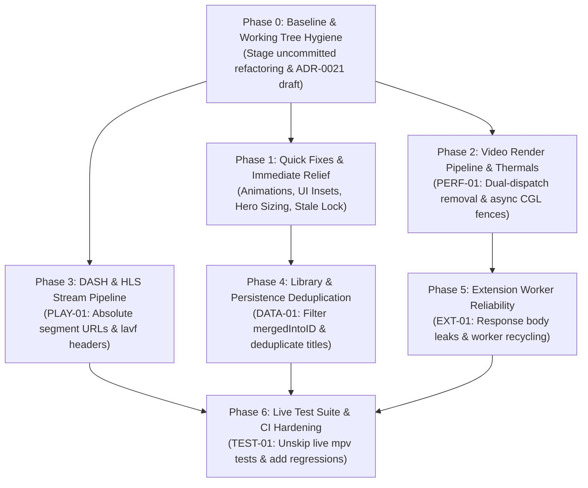

# Implementation Plan: CloudStream-macOS Remediation & Stabilization

**Author:** Antigravity Engineering  
**Target:** CloudStream-macOS  
**Branch:** `engine-logic-fixes`  
**Reference Audit:** [`Audit-Report.md`](../audit/macos-code-quality-audit-2026-10.md)

---

## 1. Guiding Principles & Strategy

1. **Zero Degradation of Existing Test Baselines:** All 978 automated tests across Gradle, SwiftPM, Python test harnesses, and Xcode (`CloudStreamMacTests` + `CloudStreamMacUITests`) must remain green at every commit boundary.
2. **Separation of Quick Fixes vs. Deep Architectural Changes:** Fast, isolated fixes (UI alignment, infinite animation, daemon locks) are decoupled from complex pipeline refactors (Metal/CGL render loop, DASH manifest rewriter, SwiftData predicates).
3. **No Unnecessary Rewrites:** Preserve existing robust patterns (e.g. Swift 6 strict concurrency, length-prefixed EDL syntax, process isolation sandbox, OkHttp request interceptors). Target only verified failure modes.
4. **macOS HIG & System Conformity:** Conform to native macOS conventions (Liquid Glass window sessions, toolbar styling, responsive ProMotion 120Hz display cadences, proper safe area handling).

---

## 2. Dependency & Phase Execution Graph



---

## Phase 0: Baseline & Working Tree Hygiene (Prerequisite)

### Objective
Commit or checkpoint the uncommitted changes on branch `engine-logic-fixes` to establish a clean git baseline before modifying source files.

### Scope & Affected Files
- **DTO Split:** Deletion of `engine/.../models/Dtos.kt` replaced by 6 modular files (`EngineDtos.kt`, `MediaDtos.kt`, `ExtensionDtos.kt`, `NetworkDtos.kt`, `WebViewDtos.kt`, `DiagnosticsDtos.kt`).
- **Extracted Views:** [`CastCard.swift`](../../../client/Sources/UI/Details/CastCard.swift), [`DownloadSourcePicker.swift`](../../../client/Sources/UI/Details/DownloadSourcePicker.swift), [`EpisodeRow.swift`](../../../client/Sources/UI/Details/EpisodeRow.swift).
- **Security & Service Helpers:** [`AsyncLimiter.swift`](../../../client/Sources/Services/AsyncLimiter.swift), [`BoundedImageDecoder.swift`](../../../client/Sources/Services/BoundedImageDecoder.swift), [`ProfileLockSecurity.swift`](../../../client/Sources/Services/ProfileLockSecurity.swift), [`GenericPasswordKeychain.swift`](../../../client/Sources/Services/Security/GenericPasswordKeychain.swift).
- **ADR-0021 Scaffold:** [`LibraryPage.swift`](../../../client/Sources/Models/LibraryPage.swift), [`LibraryPageView.swift`](../../../client/Sources/UI/Library/LibraryPageView.swift), [`LibraryPages.swift`](../../../client/Sources/UI/Library/LibraryPages.swift), [`LibraryPagePolicy.swift`](../../../client/Sources/Services/Contracts/LibraryPagePolicy.swift).

### Verification
Run `git status` and ensure all test suites pass without regressions (`./gradlew test`, `make test-core`, `xcodebuild test`).

---

## Phase 1: Quick Fixes & Immediate UI/Thermal Relief (Low Risk, High Impact)

### 1.1 Home Screen Shimmer Animation CPU Burn (PERF-02)
- **Problem:** [`HomeView.swift#L393-L418`](../../../client/Sources/UI/Home/HomeView.swift#L393-L418) contains `SkeletonShelves` with `.animation(.easeInOut(duration: 0.9).repeatForever(autoreverses: true), value: pulse)` triggered unconditionally `onAppear`. While idle or awaiting network data, this burns main thread cycles repainting views continuously.
- **Affected File:** [`client/Sources/UI/Home/HomeView.swift`](../../../client/Sources/UI/Home/HomeView.swift)
- **Changes:**
  1. Bind `pulse` activation to the loading state `isLoading`.
  2. Discontinue repeat animation when the window is occluded or when `sections` has loaded.
  3. Replace unconditional `.repeatForever()` with an explicit `withAnimation` block that cancels on `onDisappear`.
- **Risks & Compatibility:** Zero risk. Visual shimmer will continue to show during genuine loading and immediately halt when content appears.

### 1.2 Fullscreen Header Inset & Toolbar Harmonization (UI-01)
- **Problem:** Both [`RootView.swift#L220-L225`](../../../client/Sources/UI/Navigation/RootView.swift#L220-L225) and [`MediaDetailView.swift#L100-L103`](../../../client/Sources/UI/Details/MediaDetailView.swift#L100-L103) independently attach `.ignoresSafeArea(edges: windowSession.isFullScreen ? [] : .top)`. In full screen, the outer and inner modifiers conflict, creating toolbar clipping and overlapping glitches (`docs/To-dos/Header Issue in full screen 2.png`).
- **Affected Files:**
  - [`client/Sources/UI/Navigation/RootView.swift`](../../../client/Sources/UI/Navigation/RootView.swift)
  - [`client/Sources/UI/Details/MediaDetailView.swift`](../../../client/Sources/UI/Details/MediaDetailView.swift)
- **Changes:**
  1. Elevate safe-area edge ignoring strictly to the root navigation container in `RootView.swift`.
  2. In `MediaDetailView.swift`, remove the redundant `.ignoresSafeArea(edges: windowSession.isFullScreen ? [] : .top)`.
  3. Ensure `.toolbarBackgroundVisibility(..., for: .windowToolbar)` is cleanly driven by scroll offset across all child destinations.
- **Risks & Compatibility:** Ensures macOS full-screen auto-hiding menu bar and title bar slide in/out smoothly without jerking content.

### 1.3 Hero Backdrop Placeholder & Sizing Overhaul (UI-02)
- **Problem:** [`MediaDetailView.swift#L316-L363`](../../../client/Sources/UI/Details/MediaDetailView.swift#L316-L363) forces a fixed 580pt tall banner frame. If an item lacks a banner URL or is loading, [`PosterImage.swift#L46-L65`](../../../client/Sources/UI/Components/PosterImage.swift#L46-L65) renders an empty `Color.cardSurface` with a tiny 22pt icon centered in the massive gray box (`docs/To-dos/UI bug.png`).
- **Affected Files:**
  - [`client/Sources/UI/Details/MediaDetailView.swift`](../../../client/Sources/UI/Details/MediaDetailView.swift)
  - [`client/Sources/UI/Components/PosterImage.swift`](../../../client/Sources/UI/Components/PosterImage.swift)
- **Changes:**
  1. In `MediaDetailView.swift`, check if `bannerURL` or `posterURL` is present. If neither exists, collapse the hero height or render a subtle compact gradient banner (e.g. 260pt) instead of a vacant 580pt block.
  2. If only a poster URL is present (vertical aspect ratio), apply a subtle blurred background fill with the poster centered, rather than stretching a vertical poster into a 16:9 banner slot.
  3. Update gradient overlay stops to blend gracefully with `Color.canvasBackground` even during placeholder loading states.
- **Risks & Compatibility:** Visual improvement only; fully backward compatible.

### 1.4 Stale Lock Recovery & Orphan Daemon Reaping (DAEM-01)
- **Problem:** [`DaemonSupervisor.swift#L297-L304`](../../../client/Sources/App/DaemonSupervisor.swift#L297-L304) exits with code 75 (`daemon.data_root_in_use`) if a zombie daemon holds `~/.cloudstream-macos/.lock` after an abrupt relaunch.
- **Affected File:** [`client/Sources/App/DaemonSupervisor.swift`](../../../client/Sources/App/DaemonSupervisor.swift)
- **Changes:**
  1. Inspect the PID recorded in the lock file before launch.
  2. If the PID does not correspond to an active running process (`kill(pid, 0) != 0`), purge the stale lock.
  3. If the process is alive but unresponsive to IPC ping within timeout, attempt graceful `SIGTERM` followed by `SIGKILL` before proceeding.
- **Risks & Compatibility:** Prevents application launch lockouts after unexpected terminations.

---

## Phase 2: Video Render Pipeline & Thermal Stabilization (Architectural / High Impact) (PERF-01)

### 2.1 Dismantle Dual-Dispatch Racing in `MetalVideoView.swift`
- **Problem:**
  - `markFrameAvailable()` ([`MetalVideoView.swift#L848-L858`](../../../client/Sources/UI/Player/MetalVideoView.swift#L848-L858)) dispatches an asynchronous `renderQueue.async { renderFrame() }` block whenever `glContext != nil`.
  - Concurrently, `displayLinkCallback` ([`MetalVideoView.swift#L817-L832`](../../../client/Sources/UI/Player/MetalVideoView.swift#L817-L832)) triggers `scheduleRender()` at 60Hz/120Hz.
  - Two parallel dispatch streams race to render the exact same frame context, overloading GCD worker threads and driving CPU utilization through the roof.
- **Affected File:** [`client/Sources/UI/Player/MetalVideoView.swift`](../../../client/Sources/UI/Player/MetalVideoView.swift)
- **Changes:**
  1. **Single Source of Truth for Frame Delivery:** Make `CADisplayLink` the exclusive driver of render ticks during active hardware playback.
  2. **Atomic Invalidation:** When mpv invokes `on_mpv_render_update`, set an atomic boolean `hasNewFrame = true`.
  3. **DisplayLink Driven Consumption:** On the display link callback, check `hasNewFrame`. If false, bypass `renderFrame()` entirely (idle throttle). If true, clear the flag and execute `renderFrame()`.
  4. Only fall back to immediate async dispatch if the display link is paused or unavailable (e.g. view occlusion or headless tests).

### 2.2 Replace Synchronous OpenGL Wait Fences
- **Problem:**
  - In [`gl_surface.c#L120-L127`](../../../client/Sources/PlayerSupport/gl_surface.c#L120-L127), `cs_gl_finish` calls `glClientWaitSync(sync, GL_SYNC_FLUSH_COMMANDS_BIT, timeout_ns)` with a 100ms timeout (`100_000_000 ns`).
  - In `MetalVideoView.swift:1048-1059`, this blocks the render thread on every frame, starving CPU resources.
- **Affected Files:**
  - [`client/Sources/PlayerSupport/gl_surface.c`](../../../client/Sources/PlayerSupport/gl_surface.c)
  - [`client/Sources/PlayerSupport/include/gl_surface.h`](../../../client/Sources/PlayerSupport/include/gl_surface.h)
  - [`client/Sources/UI/Player/MetalVideoView.swift`](../../../client/Sources/UI/Player/MetalVideoView.swift)
- **Changes:**
  1. Replace blocking `glClientWaitSync` with a double-buffered synchronization model: insert fence on current frame, wait on the *previous* frame's fence with `timeout_ns = 0` (non-blocking query).
  2. Pass `MPV_RENDER_PARAM_BLOCK_FOR_TARGET_TIME` as `0` to `mpv_render_context_render` so mpv returns immediately if the frame is not yet ready, allowing `CADisplayLink` to manage presentation timing naturally.
  3. Flush OpenGL commands using `glFlush()` instead of forcing CPU-GPU lockstep serialization.

### 2.3 Verification & Benchmarks
- Measure CPU usage during 1080p60 and 4K playback using Activity Monitor / Instruments before and after.
- Verify zero dropped frames or audio desynchronization.

---

## Phase 3: DASH & HLS Stream Pipeline Fixes (Architectural / High Impact) (PLAY-01)

### 3.1 Support Absolute Segment URLs in Manifest Rewriter
- **Problem:** In [`ManifestRewriter.kt#L80-L85`](../../../engine/src/main/kotlin/com/lagradost/macos/ManifestRewriter.kt#L80-L85), `ManifestRewriter.dash()` throws `Unsupported("absolute $attribute")` whenever a segment template contains an absolute URL (e.g. `media="https://cdn.../chunk_$Number$.m4s"`). `MediaRelay.kt:379` rejects the manifest with HTTP 415, breaking playback for all CDNs providing absolute DASH manifests.
- **Affected Files:**
  - [`engine/src/main/kotlin/com/lagradost/macos/ManifestRewriter.kt`](../../../engine/src/main/kotlin/com/lagradost/macos/ManifestRewriter.kt)
  - [`engine/src/test/kotlin/com/lagradost/macos/MediaRelayTest.kt`](../../../engine/src/test/kotlin/com/lagradost/macos/MediaRelayTest.kt)
- **Changes:**
  1. In `ManifestRewriter.dash()`, remove the exception throwing block:
     ```kotlin
     // REMOVE:
     // if (value.startsWith("http://", true) || value.startsWith("https://", true)) throw Unsupported("absolute $attribute")
     ```
  2. For any attribute in `segmentAttributes` (`media`, `initialization`, `sourceURL`, `href`, `index`):
     - If `value` is an absolute URL or contains a template, resolve it through `map(absolute(base, value))`.
     - `MediaRelay.pathFor()` will register the directory prefix and rewrite the attribute into a loopback relay path (e.g. `/media/relay/<id>/chunk_$Number$.m4s`), enabling mpv to download segments with custom headers attached.

### 3.2 Expand FFmpeg Protocol Whitelist for DASH Demuxer
- **Problem:** FFmpeg’s DASH demuxer (`dashdec`) requires `data` (for inline initialization segments / bitstream filters) and `crypto` protocols. [`DownloadPolicy.swift#L297`](../../../client/Sources/Services/Downloads/DownloadPolicy.swift#L297) excludes `data`, causing demuxer initialization to abort.
- **Affected Files:**
  - [`client/Sources/Services/Downloads/DownloadPolicy.swift`](../../../client/Sources/Services/Downloads/DownloadPolicy.swift)
  - [`client/Sources/UI/Player/MetalVideoView.swift`](../../../client/Sources/UI/Player/MetalVideoView.swift)
- **Changes:**
  1. Update `ffmpegProtocolWhitelist`:
     ```swift
     nonisolated static let ffmpegProtocolWhitelist = "http,https,tls,tcp,crypto,httpproxy,data"
     ```
  2. Verify that `protocol_whitelist` parameter is length-prefixed correctly in `remoteProtocolOptions`.

### 3.3 Propagate Custom Request Headers to Sub-Demuxers
- **Problem:** In [`MetalVideoView.swift#L454-L456`](../../../client/Sources/UI/Player/MetalVideoView.swift#L454-L456), headers are only set via `http-header-fields`. FFmpeg's `dashdec` and `hls` demuxers instantiate nested HTTP protocols that do not receive `http-header-fields`, causing 403 Forbidden errors on segment downloads.
- **Affected File:** [`client/Sources/UI/Player/MetalVideoView.swift`](../../../client/Sources/UI/Player/MetalVideoView.swift)
- **Changes:**
  1. When constructing file options for `loadfile`, format the stream's request headers (`User-Agent`, `Referer`, `Origin`, authorization tokens) into FFmpeg's `headers` option:
     ```swift
     // Add to demuxer-lavf-o:
     let lavfHeaders = headers.map { "\($0.key): \($0.value)\r\n" }.joined()
     fileOptions.append(lengthPrefixed("demuxer-lavf-o", "headers=\(lavfHeaders)"))
     ```
  2. Ensure length-prefixed encoding (`%N%...`) avoids breaking mpv's option parser when headers contain delimiters.

---

## Phase 4: State Management & Library Persistence Deduplication (DATA-01)

### 4.1 Filter Merged Sources in Library Queries
- **Problem:** [`LibraryStore.swift#L1010-L1027`](../../../client/Sources/Services/LibraryStore.swift#L1010-L1027) queries solely on `watchTypeRaw == raw`. Secondary records merged under ADR-0020 have `mergedIntoID != nil` and are mistakenly returned as duplicate library cards.
- **Affected File:** [`client/Sources/Services/LibraryStore.swift`](../../../client/Sources/Services/LibraryStore.swift)
- **Changes:**
  1. Update `#Predicate` in `items(withWatchType:)`:
     ```swift
     predicate: #Predicate { $0.watchTypeRaw == raw && $0.mergedIntoID == nil }
     ```
  2. Update `counts()` in `LibraryStore.swift:1047` to also check `mergedIntoID == nil` so sidebar badge counts reflect only distinct top-level titles.

### 4.2 In-Memory Canonical Title Deduplication
- **Problem:** If a user bookmarks the same movie or show from multiple providers (e.g. FlixHQ and SuperStream), two distinct rows exist with different URLs and different `providerID`s.
- **Affected File:** [`client/Sources/UI/Library/LibraryView.swift`](../../../client/Sources/UI/Library/LibraryView.swift)
- **Changes:**
  1. In `filterAndSort()` or `arranged()`, group items sharing identical canonical keys (`title.trimmingCharacters(in: .whitespacesAndNewlines).lowercased()` + matching release year).
  2. For grouped duplicates, present the entry with the most recent `lastUpdated` timestamp, displaying secondary sources inside the detail view under the source switcher rather than cluttering the library grid.

### 4.3 Deduplicate Legacy Identity Migration Records
- **Problem:** 216 legacy entries with ambiguous provider names fail migration and re-trigger `library.identity_unresolved` on every launch. If a user watches one of these titles, a duplicate `remote-v2:...` record is created.
- **Affected Files:**
  - [`client/Sources/Services/Persistence/LibraryIdentityMigration.swift`](../../../client/Sources/Services/Persistence/LibraryIdentityMigration.swift)
  - [`client/Sources/ViewModels/AppState.swift`](../../../client/Sources/ViewModels/AppState.swift)
- **Changes:**
  1. Mark unresolved legacy records as `identityResolution = "legacy_unresolved"` after the initial catalog pass to avoid redundant re-scanning on every provider list change.
  2. When inserting a new `remote-v2:...` record in `LibraryStore.swift`, check if an existing legacy record shares the same `providerURL`. If found, atomically migrate and replace the legacy record rather than leaving both side-by-side.

---

## Phase 5: Extension Worker Reliability & Resource Management (EXT-01)

### 5.1 Enforce Automatic OkHttp Response Body Termination
- **Problem:** Extensions executing scrapers in [`WorkerRuntime.kt`](../../../engine/src/main/kotlin/com/lagradost/macos/worker/WorkerRuntime.kt) leak OkHttp connections (`daemon.log: WARNING: A connection to ... was leaked`), exhausting file descriptors and sockets.
- **Affected Files:**
  - [`engine/src/main/kotlin/com/lagradost/macos/worker/WorkerRuntime.kt`](../../../engine/src/main/kotlin/com/lagradost/macos/worker/WorkerRuntime.kt)
  - [`engine/src/main/kotlin/com/lagradost/cloudstream3/MainActivity.kt`](../../../engine/src/main/kotlin/com/lagradost/cloudstream3/MainActivity.kt)
  - [`engine/src/main/kotlin/com/lagradost/cloudstream3/network/Requests.kt`](../../../engine/src/main/kotlin/com/lagradost/cloudstream3/network/Requests.kt) (or OkHttp client factory)
- **Changes:**
  1. Install an OkHttp `Interceptor` on the shared client that tracks open streaming responses.
  2. When an extension method finishes (e.g. `load()`, `loadLinks()`, `search()`), automatically close any dangling response streams allocated during that execution turn.
  3. Set aggressive idle connection pool evictions (`connectionPool(maxIdleConnections = 5, keepAliveDuration = 30, TimeUnit.SECONDS)`).

### 5.2 Worker Process Recycling Thresholds
- **Problem:** Subprocess memory can grow unbounded over long sessions with dozens of loaded extension DEX/JARs.
- **Affected File:** [`engine/src/main/kotlin/com/lagradost/macos/worker/WorkerLauncher.kt`](../../../engine/src/main/kotlin/com/lagradost/macos/worker/WorkerLauncher.kt)
- **Changes:**
  1. Periodically check worker RSS memory and active file descriptor count.
  2. Gracefully retire and respawn idle worker processes that exceed 256MB RSS or have been idle for >15 minutes.

---

## Phase 6: Live Test Suite & Regression Verification (QA / Infrastructure) (TEST-01)

### 6.1 Enable Live MPV Tests in CI & Make Targets
- **Problem:** 43 tests in [`PlayerEngineLiveTests.swift`](../../../client/Tests/PlayerEngineLiveTests.swift#L19) are skipped by default.
- **Affected Files:**
  - `Makefile`
  - `scripts/test_media_stack.sh`
- **Changes:**
  1. Add `make test-live-player` target:
     ```makefile
     test-live-player:
     	CS_MPV_ENGINE_TESTS=1 xcodebuild test -project client/CloudStreamMac.xcodeproj -scheme CloudStreamMac -destination 'platform=macOS' -only-testing:CloudStreamMacTests/PlayerEngineLiveTests
     ```
  2. Integrate live player tests into local verification scripts.

### 6.2 Regression Test Additions
- **Manifest Rewriting:** Add test in `MediaRelayTest.kt` verifying that a DASH manifest containing `<SegmentTemplate media="https://cdn.example.com/segment_$Number$.m4s" initialization="https://cdn.example.com/init.mp4">` is rewritten successfully and served without HTTP 415.
- **Library Deduplication:** Add test in `LibraryDiscoveryTests.swift` verifying that items with `mergedIntoID != nil` are omitted from `items(withWatchType:)`.

---

## Risk Analysis & Mitigation Matrix

| Risk | Likelihood | Impact | Mitigation Strategy |
|:---|:---:|:---:|:---|
| **Frame drops on display link tick** | Low | High | Measure frame presentation delta with `CADisplayLink.targetTimestamp`; keep fallback rendering path intact if DisplayLink is suspended. |
| **FFmpeg header option parser breakage** | Low | High | Strictly encode header strings using length-prefixed syntax (`%N%...`) verified against existing mpv unit tests. |
| **SwiftData query performance degradation** | Very Low | Medium | Ensure `mergedIntoID` has an index or is included in compound predicate with `watchTypeRaw`. |
| **Worker premature recycling during scrape** | Low | Medium | Only recycle workers when all active coroutines have terminated and `activeRequests == 0`. |

---

## Implementation Execution Sequence

1. **Step 1:** Stage and commit Phase 0 baseline (clean branch hygiene).
2. **Step 2:** Apply Phase 1 quick fixes (Skeleton shimmer, fullscreen insets, hero placeholder, daemon lock). Run full test suite.
3. **Step 3:** Apply Phase 2 video render loop fixes (`MetalVideoView.swift`, `gl_surface.c`). Benchmark thermals and verify with live video.
4. **Step 4:** Apply Phase 3 DASH/HLS streaming fixes (`ManifestRewriter.kt`, `DownloadPolicy.swift`, `MetalVideoView.swift`). Run `MediaRelayTest.kt` and live stream tests.
5. **Step 5:** Apply Phase 4 library deduplication (`LibraryStore.swift`, `LibraryView.swift`). Verify library tests.
6. **Step 6:** Apply Phase 5 extension worker cleanup (`WorkerRuntime.kt`). Check connection leaks.
7. **Step 7:** Run `CS_MPV_ENGINE_TESTS=1 make test-live-player` and complete regression verification.
